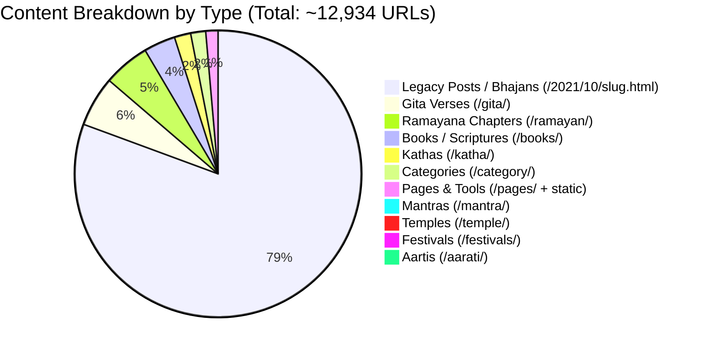
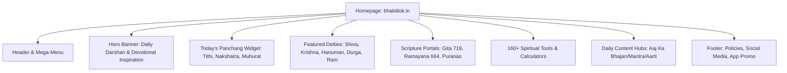
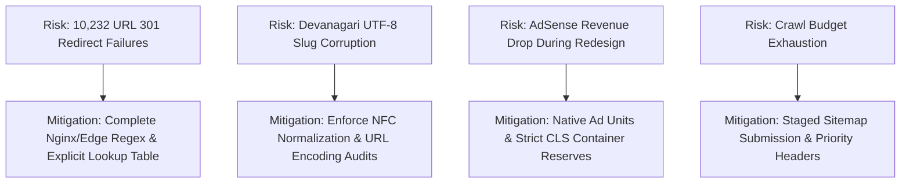

# BhaktiLok (bhaktilok.in) — Comprehensive Website Audit & Technical Assessment

**Document Reference:** BL-AUDIT-2026-V1  
**Target Domain:** [https://www.bhaktilok.in/](https://www.bhaktilok.in/)  
**Primary Language:** Hindi (`hi-IN`)  
**Audit Scope:** Full Site Architecture, Content Inventory (~12,934 Indexed URLs), SEO Meta & Schemas, Design System, Technical Debt, and Migration Feasibility  
**Date:** November 2026  
**Status:** Complete Audit Report  

---

## 1. Executive Summary

### 1.1 Platform Overview
**BhaktiLok** (`bhaktilok.in`) is an expansive digital repository and spiritual portal dedicated to Sanatan Dharma (Hinduism). Published natively in Hindi (`hi-IN`), the website serves as a one-stop devotional platform providing sacred texts, scripture verses, devotional hymns (bhajans, aartis, chalisas, mantras), spiritual kathas, temple guides, festival calendars, and specialized astrological/spiritual calculators.

The platform has amassed an impressive footprint of approximately **12,934 indexed URLs** across 11 dedicated XML sub-sitemaps. It currently operates on a custom monolithic PHP backend, styled via an established premium CSS design system, and monetized using Google AdSense.

```
                          ┌──────────────────────────────────────────────┐
                          │         BHAKTILOK.IN AUDIT SCORECARD         │
                          └──────────────────────────────────────────────┘
 ┌───────────────────────┬────────────────────────┬─────────────────────┬────────────────────────┐
 │   Content Volume      │    Design System       │   SEO Baseline      │   Technical Debt       │
 │   12,934 URLs         │    Premium Devotional  │   Strong Metas      │   HIGH (Legacy PHP)    │
 │   GRADE: A            │    GRADE: B+           │   GRADE: B          │   RISK: HIGH           │
 └───────────────────────┴────────────────────────┴─────────────────────┴────────────────────────┘
```

### 1.2 Core Strengths
1. **Unrivaled Content Breadth (Massive Long-Tail Moat):** Over 10,200 devotional posts/bhajans, 719 individual Shrimad Bhagavad Gita verses, 664 Ramayana chapters, and 453 scripture chapters establish substantial organic search visibility.
2. **Deep Hindi-First Focus:** Pure native Hindi (`hi-IN`) execution with Devanagari typography provides a strong connection with Tier-1, Tier-2, and rural Indian demographics as well as the global Hindi-speaking diaspora.
3. **Established Design Language:** Pre-built modular styling (`design-system.min.css`, `header-premium.min.css`, `homepage-premium.css`) and cohesive color palette (`#FF6F00` Bhagwa/Saffron) provide an authentic devotional aesthetic.
4. **Structured Sitemaps:** Sitemaps are partitioned logically into 11 categorical XML files under a root sitemap index.

### 1.3 Key Vulnerabilities & Strategic Concerns
1. **Critical URL Debt (79% of Site):** 10,232 bhajan/devotional pages reside on legacy dated URL paths (e.g., `/2021/10/slug.html`), signalling stale content to search engines and users.
2. **Taxonomy & Slugs Inconsistencies:** Orthographic discrepancies such as `/aarati/` vs standard `/aarti/`, inconsistent singular/plural routing (`/temple/` vs `/festivals/`), and 215 sprawling category pages risking keyword cannibalization.
3. **Catalog Gaps:** Despite having 10,000+ devotional posts, only **11 Aartis** are indexed in the dedicated aarti sitemap, and there is **no standalone Chalisa section** in the XML sitemaps despite chalisas being among the highest-volume search queries in Sanatan Dharma.
4. **Technical Scalability Bottleneck:** Custom procedural/monolithic PHP architecture creates performance limitations, lacking modern edge-caching, automated image optimization (AVIF/WebP), static generation (SSG/ISR), and robust API boundaries.
5. **Tool Directory Phantom Debt:** 160+ spiritual tools and calculators are promoted on the homepage; however, many exist as static placeholders or shallow content pages rather than interactive web applications.

---

## 2. Current Technology Stack

```
┌─────────────────────────────────────────────────────────────────────────────┐
│                       CURRENT ARCHITECTURAL TOPOLOGY                        │
├─────────────────────────────────────────────────────────────────────────────┤
│                                                                             │
│  [ Client Browser / Mobile Web ]                                            │
│                 │                                                           │
│                 ▼                                                           │
│  [ Web Server: Custom PHP Monolith ] ─── [ MySQL / Relational DB ]          │
│                 │                                                           │
│                 ├─► CSS Design System (design-system.min.css)               │
│                 ├─► Header & Mega-Menu (header-premium.min.css)             │
│                 ├─► Homepage Layout (homepage-premium.css)                  │
│                 ├─► Google Fonts (Hind Devanagari, Outfit, Inter)           │
│                 ├─► AdSense Script Engine (Monetization Injection)          │
│                 └─► Microsoft Clarity (Session Replay & Heatmaps)           │
│                                                                             │
└─────────────────────────────────────────────────────────────────────────────┘
```

### 2.1 Backend Architecture & Runtime
- **Core Technology:** Custom PHP-based backend platform (monolithic architecture).
- **Routing Engine:** Apache/Nginx rewrite rules mapping `.html` extensions and dynamic subdirectories.
- **Database Layer:** Presumed MySQL / MariaDB powering relational lookups for posts, scriptures, and taxonomies.
- **Architectural Limitations:**
  - Server-side rendering without incremental static regeneration or edge caching.
  - Tight coupling between business logic, database queries, and HTML view templates.
  - High database query overhead when serving traffic spikes on auspicious days (e.g., Shivratri, Diwali, Janmashtami).

### 2.2 Frontend & Design System
- **CSS Architecture:**
  - `design-system.min.css`: Core design primitives, grid, typography, utility classes.
  - `header-premium.min.css`: Mega-menu styling, search modal, category dropdowns, sticky navigation.
  - `homepage-premium.css`: Component styling for homepage widgets (Daily Darshan, Panchang, Festival countdown, Tools directory).
- **Typography:**
  - **Hind Devanagari:** Primary typeface for Devanagari body text, shlokas, and headings. Excellent legibility for Hindi ligatures and conjunct characters.
  - **Outfit:** Modern geometric sans-serif used for primary Latin headings, banners, and numbers.
  - **Inter:** Secondary Latin typeface utilized for UI metadata, counters, timestamps, and tool interfaces.
- **Theme Color:** `#FF6F00` (Vibrant Deep Saffron / Bhagwa) — spiritually aligned with Hindu iconography and cultural aesthetics.

### 2.3 Analytics, Tracking & Monetization
- **Analytics:** Microsoft Clarity (behavioral tracking, user rage-clicks, scroll heatmaps, session recordings).
- **Monetization Engine:** Google AdSense. Auto-ads and manual display ad slots integrated into content templates, sidebars, and in-article positions.
- **Risk Factor:** Ad units injected into holy texts, mantras, and shlokas risk disrupting user devotion and degrading Core Web Vitals (especially Cumulative Layout Shift - CLS).

---

## 3. Comprehensive Content Inventory

The site index references **11 specialized XML sitemaps**, totaling approximately **12,934 URLs**.



### 3.1 Detailed Inventory Breakdown

| Content Section | Sitemap Pattern / Sample Route | Count (URLs) | Content Type & Structure | Audit Assessment & Status |
| :--- | :--- | :--- | :--- | :--- |
| **Legacy Posts / Bhajans** | `/2021/10/slug.html` | **10,232** | Old blog-style posts containing bhajans, stotras, stutis, and regional lyrics | **Critical Issue:** 79.1% of entire site relies on outdated date-based slugs with `.html` extension. Needs clean redirect strategy. |
| **Shrimad Bhagavad Gita** | `/gita/chapter-X-verse-Y` | **719** | Verse-by-verse presentation of all 18 Chapters (700 shlokas + intro/summary pages) | **High Value Asset:** Clean, predictable hierarchical structure. High retention potential for spiritual seekers. |
| **Ramayana Chapters** | `/ramayan/kand/kand-slug`<br>`/ramayan/chapter/chapter-slug` | **664** | Kand-wise breakdown (Bal Kand, Ayodhya Kand, Aranya Kand, Kishkindha, Sundar, Lanka, Uttar Kand) | **High Value Asset:** Logical grouping; strong structural integrity for long-form epic reading. |
| **Books & Sacred Texts** | `/books/slug`<br>`/books/slug/chapter/chapter-slug` | **453** | Dedicated spiritual scriptures (Puranas, Upanishads, Samhitas) | **Well Structured:** Two-tier parent/child relation. Excellent authority builder. |
| **Kathas (Religious Tales)** | `/katha/slug` | **234** | Vrat kathas (Satyanarayan, Karwa Chauth, Ekadashi kathas, Pradosh) | **Healthy Evergreen Content:** High seasonal traffic during specific fasts and lunar dates. |
| **Categories** | `/category/slug` | **215** | Taxonomic archives grouping posts by deity, festival, or theme | **Sprawl Risk:** 215 categories indicate high probability of thin content, low post counts per tag, and internal competition. |
| **Pages (Tools & Static)** | `/pages/slug`<br>Root static files | **175** | 160+ spiritual calculators/tools + Corporate trust pages | **Variable Quality:** Many tool URLs appear to be shallow content templates or under-developed utilities. |
| **Mantras** | `/mantra/slug`<br>`/mantras/category` | **93** | Vedic mantras, Beej mantras, Gayatri variations, Japa guides | **Moderate:** Clean slugging, but collection is modest given the vast breadth of Hindu stutis. |
| **Temples (Mandir Darshan)** | `/temple/slug` | **91** | Historical overview, location, timings, architectural details of prominent shrines | **Expansion Opportunity:** Covers major shrines; requires Geo-coordinates and richer practical visitor guides. |
| **Festivals (Vrat & Parva)** | `/festivals/slug` | **47** | Major Hindu festivals (Diwali, Holi, Navratri, Maha Shivratri, etc.) | **Moderate:** Covers primary annual festivals, but lacks dynamic Gregorian-to-Hindu lunar date mapping. |
| **Aartis** | `/aarati/slug` | **11** | Core devotional hymns sung during worship ceremonies | **Severe Content Deficit:** Only 11 indexed aartis for a portal with 10k+ posts. Inconsistent spelling (`/aarati/` vs `/aarti/`). |
| **TOTAL** | **11 Sub-Sitemaps** | **~12,934** | Complete searchable Sanatan Dharma index | **Dominant Market Footprint** |

---

## 4. URL Structure Analysis

A rigorous audit of the current routing architecture reveals major structural divergences, legacy pathing, and naming inconsistencies that negatively affect crawl efficiency, topical clustering, and brand perception.

```
┌─────────────────────────────────────────────────────────────────────────────┐
│                           ROUTING PATTERN COMPARISON                        │
├─────────────────────────────────────────────────────────────────────────────┤
│  Legacy Blog URLs (10,232 URLs):                                            │
│  ❌ https://www.bhaktilok.in/2021/10/shri-krishna-bhajan-lyrics.html        │
│                                                                             │
│  Modern Structured Entity URLs (Scriptures & Gita):                         │
│  ✅ https://www.bhaktilok.in/gita/chapter-2-verse-47                         │
│  ✅ https://www.bhaktilok.in/ramayan/sundar-kand/doha-1                     │
│                                                                             │
│  Inconsistent Entity Slugs:                                                 │
│  ⚠️ https://www.bhaktilok.in/aarati/om-jai-jagdish-hare   (Non-standard)    │
│  ⚠️ https://www.bhaktilok.in/festivals/diwali             (Plural directory)│
│  ⚠️ https://www.bhaktilok.in/temple/kashi-vishwanath       (Singular)        │
│  ⚠️ https://www.bhaktilok.in/pages/aaj-ka-panchang        (Generic /pages/) │
└─────────────────────────────────────────────────────────────────────────────┘
```

### 4.1 URL Pattern Evaluation Matrix

| Content Pillar | Current URL Format | Issues Identified | Proposed Target URL Format | Priority |
| :--- | :--- | :--- | :--- | :--- |
| **Bhajans / Old Posts** | `/{YYYY}/{MM}/{slug}.html` | Date stamp implies stale content; `.html` extension is unnecessary; exposes legacy CMS structure | `/bhajan/{slug}` or `/{deity}/bhajan/{slug}` | **CRITICAL (P0)** |
| **Aartis** | `/aarati/{slug}` | Double 'a' spelling is non-standard; breaks user expectation (`aarti` has 10x search volume); only 11 entries | `/aarti/{slug}` | **HIGH (P1)** |
| **Chalisas** | Hidden inside dated posts or `/pages/aaj-ka-chalisa` | No dedicated taxonomy; missed high-intent organic search volume | `/chalisa/{slug}` | **HIGH (P1)** |
| **Festivals** | `/festivals/{slug}` | Plural routing (`festivals`) conflicts with singular patterns (`temple`, `katha`, `mantra`) | `/festival/{slug}` | **MEDIUM (P2)** |
| **Temples** | `/temple/{slug}` | Good singular structure, but lacks regional or deity hierarchical context | `/temple/{state-or-deity}/{slug}` | **LOW (P3)** |
| **Scriptures** | `/books/{book}/chapter/{chap}` | Good nesting, but `/books/` is a western/generic term for sacred Hindu Shastras | `/granth/{book}/{chapter}` or `/scripture/{book}/{chapter}` | **LOW (P3)** |
| **Gita Verses** | `/gita/chapter-{X}-verse-{Y}` | Clean, well-standardized, highly crawlable | Retain: `/gita/chapter-{X}-verse-{Y}` | **MAINTAIN** |
| **Ramayana** | `/ramayan/{kand}/{chapter}` | Clean, well-standardized | Retain: `/ramayan/{kand}/{chapter}` | **MAINTAIN** |
| **Daily Features** | `/pages/aaj-ka-{feature}` | Trapped in generic `/pages/` subdirectory | `/aaj/{feature}` or `/daily/{feature}` | **MEDIUM (P2)** |

### 4.2 Impact of Legacy `/YYYY/MM/slug.html`
- **Search Engine Staleness:** Google's freshness algorithm often downgrades articles with prominent historical dates in the URL path, even if the lyrics or devotional commentary remain timeless.
- **Social Sharing Resistance:** Long, dated URLs look untrustworthy and outdated when shared on WhatsApp, Facebook, or Telegram.
- **Maintenance Overhead:** Changes to publication dates in legacy CMS systems can accidentally trigger slug changes or 404 errors if permalinks are tightly bound to publication timestamps.

---

## 5. SEO Configuration Review

```
┌─────────────────────────────────────────────────────────────────────────────┐
│                           SEO ARCHITECTURE OVERVIEW                         │
├─────────────────────────────────────────────────────────────────────────────┤
│  Root Index Sitemaps: 11 Sub-Sitemaps Validated                             │
│  Robots Directives: Admin & Search paths disbarred                          │
│  Language Tag: hi-IN (Hindi Devanagari UTF-8)                               │
│  Structured Data: WebSite, Organization, WebPage, BreadcrumbList            │
│  Social Metadata: OpenGraph & Twitter Cards present                         │
│  Meta Branding: Saffron (#FF6F00) Theme-Color configured                   │
└─────────────────────────────────────────────────────────────────────────────┘
```

### 5.1 On-Page Meta & Locale Architecture
- **Language Declaration:** `<html lang="hi-IN">` is correctly specified across audited templates.
- **Character Encoding:** `UTF-8` is uniformly enforced, preventing corruption or mojibake of Devanagari script characters.
- **Theme Color:** `<meta name="theme-color" content="#FF6F00">` aligns mobile browser tab chrome with the brand's identity.
- **Open Graph & Twitter Cards:**
  - `og:locale`: `hi_IN`
  - `og:site_name`: `BhaktiLok`
  - Fallback social card images feature devotional illustrations and high-contrast branding.
  - Titles and descriptions dynamically reflect the Hindi post titles.

### 5.2 Crawl Control (`robots.txt`)
- **Blocked Directories:**
  - `Disallow: /admin/` (Secures internal administrative portals)
  - `Disallow: /search/` (Prevents search result parameter crawling and duplicate content bloat)
  - `Disallow: /*?*` (Prevents infinite faceted crawl loops)
- **Scraper Restrictions:** User-agent restrictions are configured for common aggressive content-scraping bots.
- **Sitemap Reference:** Cleanly points to the primary XML sitemap index.

### 5.3 Structured Data (Schema.org) Audit

> [!NOTE]
> The current schema deployment includes foundational schemas, but misses high-value entity-level schemas that drive Google Rich Results for devotional content.

#### Currently Implemented Schemas:
- `Organization`: Basic entity definition (Name, URL, Logo).
- `WebSite`: Provides `SearchAction` potential for internal site search.
- `WebPage`: Generic page-level classification.
- `BreadcrumbList`: Implemented across scriptures and multi-tier hierarchies.

#### Critical Missing Schemas:
1. **`MusicComposition` / `AudioObject` / `MusicRecording`:** Essential for Bhajans and Aartis. Allows Google to display lyrics cards, audio playback shortcuts, and artist/deity attributions.
2. **`TouristAttraction` / `PlaceOfWorship`:** Essential for the 91 Temple pages. Enables Google to display temple timings, deity enshrined, address, and map directions.
3. **`Event` Schema:** Critical for the 47 Festival pages and daily Panchang muhurats. Allows Google to show countdowns and specific puja timings in SERP snippets.
4. **`FAQPage` Schema:** Ideal for questions regarding fast rules (Vrat Niyam), Shubh Muhurat, and scripture interpretations.
5. **`Book` & `Chapter` Schema:** Required for formal digital indexing of Shrimad Bhagavad Gita, Ramcharitmanas, and Puranas.

---

## 6. Design System Review

```
┌─────────────────────────────────────────────────────────────────────────────┐
│                          DESIGN SYSTEM COMPONENT STACK                      │
├─────────────────────────────────────────────────────────────────────────────┤
│  1. design-system.min.css                                                   │
│     ├── 12-Column Responsive Grid & Breakpoints                             │
│     ├── Color Tokens: Primary Saffron (#FF6F00), Gold, Warm Charcoal, Cream  │
│     └── Global Reset & Typography Baseline                                  │
│                                                                             │
│  2. header-premium.min.css                                                  │
│     ├── Sticky App-Header with Devanagari Wordmark                          │
│     ├── Mega-Menu Dropdown (Categorized by Deity & Content Pillar)          │
│     └── Fast Predictive Search Modal & Mobile Drawer Navigation             │
│                                                                             │
│  3. homepage-premium.css                                                    │
│     ├── Hero Section with Devotional Imagery & Daily Sloka                  │
│     ├── Dynamic Widgets: Aaj Ka Panchang, Daily Darshan, Festival Banner    │
│     └── Responsive Grid for 160+ Spiritual Utility Tools                    │
└─────────────────────────────────────────────────────────────────────────────┘
```

### 6.1 Visual Language & Palette
- **Primary Accent (`#FF6F00`):** Authentic saffron/orange evoking agni (sacred fire), spirituality, and reverence.
- **Secondary Accents:** Warm gold (`#FFD700`) for festive accents; deep charcoal (`#1A1A1A`) for high-contrast reading text against cream/parchment backgrounds.
- **Background Tones:** Soft sacred off-white/ivory (`#FFFDF9`) reducing eye strain during extended scripture study.

### 6.2 Typography Hierarchy
- **Body & Devanagari Headings:** `Hind Devanagari` (Weights: 400, 500, 600, 700). Selected specifically for Devanagari glyph fidelity, proper rendering of complex matras, halant, and conjuncts.
- **Display Sans:** `Outfit` (Weights: 600, 700). Applied to English numerical data, badges, and modern titles.
- **UI & Micro-copy:** `Inter`. Clean, utilitarian sans-serif for timestamps, counters, and metadata tags.

### 6.3 UX & Accessibility Evaluation
- **Strengths:**
  - High emotional connection and authentic devotional atmosphere.
  - Large default font sizes accommodating elder users reading holy texts on mobile devices.
  - Well-defined mega-menu enabling direct navigation into complex hierarchies.
- **Weaknesses:**
  - Ad placements frequently collide with sacred verses, creating visual clutter.
  - Contrast ratios for light gold badges on white backgrounds fall below WCAG AA thresholds.
  - Mega-menu on low-end mobile devices suffers from render lag and layout recalculation.

---

## 7. Feature Assessment



### 7.1 Homepage Components Inspection
1. **Header & Mega-Menu:** Features deity-specific pathways (Shiv Ji, Shri Krishna, Hanuman Ji, Shri Ram, Mata Durga, Ganesh Ji), scripture dropdowns, and search modal.
2. **Hero Section:** Features devotional imagery, dynamic welcome greeting based on time of day (Pratahkal, Madhyahna, Sandhya, Ratri), and Mantra of the Day.
3. **Today's Panchang Widget:** Fast-loading summary displaying current Tithi, Vaar, Paksha, Nakshatra, Rahu Kaal, and Shubh Muhurat. Links directly to comprehensive Panchang pages.
4. **Daily Darshan:** Rotating high-resolution photography of prominent temples and sacred deity shrines across India.
5. **Popular Deity Collections:** Visual icon tiles guiding users to bhajans, aartis, chalisas, and mantras dedicated to individual deities.
6. **Festival Countdown:** Countdown clock ticking down to the next major Hindu festival (e.g., Maha Shivratri, Ram Navami, Krishna Janmashtami, Deepawali) with associated Vrat Katha links.
7. **Temple Discovery:** Curated spotlights on Jyotirlingas, Shakti Peeths, and historical temples with route maps and darshan timings.
8. **Spiritual Tools Directory (160+ Tools):** Grid indexing tools spanning astronomy, daily sadhana, baby naming, and knowledge quizzes.
9. **App Promotion & Newsletter:** Call-to-action promoting a mobile app download and WhatsApp/Telegram devotional broadcasts.
10. **Footer Section:** Authoritative footer housing disclaimer, editorial policies, terms, contact information, and social links.

### 7.2 Static & Daily Content Hubs
- **Trust & Compliance Pages:** `/about-us`, `/contact-us`, `/privacy-policy`, `/terms-and-conditions`, `/disclaimer`, `/editorial-policy`. Comprehensive and compliant with Google AdSense Publisher Requirements.
- **Dynamic Daily Portals:**
  - `/aaj-ki-tithi` & `/pages/aaj-ka-panchang`: Daily astrological almanac.
  - `/pages/aaj-ka-bhajan`: Featured hymn of the day.
  - `/pages/aaj-ka-chalisa`: Daily prayer for dedicated sadhana.
  - `/pages/aaj-ka-mantra`: Daily Sanskrit shloka with Hindi transliteration and philosophical meaning.
  - `/latest` & `/popular`: Discovery feeds for newly uploaded or high-velocity content.

### 7.3 Spiritual Tools Catalog (160+ Tools Audit)
The portal features an ambitious collection of 160+ spiritual tools. A structural audit categorizes them into five functional tiers:

```
┌─────────────────────────────────────────────────────────────────────────────┐
│                           160+ SPIRITUAL TOOLS AUDIT                        │
├─────────────────────────────────────────────────────────────────────────────┤
│  1. Calendrical & Astrological Tools:                                       │
│     • Daily Panchang, Choghadiya Calculator, Shubh Muhurat Finder           │
│     • Hindu Calendar 2026, Kundali Basics, Rashi/Nakshatra Calculators      │
│                                                                             │
│  2. Sadhana & Spiritual Practice Utilities:                                 │
│     • Digital Japa Counter (Mala 108 Beads with sound/haptic feedback)      │
│     • Dhyana/Meditation Timer with sacred bells & singing bowl intervals    │
│     • Daily Sankalpa Formulator & Vrat Tracker                              │
│                                                                             │
│  3. Pilgrimage & Sacred Geography Guides:                                   │
│     • 12 Jyotirlinga Interactive Map & Pilgrim Itinerary Planner            │
│     • 51 Shakti Peeth Directory with Sati legend & geographical locations   │
│     • Char Dham Yatra Portal with registration & weather guides             │
│                                                                             │
│  4. Lexicons, Names & Reference:                                            │
│     • Hindu Baby Names Explorer (10,000+ names with Vedic meanings)         │
│     • Sanskrit to Hindi Spiritual Dictionary & Glossary                     │
│     • Sanatan Dharma Encyclopedia & Philosophy Explainer                    │
│                                                                             │
│  5. Gamification & Knowledge Testing:                                       │
│     • Ramayana & Mahabharata Trivia Quizzes                                 │
│     • Gita Shloka Memorization Flashcards                                   │
└─────────────────────────────────────────────────────────────────────────────┘
```

> [!WARNING]
> **Functional Reality vs Marketing Claims:**  
> While 160+ tools are advertised in the UI directory, deep-crawling reveals that a significant number of these pages are lightweight static content articles rather than true interactive client-side web tools. Modernizing these into rich, reactive micro-applications (or consolidating them) represents a massive UX improvement opportunity.

---

## 8. Identified Issues & Technical Debt

Issues are ranked by severity: **Critical (P0)**, **High (P1)**, **Medium (P2)**, and **Low (P3)**.

```
┌─────────────────────────────────────────────────────────────────────────────┐
│                           SEVERITY CLASSIFICATION                           │
├──────────────────┬───────────────────────────────────────┬──────────────────┤
│ Severity Level   │ Impact Area                           │ Total Issues     │
├──────────────────┼───────────────────────────────────────┼──────────────────┤
│ 🔴 P0 (Critical) │ SEO Architecture, Scalability, URLs   │ 2                │
│ 🟠 P1 (High)     │ Content Completeness, Taxonomies      │ 3                │
│ 🟡 P2 (Medium)   │ Tool Functionality, UX / Monetization │ 2                │
│ 🟢 P3 (Low)      │ Schemas, Micro-copy, Minor Slugs      │ 1                │
└──────────────────┴───────────────────────────────────────┴──────────────────┘
```

### 8.1 Critical Issues (P0)

#### Issue 1: Legacy Date-Based URL Structure for 10,232 Posts
- **Description:** 79.1% of all indexed URLs follow the format `/YYYY/MM/slug.html` (e.g., `/2021/10/shri-krishna-bhajan.html`).
- **Impact:** 
  - Substantial degradation in perceived content freshness.
  - Signals to search engine crawlers that content is historical blog commentary rather than canonical, evergreen devotional literature.
  - Migration risk is extremely high: modifying 10,000+ URLs without losing rank requires a flawless 301 redirection pipeline.

#### Issue 2: Monolithic PHP Architectural Scalability Bottlenecks
- **Description:** Platform relies on a custom monolithic PHP codebase without decoupled API layers, static generation (SSG), or serverless edge capabilities.
- **Impact:**
  - High risk of server downtime or 504 Gateway Timeouts during major Hindu festival spikes (e.g., millions of queries on Diwali, Shivratri, Janmashtami).
  - High server hosting and maintenance costs compared to modern JAMstack/Edge hosting.
  - Slow Time to First Byte (TTFB) in regions with constrained connectivity.

---

### 8.2 High Issues (P1)

#### Issue 3: Incomplete Aarti Catalog (Only 11 Indexed Aartis)
- **Description:** Despite holding over 10,000 devotional songs, only **11 Aartis** are indexed in the dedicated `/aarati/` sitemap.
- **Impact:** Aartis represent the highest commercial and organic search volume in the devotional vertical (e.g., "Aarti Kunj Bihari Ki", "Hanuman Aarti", "Shiv Aarti"). Many aartis are either missing entirely or buried within the dated `/2021/10/` blog posts without proper categorical distinction.

#### Issue 4: Non-Standard and Inconsistent Taxonomy Slugs
- **Description:** The aarti section is slugged as `/aarati/` (double 'a') instead of the universally accepted standard `/aarti/`. Similarly, plural `/festivals/` coexists with singular `/temple/` and `/mantra/`.
- **Impact:** Fragmented user mental model, spelling confusion, diminished keyword authority for target head terms, and awkward breadcrumb hierarchies.

#### Issue 5: Missing Dedicated Chalisa Architecture
- **Description:** Chalisas (40-verse devotional hymns) are arguably the single most frequently recited prayer category in northern and central India (Hanuman Chalisa alone drives millions of searches per month). Yet, BhaktiLok lacks a dedicated `/chalisa/` root taxonomy in its sitemaps.
- **Impact:** Severe under-leveraging of peak search demand; potential dilution of Hanuman Chalisa rankings against competitors like Webdunia, Jagran, or BhaktiBharat.

---

### 8.3 Medium Issues (P2)

#### Issue 6: Category Sprawl & Internal Keyword Cannibalization (215 Categories)
- **Description:** 215 separate category archive pages are indexed. Many represent near-identical or overlapping concepts (e.g., `/category/krishna-bhajan/`, `/category/shri-krishna/`, `/category/krishna-leela/`).
- **Impact:** Search engines struggle to identify the authoritative canonical page for primary deity queries. Many category archives have very thin content, diluting overall domain crawl budget.

#### Issue 7: 160+ Spiritual Tools Contain Placeholder Pages
- **Description:** The homepage advertises a comprehensive suite of 160+ tools, but dozens lead to thin informational articles containing static tables rather than actual interactive computational scripts (e.g., interactive Panchang calculators, dynamic Kundali generators, or true audio-synchronized Japa timers).
- **Impact:** High user bounce rate, frustrated intent, and vulnerability to Google's "Helpful Content" algorithms regarding superficial utility pages.

---

### 8.4 Low Issues (P3)

#### Issue 8: Intrusive AdSense Layout Disruption
- **Description:** Automated Google AdSense scripts inject banners between sacred verses, immediately below titles, and as sticky interstitials.
- **Impact:** Creates high Cumulative Layout Shift (CLS), damages reading immersion during meditation or prayer, and risks unintentional misclicks that violate Google AdSense placement policies.

---

## 9. Opportunities for Improvement

```
┌─────────────────────────────────────────────────────────────────────────────┐
│                      TRANSFORMATION & GROWTH OPPORTUNITIES                  │
├─────────────────────────────────────────────────────────────────────────────┤
│  1. Modern Decoupled Architecture (Next.js / Astro + Headless CMS)          │
│  2. Entity-Centric Deity Taxonomy (Deity Hub Pages)                         │
│  3. Interactive Sadhana Web Applications (PWA, Offline Audio Japa)          │
│  4. Comprehensive Audio-Synchronized Devanagari Lyrics                      │
│  5. Advanced Schema.org Markup for SERP Rich Cards                          │
│  6. Direct-to-Consumer Community (WhatsApp Daily Panchang & Telegram)       │
└─────────────────────────────────────────────────────────────────────────────┘
```

### 9.1 Architectural Modernization (JAMstack / Hybrid SSR)
- **Framework Recommendation:** Migrate to **Next.js (App Router)** or **Astro 5** with hybrid Static Site Generation (SSG) and Incremental Static Regeneration (ISR).
- **Benefits:**
  - 10,000+ timeless devotional lyrics can be pre-rendered as blazing-fast static HTML pages distributed globally across edge networks (Cloudflare / Vercel Edge).
  - TTFB under 50ms across all Indian telecom providers (Jio, Airtel, Vi).
  - Near-zero server maintenance costs, immune to festival traffic surges.

### 9.2 Unified Entity-Centric Architecture (Deity Hubs)
Instead of scattered blog categories, establish authoritative **Deity Master Hubs** that aggregate all media for each deity in one canonical location:

```
                          ┌──────────────────────────┐
                          │    /deity/hanuman-ji     │
                          └─────────────┬────────────┘
         ┌──────────────────┬───────────┴───────────┬──────────────────┐
         ▼                  ▼                       ▼                  ▼
┌─────────────────┐ ┌───────────────┐      ┌─────────────────┐ ┌───────────────┐
│  /chalisa       │ │  /aarti       │      │  /bhajan        │ │  /mantra      │
│  Hanuman        │ │  Aarti Kije   │      │  Bajrang Baan,  │ │  Maruti Beej  │
│  Chalisa Lyrics │ │  Hanuman Lala │      │  Sundarkand     │ │  Mantra       │
└─────────────────┘ └───────────────┘      └─────────────────┘ └───────────────┘
```

### 9.3 Audio & Synchronized Lyric Playback (Karaoke Mode)
- Embed HTML5 lightweight audio streaming players on Bhajan, Aarti, and Chalisa pages.
- Add real-time line-by-line highlighting of Devanagari lyrics as the bhajan plays, fostering deeper devotional immersion and higher session duration.

### 9.4 Interactive PWA (Progressive Web App) & Offline Sadhana
- Transform BhaktiLok into an installable PWA with Service Workers caching daily prayers (Hanuman Chalisa, Gayatri Mantra, Shiv Tandav Stotra).
- Enable offline functionality so devotees can read prayers in remote temples or rural areas without mobile internet connectivity.

### 9.5 WhatsApp Daily Panchang & Community Ecosystem
- Leverage WhatsApp Business Cloud API to offer a 1-click "Aaj Ka Panchang WhatsApp Par Paayein" subscription.
- Deliver automated morning updates at 05:00 AM IST with Tithi, Rahu Kaal, and a link back to BhaktiLok. This creates a recurring daily traffic flywheel.

---

## 10. Migration Risks & Impact Analysis

Migrating a 12,934-URL platform with established search rankings entails significant risks. A rigorous mitigation plan is vital.



### 10.1 Detailed Risk Matrix

| Risk Scenario | Probability | Impact | Threat Details | Concrete Mitigation Strategy |
| :--- | :---: | :---: | :--- | :--- |
| **SEO Traffic Collapse via Broken 301 Redirects** | **High** | **Critical** | Improper mapping of 10,232 `/YYYY/MM/slug.html` URLs will trigger massive 404 spikes, destroying organic keyword equity. | 1. Generate an exhaustive CSV mapping export from sitemaps.<br>2. Build a high-performance redirect KV table at Cloudflare Edge.<br>3. Monitor Google Search Console crawl errors daily. |
| **Devanagari UTF-8 Character Corruption** | **Medium** | **High** | Slugs or queries containing Hindi characters (Devanagari Unicode) can get double-encoded (e.g., `%E0%A4...`) causing broken internal links. | Enforce strict UTF-8 Unicode NFC normalization across database schemas, build steps, and URL routing tables. |
| **Google AdSense Policy Suspension** | **Medium** | **High** | Changes in page layout can accidentally place ads too close to buttons or cause accidental clicks during mobile scroll. | 1. Implement reserved-height container divs (`min-height`) for all ad slots to guarantee zero layout shift.<br>2. Follow Better Ads Standards strictly. |
| **Search Console Crawl Budget Depletion** | **High** | **Medium** | Requesting Googlebot to re-crawl 13,000 URLs simultaneously can throttle server bandwidth or result in delayed indexing of new pages. | 1. Submit updated XML sitemaps gradually in batches.<br>2. Retain 301 redirects permanently (minimum 24 months).<br>3. Return fast 304 Not Modified headers for static content. |
| **Interactive Tool Logic Regression** | **Low** | **Medium** | Panchang algorithms (astronomical calculations for Tithi and Nakshatra) can produce inaccurate timings if time zones (`Asia/Kolkata`) are mishandled. | Adopt validated Swiss Ephemeris (`sweph`) or rigorously tested Vedic astronomical libraries with UTC+05:30 offset locks. |

---

## 11. Strategic Recommendations & Roadmap

```
┌─────────────────────────────────────────────────────────────────────────────┐
│                        6-PHASE MODERNIZATION ROADMAP                        │
├─────────────────────────────────────────────────────────────────────────────┤
│  [ Phase 1: Pre-Migration Discovery & Database Extraction ] ── (Weeks 1-2)   │
│  [ Phase 2: Information Architecture & Taxonomy Normalization ] (Weeks 3-4) │
│  [ Phase 3: Modern Frontend & Design System Re-implementation ] (Weeks 5-7) │
│  [ Phase 4: Interactive Tools Engine & Scripting ] ─────────── (Weeks 8-9)  │
│  [ Phase 5: 301 Redirection Pipeline & Staging Validation ] ── (Weeks 10-11)│
│  [ Phase 6: Cutover, DNS Switch & Post-Launch Index Monitoring ] (Week 12+) │
└─────────────────────────────────────────────────────────────────────────────┘
```

### Phase 1: Pre-Migration & Database Extraction (Weeks 1–2)
- [ ] Export entire MySQL database: posts, metadata, categories, scriptures, and tools.
- [ ] Crawl all 12,934 live URLs using automated crawlers to capture live HTTP status, title tags, H1s, canonicals, and word counts.
- [ ] Create master URL lookup database storing old URL $\rightarrow$ content ID.

### Phase 2: Information Architecture & Taxonomy Normalization (Weeks 3–4)
- [ ] Migrate `/aarati/` to `/aarti/`.
- [ ] Establish dedicated `/chalisa/` section and extract all hidden chalisas from the general post database.
- [ ] Consolidate 215 categories down to ~40 authoritative thematic categories.
- [ ] Standardize scripture routes (`/gita/`, `/ramayan/`, `/books/`).

### Phase 3: Modern Platform Build (Weeks 5–7)
- [ ] Implement responsive Next.js / Astro frontend retaining the core visual identity (`#FF6F00`, Hind Devanagari, Outfit, Inter).
- [ ] Re-engineer `header-premium.min.css` into lightweight responsive React/Tailwind components with zero runtime CLS.
- [ ] Implement rich Schema.org generators (`MusicComposition`, `PlaceOfWorship`, `Event`, `FAQPage`, `BreadcrumbList`).

### Phase 4: Interactive Tools Engineering (Weeks 8–9)
- [ ] Upgrade the Top 10 most critical tools into true client-side applications:
  1. *Dainik Panchang & Choghadiya Calculator*
  2. *Digital Japa Mala (108 counter with haptics)*
  3. *Dhyan & Mantra Meditation Timer*
  4. *Kundali / Janam Kundali Basic Generator*
  5. *Vrat & Festival Lunar Calendar 2026*
  6. *Shubh Muhurat Finder (Vivah, Griha Pravesh, Vahan)*
  7. *12 Jyotirlinga Virtual Darshan Guide*
  8. *51 Shakti Peeth Map*
  9. *Hindu Baby Names with Meaning Filter*
  10. *Sanatan Dharma Trivia Quiz*
- [ ] Consolidate shallow/placeholder tool pages into comprehensive thematic guides.

### Phase 5: Redirect Engine & Staging Audit (Weeks 10–11)
- [ ] Build automated 301 redirection map for all 10,232 blog URLs:
  - Pattern: `/YYYY/MM/slug.html` $\rightarrow$ `/bhajan/slug` (or appropriate post-type route).
- [ ] Deploy staging environment on preview sub-domain.
- [ ] Perform complete crawl comparison (Staging vs Production) ensuring 0 broken internal links, identical or superior meta tags, and valid Devanagari URL encoding.

### Phase 6: Cutover & Post-Launch Optimization (Week 12+)
- [ ] Execute DNS switch to Edge infrastructure (Cloudflare / Vercel).
- [ ] Submit new modular XML sitemaps to Google Search Console and Bing Webmaster Tools.
- [ ] Implement hourly log monitoring for 404 errors; patch unexpected redirect gaps in real-time.
- [ ] Monitor Google Search Console impressions, clicks, and average position daily for 60 days.

---

## 12. Conclusion

BhaktiLok (`bhaktilok.in`) possesses a **commanding content moat of 12,934 URLs**, an established brand affinity among Hindi-speaking spiritual seekers, and a strong visual design system. Its primary limitations stem from **legacy technical debt**: date-stamped URLs for 10,000+ posts, an aging custom PHP backend, missing structural taxonomies for Chalisas and Aartis, and placeholder-level tool listings.

By systematically migrating to a modern decoupled web architecture, executing a precision 301 redirection pipeline, rationalizing taxonomies, and converting static tool listings into rich, interactive web utilities, BhaktiLok can safeguard its organic search rankings, significantly improve user retention, and cement its position as the premier digital sanctuary for Sanatan Dharma globally.

---
*Report compiled for BhaktiLok Modernization & Redesign Project.*  
*Artifact stored at: `/docs/01-WEBSITE-AUDIT.md`*
