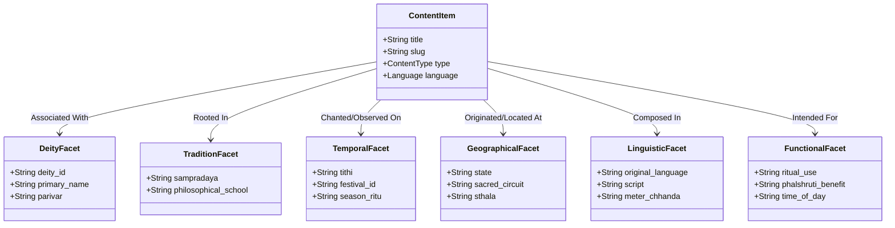
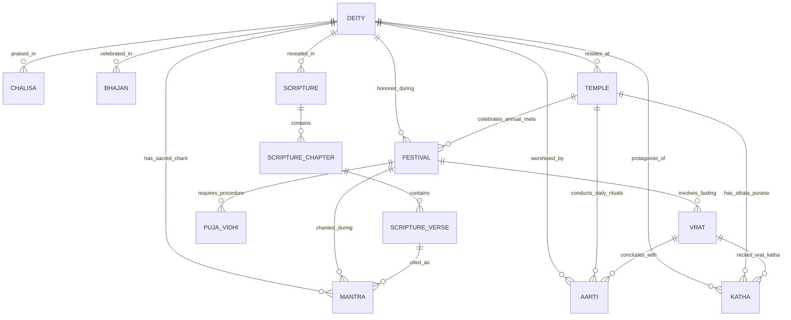
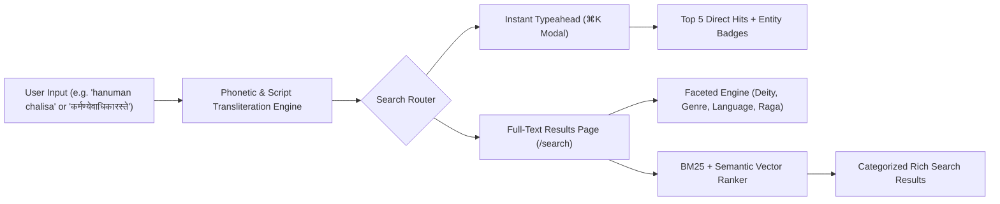
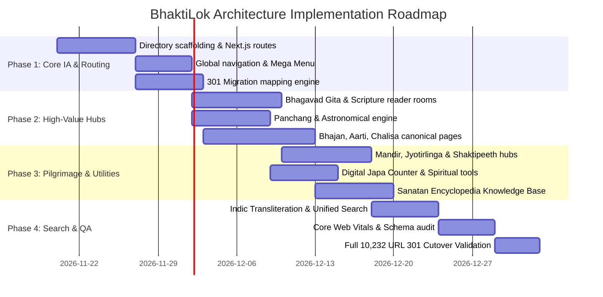

# BhaktiLok — Information Architecture & Content Strategy Specification
**Document ID:** `BL-SPEC-03`  
**Version:** `2.0.0` (Production Architecture)  
**Status:** Approved for Implementation  
**Target Platform:** Next.js 16+ App Router, React 19, TypeScript, Tailwind CSS, Supabase / PostgreSQL  
**Author:** BhaktiLok Core Architecture & Engineering Team  
**Last Updated:** November 2026  

---

## 1. Executive Summary & Architectural Vision

### 1.1 The Platform
**BhaktiLok** is a premium, authoritative, digital Sanatan Dharma spiritual ecosystem designed to serve millions of global devotees, spiritual seekers, scholars, and daily practitioners. It bridges millennia-old Vedic wisdom and Pauranik traditions with state-of-the-art web performance, elegant typography, intuitive navigation, and programmatic search engine optimization (pSEO).

### 1.2 Legacy Baseline vs. New Architecture
The legacy BhaktiLok website operated as an unorganized blog-style repository featuring:
* **10,232 blog-style posts** (heavily dominated by bhajan lyrics, mixed with unrelated articles).
* **93 Mantras, 234 Kathas, 11 Aartis, 91 Temples, 47 Festivals**.
* **453 Sacred Books/Granths**, **664 Ramayana Chapters**, **719 Bhagavad Gita Verses**.
* **215 Flat Categories** with overlapping tags, duplicate intent, and zero relational integrity.
* **175 Static and utility pages** lacking coherent user pathways.

#### Legacy Pain Points
1. **Flat URL Structure & Tag Chaos:** Bhajan lyrics, temple histories, and daily horoscopes shared the same flat permalink pattern (`/post-slug/`), destroying topic authority and confusing search engines.
2. **Missing Entity Relationships:** A user reading *Shiva Tandava Stotram* had no programmatic link to *Kashi Vishwanath Temple*, *Maha Shivaratri*, *Somwar Vrat Katha*, or the *Shiva Purana*.
3. **Fragmented Scripture Experience:** Sacred texts like the *Bhagavad Gita* and *Ramcharitmanas* were scattered across disjointed blog posts instead of hierarchical chapter/verse reading rooms.
4. **Poor Mobile Discovery:** 88% of devotional traffic is mobile, yet navigation lacked sticky utilities, deity-centric exploration, and offline-friendly reading modes.

#### New Architecture Objectives
* **Strict Semantic Hierarchy:** Segregate content into 21 dedicated top-level functional and thematic domains.
* **Relational Entity Graph:** Transform isolated posts into an interconnected Knowledge Graph anchored by *Deities*, *Scriptures*, *Temples*, *Tithis*, and *Rites*.
* **Next.js App Router Optimization:** Leverage React Server Components (RSC), Incremental Static Regeneration (ISR), static pre-rendering for core canonical hubs, and dynamic server-side rendering for real-time Panchang and astronomical calculations.
* **Zero Duplicate Intent & Systematic 301 Migration:** Retain existing search equity across 10,232 legacy URLs while establishing canonical authority across the new architecture.

---

## 2. Global Site Hierarchy Diagram

### 2.1 Full Platform Hierarchy (Mermaid Diagram)

```mermaid
graph TD
    Root["BhaktiLok Home (/)"]

    %% Core Devotional
    Root --> Devotional["Devotional Hubs"]
    Devotional --> Bhajan["Bhajan (/bhajan)"]
    Devotional --> Mantra["Mantra (/mantra)"]
    Devotional --> Aarti["Aarti (/aarti)"]
    Devotional --> Chalisa["Chalisa (/chalisa)"]
    Devotional --> Katha["Katha (/katha)"]

    %% Scriptures
    Root --> GranthHub["Granth & Scriptures (/granth)"]
    GranthHub --> Gita["Bhagavad Gita (/granth/bhagavad-gita)"]
    Gita --> GitaChap["Chapter (/granth/bhagavad-gita/[chapter])"]
    GitaChap --> GitaVerse["Verse (/granth/bhagavad-gita/[chapter]/[verse])"]
    GranthHub --> Ramayana["Ramayana (/granth/ramayana)"]
    Ramayana --> RamKand["Kand (/granth/ramayana/[kand])"]
    RamKand --> RamChap["Chapter (/granth/ramayana/[kand]/[chapter])"]
    GranthHub --> OtherGranth["Other Granths (/granth/[slug])"]

    %% Astrology, Panchang & Calendar
    Root --> AstroHub["Time, Calendar & Astrology"]
    AstroHub --> Panchang["Aaj Ka Panchang (/panchang)"]
    Panchang --> PanchangDate["Date / City (/panchang/[city]/[date])"]
    AstroHub --> Calendar["Hindu Calendar (/calendar)"]
    Calendar --> CalMonth["Year / Month (/calendar/[year]/[month])"]
    AstroHub --> Festivals["Festivals (/festivals & /festivals/[slug])"]
    AstroHub --> Vrat["Vrats & Fasting (/vrat & /vrat/[slug])"]
    AstroHub --> Rashifal["Rashifal (/rashifal & /rashifal/[rashi])"]

    %% Sacred Pilgrimage & Temples
    Root --> MandirHub["Mandir & Pilgrimage (/mandir)"]
    MandirHub --> Jyotirlinga["12 Jyotirlinga (/jyotirlinga & /[slug])"]
    MandirHub --> Shaktipeeth["51 Shakti Peeth (/shaktipeeth & /[slug])"]
    MandirHub --> Chardham["Char Dham (/char-dham & /[slug])"]
    MandirHub --> MandirDetail["Mandir Detail (/mandir/[slug])"]

    %% Knowledge, Tools & Editorial
    Root --> KnowledgeHub["Knowledge & Tools"]
    KnowledgeHub --> Encyclopedia["Encyclopedia (/encyclopedia & /[slug])"]
    KnowledgeHub --> Tools["Spiritual Tools (/tools & /[slug])"]
    KnowledgeHub --> Articles["Articles & Editorial (/articles & /[slug])"]
    KnowledgeHub --> Authors["Scholars & Authors (/authors & /[slug])"]

    %% System & Utilities
    Root --> SystemHub["System & Utilities"]
    SystemHub --> Search["Unified Search (/search)"]
    SystemHub --> App["Mobile App Onboarding (/app)"]
    SystemHub --> Static["Static Legal/Editorial Pages (/about, etc.)"]
    SystemHub --> Admin["Admin & Editorial CMS (/admin/*)"]
```



### 2.2 Text-Based Structural Tree

```text
/ (Home: Live Panchang Pill, Deity Grid, Trending Bhajans, Daily Gita Sloka, Upcoming Festivals)
├── /bhajan (Listing, Filters: Deity, Singer, Raga, Language)
│   ├── /bhajan/[slug] (Canonical Bhajan page with Lyrics, Meaning, Video/Audio Player)
│   ├── /bhajan/deity/[deity-slug] (Deity-specific Bhajan collection)
│   └── /bhajan/singer/[singer-slug] (Singer-specific collection)
├── /mantra (Vedic, Pauranik, Beej & Gayatri Mantras)
│   ├── /mantra/[slug] (Mantra Sloka, Transliteration, Audio, Meaning, Japa Vidhi)
│   └── /mantra/deity/[deity-slug]
├── /aarti (Daily & Festival Aartis)
│   ├── /aarti/[slug] (Aarti Lyrics, Video/Audio, Translation, Aarti Vidhi)
│   └── /aarti/deity/[deity-slug]
├── /chalisa (40-verse Devotional Hymns)
│   ├── /chalisa/[slug] (Full 40 Chaupais, Word Meaning, Audio, Benefits/Phalshruti)
│   └── /chalisa/deity/[deity-slug]
├── /katha (Vrat Kathas, Puranic Legends, Lila Stories)
│   ├── /katha/[slug] (Story, Vidhi, Significance, Associated Vrat/Deity)
│   └── /katha/vrat/[vrat-slug]
├── /granth (Scripture Library & Sacred Texts)
│   ├── /granth/bhagavad-gita (Gita Overview, 18 Chapters index, Themes)
│   │   ├── /granth/bhagavad-gita/[chapter] (Chapter overview, Verse grid)
│   │   └── /granth/bhagavad-gita/[chapter]/[verse] (Sloka, IAST, Anuvad, Multiple Commentaries)
│   ├── /granth/ramayana (Ramcharitmanas & Valmiki Ramayana)
│   │   ├── /granth/ramayana/[kand] (7 Kands: Bal, Ayodhya, Aranya, Kishkindha, Sundar, Lanka, Uttar)
│   │   └── /granth/ramayana/[kand]/[chapter] (Doha, Chaupai, Sortha with Hindi/English Meaning)
│   └── /granth/[slug] (Upanishads, Puranas, Stotra Sangraha, Yoga Sutras)
├── /panchang (Today's Real-Time Panchang)
│   ├── /panchang/[date] (YYYY-MM-DD Date Specific Panchang)
│   └── /panchang/[city]/[date] (Geo-located Panchang: Tithi, Nakshatra, Yoga, Karana, Rahu Kaal)
├── /calendar (Hindu Vikram Samvat / Gregorian Interactive Calendar)
│   ├── /calendar/[year] (Full Year High-Level Overview)
│   └── /calendar/[year]/[month] (Monthly Grid with Tithis, Ekadashis, Purnimas, Festivals)
├── /festivals (Tyohar Directory & Guides)
│   ├── /festivals/[slug] (Shubh Muhurat, Puja Vidhi, Samagri, Katha, Associated Mantras)
│   └── /festivals/[year]/[slug] (Year-specific Muhurat & Tithi timings)
├── /vrat (Fasting Days & Rituals)
│   ├── /vrat/[slug] (Vrat Vidhi, Paran Timing, Rules, Katha, Do's & Don'ts)
│   ├── /vrat/ekadashi (Specialized Ekadashi Hub with 24/26 Annual Ekadashis)
│   └── /vrat/pradosh (Som, Bhauma, Shani Pradosh Hub)
├── /mandir (Sacred Temples & Pilgrimage Portal)
│   ├── /mandir/[slug] (Temple History, Deities, Aarti Timings, Live Darshan, Route, Sthala Purana)
│   ├── /jyotirlinga (12 Jyotirlinga Hub)
│   │   └── /jyotirlinga/[slug] (Individual Jyotirlinga canonical guide)
│   ├── /shaktipeeth (51/52 Shakti Peeth Hub)
│   │   └── /shaktipeeth/[slug] (Individual Shakti Peeth guide & Body Part Relic)
│   └── /char-dham (Bada & Chota Char Dham Hub)
│       └── /char-dham/[slug] (Badrinath, Kedarnath, Gangotri, Yamunotri, Puri, Dwarka, Rameswaram)
├── /encyclopedia (Sanatan Dharma Knowledge Base & Vedic Glossary)
│   ├── /encyclopedia/[slug] (Deities, Avatars, Rishis, Danavas, Sacred Concepts, Yantras, Symbols)
│   └── /encyclopedia/category/[cat-slug]
├── /rashifal (Daily, Weekly, Monthly, Yearly Horoscopes)
│   ├── /rashifal/[rashi] (12 Rashis: Mesh to Meen - Daily, Weekly, Yearly Tabs)
│   └── /rashifal/[rashi]/[period] (Period specific: daily, weekly, monthly, yearly)
├── /tools (Devotional Utilities & Vedic Calculators)
│   ├── /tools/japa-counter (Interactive Digital Mala Counter with audio haptics)
│   ├── /tools/choghadiya (Day & Night Choghadiya Muhurat Calculator)
│   ├── /tools/rahu-kaal (Real-time Rahu Kaal & Yamaganda Finder)
│   ├── /tools/kundali-matching (Vedic Ashtakoot Guna Milan)
│   ├── /tools/vrat-finder (Personalized Upcoming Vrat & Fasting Alert Generator)
│   ├── /tools/naamkaran (Nakshatra-based Baby Name Finder)
│   └── /tools/puja-samagri-generator (Checklist & export tool for domestic pujas)
├── /articles (Spiritual Discourse, Philosophy, News, Sadhana Guides)
│   ├── /articles/[slug] (Long-form editorial, rich media, related verses)
│   └── /articles/category/[category-slug]
├── /authors (Scholars, Translators, Astrologers, Editorial Team)
│   └── /authors/[slug] (Biography, Credentials, Lineage, Published Articles & Granth Translations)
├── /search (Unified Instant Search & Global Filter Suite)
├── /app (Progressive Web App / Native App Download & Features Walkthrough)
├── /static legal & policy pages
│   ├── /about
│   ├── /contact
│   ├── /privacy-policy
│   ├── /terms-and-conditions
│   ├── /disclaimer
│   ├── /editorial-policy
│   ├── /corrections-policy
│   ├── /copyright-policy
│   └── /accessibility
└── /admin (Secure Editorial Workflow & CMS)
    ├── /admin/login
    ├── /admin/dashboard
    ├── /admin/content/[type] (Bhajans, Mantras, Granths, Kathas)
    ├── /admin/panchang (Ephemeris data sync & festival overrides)
    ├── /admin/media (Audio, PDF, Image asset management)
    ├── /admin/analytics (Devotional traffic, search queries, missing slokas)
    └── /admin/settings
```

---

## 3. Navigation Architecture

The navigation system of BhaktiLok must serve two distinct user intents:
1. **The Daily Devotee (Ritualistic/Fast Access):** Needs immediate access to Today's Panchang, Today's Tithi, Sunrise/Sunset, Daily Aarti, Daily Rashifal, and Japa Counter.
2. **The In-Depth Explorer (Scriptural/Pilgrimage):** Desires systematic browsing of the *Bhagavad Gita*, *Ramcharitmanas*, Temple histories, Vedic Mantras, and scholarly articles.

### 3.1 Global Top Utility Bar (Desktop)
Positioned at the highest layer of every viewport, providing instant situational awareness:
* **Live Tithi / Panchang Pill:** e.g., *"फाल्गुन शुक्ल पक्ष एकादशी (आमलकी एकादशी) | राहुकाल: 15:12 – 16:38"* (Clicking opens instant Panchang flyout).
* **Location Selector:** Quick geo-location switcher (Default: Auto-detected city e.g., *"नई दिल्ली, भारत"* with one-click change to 5,000+ global cities for accurate sunrise/muhurat calculation).
* **Language Switcher:** Toggle between Hindi (`हिन्दी`) and English (`EN`) or dual-script transliteration (`IAST`).
* **Display Mode / Theme Toggle:** Traditional Saffron (`सात्विक`), Deep Midnight (`अमृत वेला / Dark`), and Clean Ivory (`शुक्ल / Light`).
* **Floating Mini Audio Player Dock:** Shows currently playing Bhajan/Mantra/Aarti with play/pause, loop counter (11x, 21x, 108x), and audio expansion trigger.

### 3.2 Desktop Header & Mega Menu System

```text
+---------------------------------------------------------------------------------------------------------+
| [BHAKTILOK LOGO]   भक्ति संग्रह v   धर्म ग्रंथ v   पंचांग व ज्योतिष v   मंदिर दर्शन v   उपकरण v   [🔍 खोजिए ⌘K]  [📱 ऐप] |
+---------------------------------------------------------------------------------------------------------+
```

The desktop header features 5 purpose-built, high-conversion Mega Menus:

#### Mega Menu 1: "भक्ति संग्रह" (Devotional Hub)
* **Column 1: नित्य नियम (Daily Devotion):** दैनिक आरती संग्रह (11 Aartis), प्रसिद्ध चालीसा (Hanuman, Shiva, Durga), सिद्ध मंत्र (Mahamrityunjaya, Gayatri), वैदिक स्तोत्र.
* **Column 2: भजन सरिता (Bhajan Streams):** कृष्ण भजन, शिव भजन, राम भजन, हनुमान भजन, माता के भजन, निर्गुण भजन (कबीर / मीरा बाई).
* **Column 3: पावन कथाएं (Kathas & Tales):** व्रत कथाएं (एकादशी, प्रदोष, सत्यनारायण), पौराणिक कथाएं, शिव लिला, कृष्ण लिला.
* **Featured Card:** *“आज का विशेष भजन / आरती”* with thumbnail, singer name, and direct play button.

#### Mega Menu 2: "धर्म ग्रंथ" (Sacred Scriptures)
* **Column 1: श्रीमद्भगवद्गीता (Bhagavad Gita):** सभी 18 अध्याय (All 18 Chapters), कर्मयोग, भक्तियोग, ज्ञानयोग, श्लोक खोजक (Verse Finder), प्रसिद्ध उद्धरण.
* **Column 2: रामायण व मानस (Ramayana):** श्रीरामचरितमानस (7 काण्ड), वाल्मीकि रामायण, सुंदरकाण्ड पाठ (विशेष), हनुमान बाहुक.
* **Column 3: उपनिषद व पुराण (Scriptures & Stutis):** ईशावास्य उपनिषद, शिव पुराण, विष्णु पुराण, श्रीमद्भागवत महापुराण, पतंजलि योगसूत्र.
* **Featured Card:** *“आज का श्लोक”* (Daily Shloka with Sanskrit, Hindi Anuvad & Audio).

#### Mega Menu 3: "पंचांग व ज्योतिष" (Panchang & Astrology)
* **Column 1: आज का पंचांग:** आज की तिथि व वार, शुभ मुहूर्त व चौघड़िया, राहु काल व यमगण्ड, सूर्योदय/सूर्यास्त समय.
* **Column 2: व्रत व त्यौहार (Calendar):** आगामी व्रत सूची, एकादशी पंचांग (2026-2027), प्रदोष व्रत, पूर्णिमा व अमावस्या तिथियां, वार्षिक हिंदू कैलेंडर.
* **Column 3: दैनिक राशिफल (Zodiac):** मेष, वृषभ, मिथुन, कर्क, सिंह, कन्या, तुला, वृश्चिक, धनु, मकर, कुम्भ, मीन (दैनिक / साप्ताहिक / वार्षिक राशिफल).
* **Featured Card:** *“अगला प्रमुख त्यौहार”* countdown widget with Muhurat timings and Puja Vidhi link.

#### Mega Menu 4: "मंदिर दर्शन" (Pilgrimage & Temples)
* **Column 1: 12 ज्योतिर्लिंग:** सोमनाथ, काशी विश्वनाथ, महाकालेश्वर, केदारनाथ, ओंकारेश्वर, मल्लिकार्जुन, बैद्यनाथ, भीमाशंकर, त्र्यंबकेश्वर, नागेश्वर, रामेश्वरम, घृष्णेश्वर.
* **Column 2: 51 शक्तिपीठ:** कामाख्या, वैष्णो देवी, कालिका, ज्वाला जी, तारापीठ, मीनाक्षी, ललिता देवी, विशालाक्षी.
* **Column 3: पावन धाम व तीर्थ:** चार धाम (बद्रीनाथ, द्वारका, जगन्नाथ पुरी, रामेश्वरम), छोटा चार धाम (उत्तराखंड), नवग्रह मंदिर, अयोध्या धाम.
* **Featured Card:** Virtual Darshan / Sthala Purana guide of the week.

#### Mega Menu 5: "साधना उपकरण" (Spiritual Tools)
* डिजिटल जप माला (Digital 108 Japa Counter)
* दिन-रात का चौघड़िया (Day & Night Choghadiya)
* राहुकाल कैलकुलेटर (Live Rahu Kaal Timer)
* जन्म कुण्डली व गुण मिलान (Kundali Matching)
* पूजा सामग्री सूची जेनरेटर (Custom Puja Checklist)
* नामकरण अक्षर व नक्षत्र कैलकुलेटर

### 3.3 Mobile Navigation Structure
On viewport widths $< 1024\text{px}$, the UI transitions to an app-like ergonomic mobile design:

#### 1. Sticky Mobile Top Header
* Brand Logo & Devanagari Wordmark.
* Live Panchang summary pill (e.g. `शुक्ल एकादशी`).
* Instant Search icon (triggers full-screen overlay).
* Hamburger Menu button.

#### 2. Mobile Drawer Menu (Slide-out from Left)
* **Quick Access Chips:** `गीता श्लोक` | `आज का पंचांग` | `जप माला` | `आरती संग्रह` | `राशिफल`.
* **Accordion Navigation:**
  * ▾ भक्ति संग्रह (भजन, आरती, चालीसा, मंत्र, कथा)
  * ▾ धर्म ग्रंथ (भगवद्गीता, रामायण, उपनिषद, स्तोत्र)
  * ▾ पंचांग व व्रत (आज का पंचांग, कैलेंडर, एकादशी, त्यौहार)
  * ▾ पावन मंदिर (12 ज्योतिर्लिंग, 51 शक्तिपीठ, चार धाम)
  * ▾ साधना उपकरण (जप माला, चौघड़िया, राहुकाल, कुण्डली)
  * ▾ सनातन ज्ञानकोष (देवता, अवतार, ऋषि, प्रतीक)
* **App Download Banner:** "भक्तिलोक ऐप इंस्टॉल करें — ऑफलाइन पाठ व दैनिक अलार्म".
* **Language & Theme Selector**.

#### 3. Sticky Bottom Navigation Bar (Thumb Zone)
Always visible at the bottom on mobile screens (iOS & Android):
* **Tab 1: मुख्य पृष्ठ (Home)** (`/`) — Icon: `Temple / Om`
* **Tab 2: पंचांग (Panchang)** (`/panchang`) — Icon: `Sun / Calendar`
* **Tab 3: गीता / ग्रंथ (Scriptures)** (`/granth/bhagavad-gita`) — Icon: `BookOpen`
* **Tab 4: जप माला (Japa Counter)** (`/tools/japa-counter`) — Icon: `Disc / Beads`
* **Tab 5: मेन्यू (Menu)** (Triggers Drawer) — Icon: `Menu`

### 3.4 Footer Architecture
The footer serves as the comprehensive sitemap, legal bedrock, and secondary crawl discovery engine:

```text
+----------------------------------------------------------------------------------------------------------------------+
| [BHAKTILOK LOGO] — भारत का सर्वाधिक प्रामाणिक सनातन धर्म व भक्ति पोर्टल                                             |
| [Daily Newsletter Signup: "प्रातःकालीन अमृतवेला सुविचार व दैनिक पंचांग सीधे ईमेल / व्हाट्सएप पर प्राप्त करें"]           |
+----------------------------------------------------------------------------------------------------------------------+
| 1. भक्ति व आराधना    | 2. पावन धर्म ग्रंथ  | 3. पंचांग व ज्योतिष | 4. दिव्य तीर्थ व धाम | 5. साधना उपकरण व ज्ञान | 6. संस्था व नीतियां |
| - श्री हनुमान चालीसा  | - श्रीमद्भगवद्गीता  | - आज का पंचांग      | - 12 ज्योतिर्लिंग     | - डिजिटल जप माला       | - हमारे बारे में    |
| - शिव तांडव स्तोत्र   | - श्रीरामचरितमानस   | - हिन्दू कैलेंडर     | - 51 शक्तिपीठ         | - आज का चौघड़िया        | - संपर्क सूत्र      |
| - महामृत्युंजय मंत्र  | - वाल्मीकि रामायण   | - एकादशी व्रत सूची   | - चार धाम तीर्थ       | - राहुकाल समय          | - सम्पादकीय नीति   |
| - सम्पूर्ण आरती संग्रह | - उपनिषद संग्रह    | - प्रदोष व्रत मुहूर्त| - प्रमुख मंदिर सूची   | - कुण्डली गुण मिलान     | - शुद्धि व सुधार नीति|
| - लोकप्रिय भजन संग्रह | - विष्णु सहस्रनाम   | - दैनिक राशिफल 2026 | - अयोध्या राम मंदिर   | - सनातन ज्ञानकोष       | - कॉपीराइट नीति     |
| - पौराणिक व्रत कथाएं | - शिव पुराण         | - आगामी प्रमुख त्यौहार| - काशी विश्वनाथ      | - आध्यात्मिक लेख        | - गोपनीयता नीति     |
| - संकटमोचन हनुमानाष्टक| - सुंदरकाण्ड पाठ    | - विवाह मुहूर्त सूची  | - तिरुपति बालाजी      | - लेखक व विद्वान       | - नियम व शर्तें     |
+----------------------------------------------------------------------------------------------------------------------+
| भाषाएं: हिन्दी | English | संस्कृतम् | मराठी | ગુજરાતી | বাংলা | தமிழ் | తెలుగు                                               |
| © 2026 BhaktiLok.com. All Rights Reserved. समर्पित सनातन संस्कृति, वेद एवं लोककल्याणार्थ।                             |
+----------------------------------------------------------------------------------------------------------------------+
```

---

## 4. Content Taxonomy & Classification Model

To permanently resolve the legacy flaw of 215 flat, overlapping categories, BhaktiLok implements a **Multidimensional Orthogonal Taxonomy**. Content is never classified by a single arbitrary bucket; instead, it is tagged across seven structured dimensions.

### 4.1 The 7 Core Facets



#### Dimension 1: Deity / Ishta Devata (इष्ट देवता)
Every devotional artifact belongs to a Primary Presiding Deity, with optional Secondary/Pariwar links:
* **Shiva (भगवान शिव):** Parvati, Ganesha, Kartikeya, Nandi, Bhairava, Veerabhadra.
* **Vishnu (भगवान श्री हरि विष्णु):** Lakshmi, Garuda, Sheshnag.
  * *Avatars:* Rama (with Sita, Lakshmana, Hanuman), Krishna (with Radha, Balarama, Rukmini), Narasimha, Vamana, Varaha, Matsya, Kurma, Parashurama.
* **Devi / Shakti (आदिशक्ति माँ दुर्गा):** Kali, Lakshmi, Saraswati, Parvati, Navadurga (Shailaputri to Siddhidatri), Mahavidyas (10 Mahavidyas), Chandi, Santoshi Mata, Sheetala Mata.
* **Hanuman (श्री हनुमान जी):** Rudravatar, Sankat Mochan, Bajrangbali, Panchamukhi.
* **Ganesha (भगवान श्री गणेश):** Vinayaka, Ganapati, Siddhivinayak, Riddhi-Siddhi.
* **Surya & Navagraha (सूर्य देव एवं नवग्रह):** Surya, Chandra, Mangal, Budh, Guru, Shukra, Shani, Rahu, Ketu.
* **Other Revered Deities & Saints:** Dattatreya, Ayyappa, Murugan, Sai Baba, Sant Kabir, Meera Bai, Tulsidas, Surdas.

#### Dimension 2: Content Format & Genre (प्रारूप व विधा)
Defines layout, UI components, schema markup, and metadata requirements:
* `bhajan` — Devotional song/lyrics with composer, singer, taal, raga, video/audio.
* `mantra` — Sacred sound vibration with rishi, chhanda, devata, beej, audio chant, japa vidhi.
* `aarti` — Ritual fire offering hymn with musical notation, timings, and meaning.
* `chalisa` — Structured 40-chaupai poem with doha, invocation, and phalshruti.
* `stotra` / `stuti` — Sanskrit praise/hymn (e.g. *Shiva Tandava*, *Mahishasura Mardini*).
* `katha` — Sacred narrative (Vrat katha, Puranic legend, Upkatha).
* `granth_verse` — Scriptural unit (Sloka, Chaupai, Sutra, Mantra) with word-for-word breakdown.
* `temple_guide` — Architectural, historical, and pilgrimage practical guide.
* `ritual_vidhi` — Step-by-step puja and vrata procedure with samagri list.
* `article` — Scholarly editorial, spiritual inquiry, or cultural commentary.

#### Dimension 3: Tradition & Sampradaya (सम्प्रदाय व दर्शन)
Provides philosophical context for commentaries and theological interpretations:
* **Vaishnava (वैष्णव):** Ramanuja (Sri Sampradaya), Madhva (Brahma Sampradaya), Nimbarka (Kumara Sampradaya), Vallabha (Pushtimarg), Gaudiya Vaishnavism, Ramanandi.
* **Shaiva (शैव):** Kashmir Shaivism, Shaiva Siddhanta, Lingayatism, Dashanami Sampradaya (Adi Shankara).
* **Shakta (शाक्त):** Sri Vidya, Kaula, Kalikula.
* **Smarta (स्मार्त):** Panchayatana Puja tradition adhering to Advaita Vedanta.
* **Saurya & Ganapatya:** Solar and Ganapati focused traditions.

#### Dimension 4: Language & Script (भाषा व लिपि)
Enables multi-script rendering and phonetic search:
* Sanskrit (संस्कृत — Devanagari & IAST Latin Transliteration).
* Hindi (हिन्दी — Modern Standard Hindi).
* Awadhi (अवधी — Language of *Ramcharitmanas* & *Hanuman Chalisa*).
* Braj Bhasha (ब्रजभाषा — Language of Surdas, Raskhan, Mirabai).
* Maithili, Gujarati, Marathi, Bengali, Odia, Telugu, Tamil, Kannada, Malayalam.
* English (Translations, transliterations, and philosophical purport).

#### Dimension 5: Occasion & Temporal Context (पर्व, त्यौहार व काल)
Links content dynamically to the Hindu Almanac:
* **Festivals:** Maha Shivaratri, Janmashtami, Diwali, Holi, Rama Navami, Ganesh Chaturthi, Navratri (Chaitra & Sharadiya), Hanuman Jayanti, Raksha Bandhan, Makar Sankranti.
* **Recurrent Tithis:** Ekadashi (24 specific instances), Pradosh, Sankashti Chaturthi, Vinayaka Chaturthi, Purnima, Amavasya, Masik Shivaratri.
* **Days of the Week (वार):** Somwar (Shiva), Mangalwar (Hanuman), Budhwar (Ganesha), Guruwar (Vishnu/Brihaspati), Shukrawar (Devi Lakshmi/Durga), Shaniwar (Shani Dev/Hanuman), Ravivar (Surya).
* **Time of Day (प्रहर):** Brahma Muhurta / Pratah (Dawn), Madhyahna (Noon), Sandhya (Dusk), Nishita Kaal (Midnight).

#### Dimension 6: Raga & Musical Bhava (राग व भाव)
Enhances search and discovery for musicians, kirtaniyas, and aesthetic seekers:
* **Raga:** Bhairav, Yaman, Bhairavi, Darbari Kanada, Todi, Bilawal, Kafi, Khamaj, Desh, Vrindavani Sarang.
* **Bhava (भक्ति रस):** Shanta (Serenity), Dasya (Servitude to God), Sakhya (Divine Friendship), Vatsalya (Parental Love), Madhurya (Sweet Divine Romance/Surrender).

#### Dimension 7: Sacred Geography (तीर्थ व क्षेत्र)
Organizes physical pilgrimage and temple data:
* **Panch Mahabhuta Sthalas** (Earth, Water, Fire, Air, Space).
* **12 Jyotirlingas** & **51 Shakti Peethas**.
* **Char Dham** & **Chota Char Dham**.
* **Pancha Kedar**, **Pancharama Kshetras**, **Navagraha Temples**, **Divya Desams**.
* **Sacred River Basins:** Ganga, Yamuna, Saraswati, Narmada, Godavari, Krishna, Kaveri.

---

## 5. Entity Relationships & The Devotional Knowledge Graph

The heart of BhaktiLok’s new architecture is a **Unified Entity Relationship Graph**. Content items are not isolated silos; they are interconnected nodes radiating outward from core deities and sacred scriptures.

### 5.1 The 360-Degree Devotional Knowledge Graph



### 5.2 Concrete Entity Flow Example: Bhagwan Shiva

To demonstrate how the Knowledge Graph works in practice, consider a user navigating the node **Bhagwan Shiva (भगवान शिव)**:

| Entity Type | Linked Nodes & Concrete Cross-References |
| :--- | :--- |
| **Primary Deities** | Mahadev, Bholenath, Rudra, Nataraja, Ardhanarishvara |
| **Associated Parivar** | Mata Parvati, Lord Ganesha, Kartikeya, Nandi, Ganga Mata |
| **Mantras (`/mantra`)** | Mahamrityunjaya Mantra, Om Namah Shivaya (Panchakshari), Rudra Gayatri, Shiva Dhyan Mantra |
| **Aartis (`/aarti`)** | Om Jai Shiv Omkara, Aarti Kunjbihari Ki (relative), Karpura Gauram Karunavataram |
| **Chalisas (`/chalisa`)** | Shri Shiva Chalisa, Rudrashtakam |
| **Stotras (`/granth/stotra`)** | Shiva Tandava Stotram, Shiva Mahimna Stotra, Bilwashtakam, Lingashtakam |
| **Bhajans (`/bhajan`)** | *Namo Namo Ji Shankara*, *Shiv Kailashon Ke Vasi*, *Subah Subah Le Shiv Ka Naam*, *Bhole Ki Nagari* |
| **Kathas (`/katha`)** | Samudra Manthan & Halahal Visha, Sati Dah & Parvati Tapasya, Ganga Avatarana Katha, Somwar Vrat Katha |
| **Temples (`/mandir`)** | 12 Jyotirlingas (Somnath, Kashi Vishwanath, Mahakaleshwar, Kedarnath, etc.), Baijnath, Tungnath |
| **Festivals (`/festivals`)**| Maha Shivaratri, Shravan Maas (Sawan), Masik Shivaratri |
| **Vrats (`/vrat`)** | Somwar Vrat, Solah Somwar Vrat, Pradosh Vrat (Som Pradosh) |
| **Scriptures (`/granth`)**| Shiva Purana, Linga Purana, Svetasvatara Upanishad, Yajurveda Sri Rudram |
| **Tools (`/tools`)** | 108 Japa Mala Counter (Default Mantra: *Om Namah Shivaya*), Bilva Patra puja checklist |

---

## 6. Systematic Cross-Linking Strategy

Internal linking is not an afterthought; it is an algorithmic strategy to maximize user dwell time, lower bounce rates, and distribute PageRank across all 10,232+ content nodes.

### 6.1 The "360-Degree Devotional Circle" Rule
Every content detail page must render at least four contextual entity connection modules:

```text
+---------------------------------------------------------------------------------------------------+
|                                 CANONICAL CONTENT (e.g., Shiv Chalisa)                            |
|                                       Lyrics, Meaning, Audio                                      |
+---------------------------------------------------------------------------------------------------+
|  [SECTION 1: सम्बद्ध इष्टदेव]      [SECTION 2: सम्बद्ध मंत्र व स्तोत्र]  [SECTION 3: पावन मंदिर]    |
|  - भगवान शिव का सम्पूर्ण परिचय     - महामृत्युंजय मंत्र                  - 12 ज्योतिर्लिंग दर्शन     |
|  - शिव परिवार                      - शिव तांडव स्तोत्र                    - श्री केदारनाथ धाम        |
|  - शिव प्रिय पुष्प व पूजा विधि     - रुद्राष्टकम                          - श्री काशी विश्वनाथ        |
+---------------------------------------------------------------------------------------------------+
|  [SECTION 4: आगामी व्रत व पर्व]    [SECTION 5: लोकप्रिय शिव भजन]        [SECTION 6: साधना उपकरण]    |
|  - अगला प्रदोष व्रत (तिथि व मुहूर्त)  - नमो नमो जी शंकरा (लिरिक्स)         - 108 ॐ नमः शिवाय जप काउंटर |
|  - महाशिवरात्रि 2027 पूजा विधि      - शिव कैलासों के वासी                  - शिव पूजा सामग्री सूची    |
+---------------------------------------------------------------------------------------------------+
```

### 6.2 Contextual In-Text Wiki Links (Encyclopedia Interlinking)
* Whenever an authoritative deity name, sage, scripture, or philosophical concept appears in any bhajan, katha, or article, the CMS automatically injects a verified contextual hyperlink to the relevant `/encyclopedia/[slug]` or `/granth/[slug]` page.
* **Strict Quality Safeguard:** Maximum of 1 link per 150 words to avoid visual clutter and maintain pristine readability.

### 6.3 Dynamic Temporal Cross-Links (Panchang Driven)
* On days preceding major fasting days (e.g., 48 hours before *Amalaki Ekadashi*):
  * The Home page, Bhajan listing, and Aarti pages display a prominent notification ribbon: *"परसों है आमलकी एकादशी — जानिए शुभ मुहूर्त, पारण समय व एकादशी व्रत कथा"*.
  * The link guides devotees directly to `/vrat/ekadashi/amalaki-ekadashi`.

---

## 7. URL Structure & Routing Specification

The URL hierarchy follows strict lowercase, hyphenated, kebab-case patterns. URLs are semantic, human-readable, and free from file extensions or database query parameters for core canonical routes.

### 7.1 Primary Route Specifications

| ID | Section Name | Canonical URL Pattern | Next.js App Router File Path | Description |
| :--- | :--- | :--- | :--- | :--- |
| **1** | **Home** | `/` | `src/app/page.tsx` | Dynamic devotional dashboard, live panchang, daily sloka |
| **2** | **Bhajan Index** | `/bhajan` | `src/app/bhajan/page.tsx` | Searchable directory with faceted filters |
| | **Bhajan Detail** | `/bhajan/[slug]` | `src/app/bhajan/[slug]/page.tsx` | Lyrics, transliteration, raga, audio/video player |
| | **Bhajan by Deity** | `/bhajan/deity/[deity-slug]` | `src/app/bhajan/deity/[deity-slug]/page.tsx` | e.g. `/bhajan/deity/krishna` |
| | **Bhajan by Singer**| `/bhajan/singer/[singer-slug]`| `src/app/bhajan/singer/[singer-slug]/page.tsx`| e.g. `/bhajan/singer/anup-jalota` |
| **3** | **Mantra Index** | `/mantra` | `src/app/mantra/page.tsx` | Vedic, Beej, Tantrokta mantra directory |
| | **Mantra Detail** | `/mantra/[slug]` | `src/app/mantra/[slug]/page.tsx` | Sanskrit sloka, IAST, audio, japa count, benefits |
| | **Mantra by Deity** | `/mantra/deity/[deity-slug]` | `src/app/mantra/deity/[deity-slug]/page.tsx` | All mantras consecrated to a specific deity |
| **4** | **Aarti Index** | `/aarti` | `src/app/aarti/page.tsx` | Daily and festival aartis index |
| | **Aarti Detail** | `/aarti/[slug]` | `src/app/aarti/[slug]/page.tsx` | Complete lyrics, meaning, audio, aarti timings |
| **5** | **Chalisa Index** | `/chalisa` | `src/app/chalisa/page.tsx` | All 40-chaupai devotional stutis |
| | **Chalisa Detail** | `/chalisa/[slug]` | `src/app/chalisa/[slug]/page.tsx` | Chaupai-by-chaupai breakdown, audio, phalshruti |
| **6** | **Katha Index** | `/katha` | `src/app/katha/page.tsx` | Pauranik, Vrat, and Lila stories archive |
| | **Katha Detail** | `/katha/[slug]` | `src/app/katha/[slug]/page.tsx` | Full narrative, moral significance, puja vidhi |
| | **Katha by Vrat** | `/katha/vrat/[vrat-slug]` | `src/app/katha/vrat/[vrat-slug]/page.tsx` | e.g. `/katha/vrat/satyanarayan` |
| **7** | **Granth Library** | `/granth` | `src/app/granth/page.tsx` | Digital library of scriptures, upanishads, stotras |
| | **Granth Detail** | `/granth/[slug]` | `src/app/granth/[slug]/page.tsx` | Overview, introduction, chapter table of contents |
| | **Gita Hub** | `/granth/bhagavad-gita` | `src/app/granth/bhagavad-gita/page.tsx` | 18 Chapters index, themes, characters, summary |
| | **Gita Chapter** | `/granth/bhagavad-gita/[chapter]`| `src/app/granth/bhagavad-gita/[chapter]/page.tsx` | e.g. `/chapter-2` (Overview, 72 verses list) |
| | **Gita Verse** | `/granth/bhagavad-gita/[chapter]/[verse]` | `src/app/granth/bhagavad-gita/[chapter]/[verse]/page.tsx` | e.g. `/chapter-2/verse-47` (Sloka, Padachheda, Anuvad, Shankara/Ramanuja purports) |
| | **Ramayana Hub** | `/granth/ramayana` | `src/app/granth/ramayana/page.tsx` | 7 Kands index, characters, chopais |
| | **Ramayana Kand** | `/granth/ramayana/[kand]` | `src/app/granth/ramayana/[kand]/page.tsx` | e.g. `/sundar-kand` |
| | **Ramayana Chapter**| `/granth/ramayana/[kand]/[chapter]` | `src/app/granth/ramayana/[kand]/[chapter]/page.tsx`| e.g. `/sundar-kand/doha-1-to-10` |
| **8** | **Panchang Hub** | `/panchang` | `src/app/panchang/page.tsx` | Today's Panchang based on user's geo-location |
| | **Panchang by Date**| `/panchang/[date]` | `src/app/panchang/[date]/page.tsx` | e.g. `/panchang/2026-11-18` |
| | **Panchang City/Date**| `/panchang/[city]/[date]` | `src/app/panchang/[city]/[date]/page.tsx`| e.g. `/panchang/varanasi/2026-11-18` |
| **9** | **Calendar Hub** | `/calendar` | `src/app/calendar/page.tsx` | Interactive Hindu-Gregorian calendar dashboard |
| | **Calendar Month** | `/calendar/[year]/[month]` | `src/app/calendar/[year]/[month]/page.tsx`| e.g. `/calendar/2026/11` |
| **10**| **Festivals Hub** | `/festivals` | `src/app/festivals/page.tsx` | Annual festival directory & dates index |
| | **Festival Detail**| `/festivals/[slug]` | `src/app/festivals/[slug]/page.tsx` | Evergreen guide: Significance, rituals, mantras |
| | **Festival Year** | `/festivals/[year]/[slug]` | `src/app/festivals/[year]/[slug]/page.tsx`| e.g. `/festivals/2026/diwali` (Exact muhurat) |
| **11**| **Vrat Hub** | `/vrat` | `src/app/vrat/page.tsx` | Fasting directory & calendar |
| | **Vrat Detail** | `/vrat/[slug]` | `src/app/vrat/[slug]/page.tsx` | Fasting rules, vidhi, timings, katha link |
| | **Ekadashi Hub** | `/vrat/ekadashi` | `src/app/vrat/ekadashi/page.tsx` | Complete 24 annual Ekadashis index |
| | **Pradosh Hub** | `/vrat/pradosh` | `src/app/vrat/pradosh/page.tsx` | Som, Bhauma, Shani Pradosh dates and vidhi |
| **12**| **Mandir Hub** | `/mandir` | `src/app/mandir/page.tsx` | Pilgrimage portal & sacred temple search |
| | **Mandir Detail** | `/mandir/[slug]` | `src/app/mandir/[slug]/page.tsx` | History, timings, darshan rules, route, maps |
| | **Jyotirlinga Hub** | `/jyotirlinga` | `src/app/jyotirlinga/page.tsx` | 12 Sacred Jyotirlinga thematic portal |
| | **Jyotirlinga Detail**| `/jyotirlinga/[slug]` | `src/app/jyotirlinga/[slug]/page.tsx` | e.g. `/jyotirlinga/kashi-vishwanath` |
| | **Shaktipeeth Hub**| `/shaktipeeth` | `src/app/shaktipeeth/page.tsx` | 51 Holy Shakti Peeth thematic portal |
| | **Shaktipeeth Detail**| `/shaktipeeth/[slug]` | `src/app/shaktipeeth/[slug]/page.tsx`| e.g. `/shaktipeeth/kamakhya` |
| | **Char Dham Hub** | `/char-dham` | `src/app/char-dham/page.tsx` | Bada & Chota Char Dham thematic portal |
| | **Char Dham Detail**| `/char-dham/[slug]` | `src/app/char-dham/[slug]/page.tsx` | e.g. `/char-dham/kedarnath` |
| **13**| **Encyclopedia** | `/encyclopedia` | `src/app/encyclopedia/page.tsx` | A-Z Sanatan Dharma glossary & entity directory |
| | **Encyclopedia Entry**| `/encyclopedia/[slug]`| `src/app/encyclopedia/[slug]/page.tsx`| In-depth profile of deity, sage, or concept |
| **14**| **Rashifal Hub** | `/rashifal` | `src/app/rashifal/page.tsx` | 12 Zodiac sign dashboard |
| | **Rashifal Detail**| `/rashifal/[rashi]` | `src/app/rashifal/[rashi]/page.tsx` | e.g. `/rashifal/mesh` (Daily, Weekly, Yearly) |
| **15**| **Tools Hub** | `/tools` | `src/app/tools/page.tsx` | Interactive devotional & astrological utilities |
| | **Tool Detail** | `/tools/[slug]` | `src/app/tools/[slug]/page.tsx` | e.g. `/tools/japa-counter`, `/tools/choghadiya` |
| **16**| **Articles Hub** | `/articles` | `src/app/articles/page.tsx` | Editorial discourses, philosophy, essays |
| | **Article Detail**| `/articles/[slug]` | `src/app/articles/[slug]/page.tsx` | Long-form reading with author byline |
| **17**| **Authors Hub** | `/authors` | `src/app/authors/page.tsx` | Contributing scholars, translators, astrologers |
| | **Author Profile** | `/authors/[slug]` | `src/app/authors/[slug]/page.tsx` | Bio, credentials, published treatises |
| **18**| **Static Pages** | `/[slug]` | `src/app/(static)/[slug]/page.tsx` | `/about`, `/contact`, `/editorial-policy`, etc. |
| **19**| **Search** | `/search` | `src/app/search/page.tsx` | Multi-faceted full-text search engine |
| **20**| **App Onboarding**| `/app` | `src/app/app/page.tsx` | Mobile PWA & Native app features showcase |
| **21**| **Admin CMS** | `/admin/*` | `src/app/admin/*` | Multi-role management, workflows & analytics |

### 7.2 The 10,232 Legacy URL 301 Migration Engine
The legacy site featured 10,232 flat posts (`https://bhaktilok.com/post-title/`). To maintain SEO link equity and eliminate 404 crawl errors, an automated routing and database map is implemented in `next.config.ts` via middleware and a high-performance Redis/KV lookup table:

```typescript
// Conceptual Next.js Edge Middleware for Legacy URL Translation
export async function middleware(request: NextRequest) {
  const pathname = request.nextUrl.pathname;
  
  // Skip static assets, APIs, and new structured prefixes
  if (isNewSystemRoute(pathname)) return NextResponse.next();

  // Query high-speed Edge KV for legacy slug match
  const legacySlug = pathname.replace(/^\/|\/$/g, '');
  const destination = await legacyUrlMap.get(legacySlug);

  if (destination) {
    return NextResponse.redirect(new URL(destination, request.url), 301);
  }

  // Fallback to intelligent slug classifier or standard 404
  return NextResponse.next();
}
```

* **Bhajan Migration Rule:** `/[legacy-bhajan-slug]/` $\rightarrow$ `/bhajan/[legacy-bhajan-slug]`
* **Aarti Migration Rule:** `/[legacy-aarti-slug]/` $\rightarrow$ `/aarti/[standardized-slug]`
* **Chalisa Migration Rule:** `/[legacy-chalisa-slug]/` $\rightarrow$ `/chalisa/[standardized-slug]`
* **Mantra Migration Rule:** `/[legacy-mantra-slug]/` $\rightarrow$ `/mantra/[standardized-slug]`
* **Temple Migration Rule:** `/[legacy-temple-slug]/` $\rightarrow$ `/mandir/[standardized-slug]`

---

## 8. Breadcrumb Navigation & Schema Architecture

Breadcrumbs deliver two critical functions:
1. Provide users with instant contextual orientation within deep scriptural hierarchies.
2. Generate structured data (`BreadcrumbList`) in Google SERPs, replacing raw URLs with clean navigation trails.

### 8.1 Schema.org `BreadcrumbList` Standard
Every page dynamically generates a JSON-LD microdata snippet complying with Schema.org specifications:

```json
{
  "@context": "https://schema.org",
  "@type": "BreadcrumbList",
  "itemListElement": [
    {
      "@type": "ListItem",
      "position": 1,
      "name": "होम (Home)",
      "item": "https://bhaktilok.com"
    },
    {
      "@type": "ListItem",
      "position": 2,
      "name": "धर्म ग्रंथ",
      "item": "https://bhaktilok.com/granth"
    },
    {
      "@type": "ListItem",
      "position": 3,
      "name": "श्रीमद्भगवद्गीता",
      "item": "https://bhaktilok.com/granth/bhagavad-gita"
    },
    {
      "@type": "ListItem",
      "position": 4,
      "name": "अध्याय 2: सांख्य योग",
      "item": "https://bhaktilok.com/granth/bhagavad-gita/chapter-2"
    },
    {
      "@type": "ListItem",
      "position": 5,
      "name": "श्लोक 47",
      "item": "https://bhaktilok.com/granth/bhagavad-gita/chapter-2/verse-47"
    }
  ]
}
```

### 8.2 Canonical Visual Breadcrumb Patterns by Domain

* **Bhajan:**
  `होम` > `भजन संग्रह` > `भगवान कृष्ण भजन` > *अच्युतम केशवम कृष्ण दामोदरम*
* **Bhagavad Gita Verse:**
  `होम` > `धर्म ग्रंथ` > `श्रीमद्भगवद्गीता` > `अध्याय 2 (सांख्य योग)` > *श्लोक 47*
* **Ramayana Chapter:**
  `होम` > `धर्म ग्रंथ` > `श्रीरामचरितमानस` > `सुंदरकाण्ड` > *दोहा 1 से 10*
* **Jyotirlinga Temple:**
  `होम` > `तीर्थ व मंदिर` > `12 ज्योतिर्लिंग` > *श्री काशी विश्वनाथ मंदिर*
* **Shakti Peeth:**
  `होम` > `तीर्थ व मंदिर` > `51 शक्तिपीठ` > *कामाख्या देवी मंदिर*
* **Panchang:**
  `होम` > `पंचांग व ज्योतिष` > `दैनिक पंचांग` > `वाराणसी (2026-11-18)`
* **Festival:**
  `होम` > `पंचांग व ज्योतिष` > `पर्व व त्यौहार` > *महाशिवरात्रि 2027*
* **Spiritual Tool:**
  `होम` > `साधना उपकरण` > *डिजिटल 108 जप माला*

---

## 9. Search Architecture & Query Intelligence

With 10,232+ bhajans, 719 Gita slokas, 664 Ramayana chapters, and hundreds of mantras, search is the primary conversion and navigation tool for 65%+ of repeat visitors.

### 9.1 Multi-Layered Search Engine Structure



### 9.2 The "Bilingual & Transliterated" Intelligence Layer
Devotees search in varying scripts and phonetic spellings:
1. **Devanagari Search:** `हनुमान चालीसा`
2. **Romanized Hinglish Search:** `hanuman chalisa`
3. **Phonetic / Colloquial Variations:** `hanumaan chalisa`, `bajarangbali chalisa`, `sankat mochan path`
4. **First-Line Lyric Search:** `jai hanuman gyan gun sagar`
5. **Vedic Sloka Partial Match:** `karmanye vadhikaraste` or `यदा यदा ही धर्मस्य`

#### Implementation Specification
* **Search Gateway:** Next.js Route Handler (`/api/search/route.ts`) backed by PostgreSQL `pg_trgm` + `tsvector` with Hindi stemmer dictionary, complemented by Algolia / Meilisearch index.
* **Transliteration Pipeline:** Seamless conversion of Romanized queries to Devanagari using the Indic Transliteration Dictionary.
* **Auto-Correction & "Did You Mean?":** Fuzzy matching with a Levenshtein distance $\le 2$ (e.g., correcting *"shiv tandv stotam"* $\rightarrow$ *"शिव तांडव स्तोत्रम्"*).

### 9.3 Global `⌘K` Quick Search Modal
Accessible from every page via top navigation bar or keyboard shortcut (`⌘K` / `Ctrl+K`):
* **Hot Suggestions:** Displays Trending Searches (`आज की एकादशी`, `शिव तांडव स्तोत्र`, `हनुमान चालीसा`, `आरती कुंजबिहारी की`).
* **Recent User History:** Stored in local storage (private to devotee).
* **Live Direct Navigation:** Hitting `Enter` on an exact entity match routes immediately to the canonical detail page without loading an intermediate search result page.

---

## 10. Pagination & Data Loading Strategy

To balance **Googlebot crawl efficiency**, **Server Core Web Vitals (INP, LCP, CLS)**, and **frictionless mobile browsing**, BhaktiLok strictly avoids monolithic infinite scrolls on canonical indexing pages.

### 10.1 Pagination Matrix by Content Type

| Section | Loading Mechanism | Desktop Behavior | Mobile Behavior | SEO Strategy |
| :--- | :--- | :--- | :--- | :--- |
| **Bhajan Index** (`/bhajan`) | Hybrid Numerical SSR + "Load More" | Numbered pagination (24 cards/page) with URL query `?page=2` | "और भजन देखें" (Load More) button updating browser history | `<link rel="canonical">`, `<link rel="next">`, `<link rel="prev">` tags rendered in HTML head |
| **Granth Chapter Reading** (`/granth/...`) | Paged Reader / Virtualized List | Side Chapter Drawer + Next/Previous Sloka Floating Bar | Swipe Gestures (Left/Right) + Sticky Bottom Sloka Navigator | Every single verse has its own discrete canonical static URL (`.../verse-47`) |
| **Panchang** (`/panchang`) | Date-based Navigation | Interactive Mini Calendar Picker + Today/Tomorrow quick jumps | Date Swiper Ribbon (Past 7 days / Next 7 days) | Each day is a deterministic static/ISR route (`/panchang/YYYY-MM-DD`) |
| **Temple Index** (`/mandir`) | Geographic / Facet Grid | 18 cards/page with State/Circuit filters | Infinite scroll with window virtualization | Clean canonical pagination links |
| **Search Results** (`/search`) | Client-Side Dynamic Paging | 10 rich snippet cards per page with instant pagination | Continuous "Load More Results" | Marked with `robots: noindex, follow` to prevent duplicate search loops |

### 10.2 Next.js Server-Side Pagination Pattern
```typescript
// Example: Canonical Bhajan Listing Page (src/app/bhajan/page.tsx)
interface BhajanListingProps {
  searchParams: Promise<{
    page?: string;
    deity?: string;
    lang?: string;
  }>;
}

export default async function BhajanPage({ searchParams }: BhajanListingProps) {
  const { page = '1', deity, lang } = await searchParams;
  const currentPage = Math.max(1, parseInt(page, 10));
  const pageSize = 24;

  const { items, totalCount } = await getBhajans({
    page: currentPage,
    limit: pageSize,
    deity,
    lang,
  });

  const totalPages = Math.ceil(totalCount / pageSize);

  return (
    <main className="max-w-7xl mx-auto px-4 py-8">
      <BhajanFilterBar activeDeity={deity} activeLang={lang} />
      <BhajanGrid items={items} />
      <ServerPagination 
        currentPage={currentPage}
        totalPages={totalPages}
        basePath="/bhajan"
        query={{ deity, lang }}
      />
    </main>
  );
}
```

---

## 11. Filter & Faceted Navigation Design

Faceted navigation enables users to drill down into 10,232+ bhajans and hundreds of scriptures without page reloads, while maintaining a clean parameter architecture that prevents search index bloat.

### 11.1 Facet Specifications by Domain

#### A. Bhajan Facets (`/bhajan`)
* **इष्टदेव (Deity):** Shiv (1,840), Krishna (2,410), Ram (1,230), Hanuman (1,150), Durga/Mata (1,620), Ganesh (520), Sai Baba (310), Other (1,152).
* **गायक / कलाकार (Singer):** Anup Jalota, Anuradha Paudwal, Lakhbir Singh Lakkha, Maanya Arora, Jubin Nautiyal, Jagjit Singh, traditional folk.
* **भाषा (Language):** हिन्दी (Hindi), ब्रजभाषा (Braj), अवधी (Awadhi), गुजराती (Gujarati), मराठी (Marathi), संस्कृत (Sanskrit).
* **राग व भाव (Musical Mood):** शांत भाव (Peaceful), ध्यान (Meditative), आनंद/नृत्य (Joyful/Kirtan), समर्पण (Surrender), विराह (Longing).
* **पर्व / अवसर (Occasion):** प्रभात फेरी (Morning), संध्या आरती (Evening), नवरात्रि विशेष, शिवरात्रि, जन्माष्टमी, होली संकीर्तन.

#### B. Sacred Granth Facets (`/granth`)
* **परम्परा (Tradition):** श्रुति (Vedas, Upanishads), स्मृति (Gita, Puranas, Ramayana), स्तोत्र साहित्य.
* **अनुवाद भाषा (Translation Language):** हिन्दी (Hindi), English, संस्कृत मूल (Sanskrit Original), द्वैत/अद्वैत भाष्य.
* **प्रारूप (Format):** श्लोक (Sloka), दोहा-चौपाई (Doha-Chaupai), सूत्र (Sutra).

#### C. Mandir & Pilgrimage Facets (`/mandir`)
* **पवित्र परिपथ (Sacred Circuit):** 12 ज्योतिर्लिंग, 51 शक्तिपीठ, चार धाम, छोटा चार धाम, नवग्रह मंदिर, पंच केदार.
* **राज्य / क्षेत्र (State/Region):** उत्तर प्रदेश, उत्तराखण्ड, गुजरात, मध्य प्रदेश, महाराष्ट्र, तमिलनाडु, राजस्थान, हिमाचल प्रदेश.
* **मुख्य देवता (Presiding Deity):** शिव, शक्ति, विष्णु, राम, कृष्ण, हनुमान, सूर्य.
* **सुविधाएं (Amenities):** ऑनलाइन दर्शन, धर्मशाला, व्हीलचेयर सुलभ (Accessible), वीआईपी दर्शन पास.

### 11.2 URL Query Parameter Serialization Standard
To prevent spider traps and infinite combinations for search engines:
* Filter query keys use clean, lowercase names: `?deity=shiva&singer=anuradha-paudwal&lang=hindi`.
* **Canonical Tag Enforcement:** Facet pages with 2 or more filter combinations automatically render a canonical tag pointing back to the primary deity hub (e.g., `/bhajan?deity=shiva&singer=lakkha` $\rightarrow$ canonicalizes to `/bhajan/deity/shiva`).
* **Robots Meta Directives:** Faceted filter combinations are marked `noindex, follow` via Next.js metadata API to keep crawl budgets focused purely on high-value canonical pages.

---

## 12. Next.js App Router File & Directory Blueprint

The Next.js 16+ App Router (`src/app/`) structure maps directly to the information architecture:

```text
src/
├── app/
│   ├── layout.tsx                     # Global layout: Font, Analytics, TopBar, Header, AudioDock, Footer
│   ├── page.tsx                       # Home page (Section 1)
│   ├── globals.css                    # Tailwind CSS v4 design system
│   │
│   ├── bhajan/                        # Section 2: Bhajan Hub
│   │   ├── page.tsx                   # Listing & filters
│   │   ├── [slug]/                    # Canonical bhajan page
│   │   │   └── page.tsx
│   │   ├── deity/[deity-slug]/        # Category page by deity
│   │   │   └── page.tsx
│   │   └── singer/[singer-slug]/      # Category page by singer
│   │       └── page.tsx
│   │
│   ├── mantra/                        # Section 3: Mantra Hub
│   │   ├── page.tsx
│   │   ├── [slug]/page.tsx
│   │   └── deity/[deity-slug]/page.tsx
│   │
│   ├── aarti/                         # Section 4: Aarti Hub
│   │   ├── page.tsx
│   │   ├── [slug]/page.tsx
│   │   └── deity/[deity-slug]/page.tsx
│   │
│   ├── chalisa/                       # Section 5: Chalisa Hub
│   │   ├── page.tsx
│   │   ├── [slug]/page.tsx
│   │   └── deity/[deity-slug]/page.tsx
│   │
│   ├── katha/                         # Section 6: Katha Hub
│   │   ├── page.tsx
│   │   ├── [slug]/page.tsx
│   │   └── vrat/[vrat-slug]/page.tsx
│   │
│   ├── granth/                        # Section 7: Granth Library Hub
│   │   ├── page.tsx                   # Granth library catalog
│   │   ├── [slug]/page.tsx            # Generic granth overview
│   │   ├── bhagavad-gita/             # Specialized Gita Sub-domain
│   │   │   ├── page.tsx               # 18 Chapters index
│   │   │   ├── [chapter]/
│   │   │   │   ├── page.tsx           # Chapter detail & verse grid
│   │   │   │   └── [verse]/
│   │   │   │       └── page.tsx       # Individual Verse reading room
│   │   └── ramayana/                  # Specialized Ramayana Sub-domain
│   │       ├── page.tsx               # 7 Kands index
│   │       ├── [kand]/
│   │       │   ├── page.tsx           # Kand chapters list
│   │       │   └── [chapter]/
│   │       │       └── page.tsx       # Chaupai reading page
│   │
│   ├── panchang/                      # Section 8: Real-Time Panchang
│   │   ├── page.tsx                   # Today's geo-located Panchang
│   │   ├── [date]/page.tsx            # Date-specific panchang
│   │   └── [city]/[date]/page.tsx     # City & Date specific panchang
│   │
│   ├── calendar/                      # Section 9: Hindu Calendar
│   │   ├── page.tsx                   # Current month/year calendar
│   │   ├── [year]/page.tsx
│   │   └── [year]/[month]/page.tsx
│   │
│   ├── festivals/                     # Section 10: Festivals Hub
│   │   ├── page.tsx                   # All festivals directory
│   │   ├── [slug]/page.tsx            # Evergreen festival guide
│   │   └── [year]/[slug]/page.tsx     # Year-specific muhurat page
│   │
│   ├── vrat/                          # Section 11: Vrats Hub
│   │   ├── page.tsx
│   │   ├── [slug]/page.tsx
│   │   ├── ekadashi/page.tsx          # Dedicated Ekadashi hub
│   │   └── pradosh/page.tsx           # Dedicated Pradosh hub
│   │
│   ├── mandir/                        # Section 12: Temples & Pilgrimage
│   │   ├── page.tsx                   # Temple directory
│   │   └── [slug]/page.tsx            # Comprehensive temple guide
│   ├── jyotirlinga/                   # Specialized 12 Jyotirlinga Hub
│   │   ├── page.tsx
│   │   └── [slug]/page.tsx
│   ├── shaktipeeth/                   # Specialized 51 Shakti Peeth Hub
│   │   ├── page.tsx
│   │   └── [slug]/page.tsx
│   ├── char-dham/                     # Specialized Char Dham Hub
│   │   ├── page.tsx
│   │   └── [slug]/page.tsx
│   │
│   ├── encyclopedia/                  # Section 13: Sanatan Encyclopedia
│   │   ├── page.tsx                   # A-Z Index & Categories
│   │   ├── [slug]/page.tsx            # Entity encyclopedia entry
│   │   └── category/[cat-slug]/page.tsx
│   │
│   ├── rashifal/                      # Section 14: Daily/Monthly Rashifal
│   │   ├── page.tsx                   # 12 Rashi selector
│   │   ├── [rashi]/page.tsx           # Individual Rashi (Today/Week/Year)
│   │   └── [rashi]/[period]/page.tsx  # Specific period horoscope
│   │
│   ├── tools/                         # Section 15: Devotional Tools
│   │   ├── page.tsx                   # Tools directory
│   │   ├── japa-counter/page.tsx      # Interactive 108 Mala Counter
│   │   ├── choghadiya/page.tsx        # Day & Night Choghadiya
│   │   ├── rahu-kaal/page.tsx         # Rahu Kaal Calculator
│   │   ├── kundali-matching/page.tsx  # Vedic Guna Milan
│   │   ├── vrat-finder/page.tsx       # Personalized Vrat Alert tool
│   │   └── [slug]/page.tsx            # Generic tool wrapper
│   │
│   ├── articles/                      # Section 16: Articles & Blog
│   │   ├── page.tsx
│   │   ├── [slug]/page.tsx
│   │   └── category/[category-slug]/page.tsx
│   │
│   ├── authors/                       # Section 17: Authors & Scholars
│   │   ├── page.tsx
│   │   └── [slug]/page.tsx
│   │
│   ├── (static)/                      # Section 18: Static Policy & Legal Pages
│   │   ├── about/page.tsx
│   │   ├── contact/page.tsx
│   │   ├── privacy-policy/page.tsx
│   │   ├── terms-and-conditions/page.tsx
│   │   ├── disclaimer/page.tsx
│   │   ├── editorial-policy/page.tsx
│   │   ├── corrections-policy/page.tsx
│   │   ├── copyright-policy/page.tsx
│   │   └── accessibility/page.tsx
│   │
│   ├── search/                        # Section 19: Unified Search
│   │   └── page.tsx
│   │
│   ├── app/                           # Section 20: Mobile App Onboarding
│   │   └── page.tsx
│   │
│   └── admin/                         # Section 21: Admin & Editorial CMS
│       ├── layout.tsx                 # Protected admin shell & sidebar
│       ├── page.tsx                   # Admin dashboard redirect
│       ├── login/page.tsx
│       ├── dashboard/page.tsx
│       ├── content/
│       │   ├── [type]/page.tsx        # Dynamic list by content type
│       │   └── [type]/[id]/page.tsx   # Edit / review editor
│       ├── panchang/page.tsx          # Panchang sync & overrides
│       ├── media/page.tsx             # Audio, PDF, and image library
│       └── analytics/page.tsx         # Performance & search metrics
│
├── components/                        # Reusable Component Architecture
│   ├── navigation/                    # Header, Footer, MegaMenu, MobileNav, Breadcrumb
│   ├── devotional/                    # AudioPlayer, JapaCounter, SlokaCard, AartiLyrics
│   ├── panchang/                      # MuhuratBadge, ChoghadiyaTable, TithiCard
│   ├── mandir/                        # TempleMeta, DarshanTimings, MapView
│   └── search/                        # QuickSearchModal, SearchFilters, ResultCard
│
└── lib/                               # Core Business Logic & Data Access
    ├── db/                            # Supabase / PostgreSQL clients & types
    ├── panchang/                      # Astronomical ephemeris & tithi algorithms
    ├── search/                        # Indic transliteration & search clients
    └── seo/                           # Metadata generators & schema builders
```

---

## 13. SEO, Programmatic Rendering & Performance Benchmarks

### 13.1 Rendering Strategy Matrix
To ensure 100/100 Core Web Vitals and instant page transitions across India and globally:

| Content Classification | Volume | Rendering Mode | Revalidation Strategy (ISR) | Cache Headers |
| :--- | :--- | :--- | :--- | :--- |
| **Gita & Ramayana Verses** | ~1,400 pages | **Static Pre-render (SSG)** | Indefinite (Build-time) | `public, max-age=31536000, immutable` |
| **Bhajans, Aartis, Chalisas**| ~10,500 pages| **ISR (Incremental Static)**| 7 days (`revalidate: 604800`) | Stale-while-revalidate |
| **Temples & Encyclopedia** | ~1,200 pages | **ISR (Incremental Static)**| 14 days (`revalidate: 1209600`)| Stale-while-revalidate |
| **Today's Panchang & Tools** | Dynamic | **Server-Side Rendered (SSR)**| Dynamic per city & minute | `public, s-maxage=3600, stale-while-revalidate=600` |
| **Yearly Festival Dates** | ~200 pages | **ISR** | 30 days (`revalidate: 2592000`)| Long-term edge cache |
| **Daily Rashifal** | 12 routes | **Scheduled ISR** | Midnight IST revalidation | Revalidated daily at 00:01 AM IST |

### 13.2 Core Web Vitals Targets
* **Largest Contentful Paint (LCP):** $\le 1.2\text{s}$ on mobile 4G connections.
* **Interaction to Next Paint (INP):** $\le 100\text{ms}$ on low-end Android mobile devices.
* **Cumulative Layout Shift (CLS):** $0.00$ (zero layout shifting during font or audio-player hydration).
* **Time to First Byte (TTFB):** $\le 200\text{ms}$ globally via Vercel Edge Network / Cloudflare.

---

## 14. Implementation & Governance Roadmap



### 14.1 Editorial & Taxonomy Governance Rules
1. **Zero Orphaned Content:** Every new piece of content must declare at least one Presiding Deity, one Content Format, and one Scriptural or Festive anchor before publishing.
2. **Standardized Slug Nomenclature:** Slugs must strictly follow English kebab-case naming. Accented or devanagari characters in URLs are forbidden to ensure universal browser compatibility.
3. **Mandatory Schema Verification:** No scripture verse or temple guide can be merged to production without valid Schema.org validation (`Article`, `BreadcrumbList`, `MusicComposition`, `Place/TouristAttraction`).

---

**End of Specification.**  
*Document signed off for Next.js App Router engineering implementation.*
