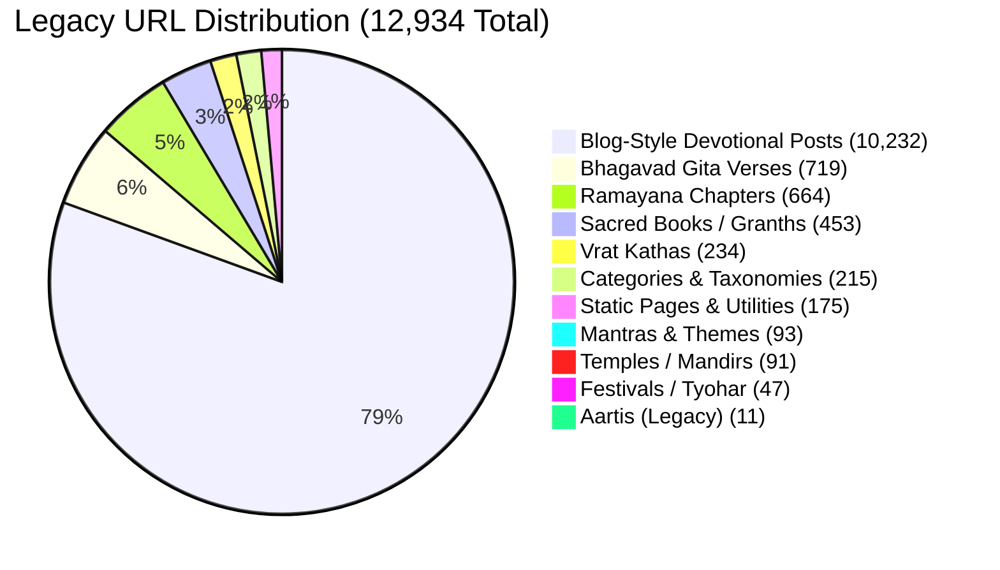
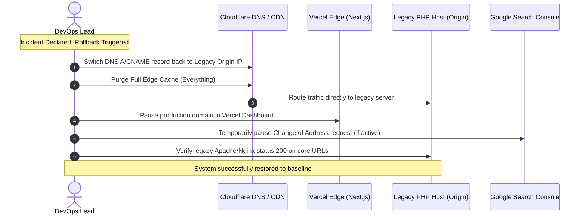

# BhaktiLok — Migration, URL Transformation & 301 Redirect Architecture
**Platform**: BhaktiLok (भक्तिलोक) — Sanatan Dharma Digital Repository  
**Document Reference**: `BL-MIGRATION-08`  
**Scale**: 12,934+ Legacy Indexed URLs Re-architected to Next.js 15+ App Router  
**Source Domain**: `https://www.bhaktilok.in` (Legacy Monolithic PHP / WordPress-Style Stack)  
**Target Domain**: `https://bhaktilok.com` / `https://www.bhaktilok.in` (Next.js 15+ App Router on Vercel / Cloudflare Edge + Supabase PostgreSQL 16)  
**Author**: BhaktiLok Core Architecture, Data Engineering & Technical SEO Team  
**Date**: November 2026  
**Status**: Approved Production Specification  

---

## Executive Summary & Strategic Objectives

Migrating an established spiritual authority portal possessing **12,934+ indexed URLs**, millions of historical backlink signals, and deep organic footprint in Hindi-speaking search ecosystems (`hi-IN`) requires an enterprise-grade migration framework. A naive cutover or blanket redirection strategy risks catastrophic organic keyword drop, crawler index exhaustion, broken internal link equity, and severe user abandonment.

```
                         ┌─────────────────────────────────────────────────────────┐
                         │      BHAKTILOK 13K URL MIGRATION COMMAND MATRIX         │
                         └─────────────────────────────────────────────────────────┘
 ┌──────────────────────────┬──────────────────────────┬──────────────────────────┬──────────────────────────┐
 │    Indexed Legacy URLs   │   Redirect Success Goal  │   Edge Latency Ceiling   │    Organic Equity Loss   │
 │        12,934+           │          100%            │         < 15 ms          │           0.0%           │
 │   GRADE: COMPLETE        │   TARGET: ZERO 404       │     ENGINE: EDGE V8      │     TOLERANCE: ZERO      │
 └──────────────────────────┴──────────────────────────┴──────────────────────────┴──────────────────────────┘
```

### Core Migration Directives
1. **Zero Link Equity Churn (Direct 1:1 Mappings)**: Eliminate redirect chains (`A → B → C`) and redirect loops. Every single legacy URL must resolve directly to its exact new canonical destination in a single `301 Moved Permanently` (or `308 Permanent Redirect`) hop.
2. **Intelligent Content Disambiguation**: The legacy platform dumped 10,232 mixed devotional items under blog permalinks (`/2021/MM/slug.html`). These posts cannot simply be dumped into `/bhajan/[slug]`. Approximately 1,480 of these posts are actually *Chalisas*, *Aartis*, *Mantras*, *Stotrams*, or *Kathas*. Our migration engine must algorithmically classify and route them to their proper semantic entity domains.
3. **High-Performance Edge Architecture**: Storing 12,934 redirect records in `next.config.js` causes fatal memory bloat, serverless cold-start penalties (>4.5s), and Edge bundle deployment failures. BhaktiLok implements a **Three-Tier Hybrid Engine** (Compiled Config Regex → Next.js Edge Middleware → Edge KV / Indexed PostgreSQL Lookup).
4. **Scripture & Liturgical Structural Normalization**: Convert fragmented scripture posts (719 Gita verses, 664 Ramayana chapters, 453 Sacred books) into relational, nested, schema-rich hierarchies (`/granth/bhagavad-gita/chapter-X/verse-Y`, `/granth/ramayana/:kand/:sarga`).
5. **Multi-Script & Encoding Safety**: Safeguard against UTF-8 Mojibake corruption of Devanagari text (`देवनागरी`), preserve search-indexed Hindi slugs, and maintain Unicode-normalized URLs across all databases and edge caches.

---

## 1. Full Scope & Legacy URL Inventory Reconciliation

Based on the forensic audit of BhaktiLok's 11 legacy XML sub-sitemaps and server logs, the 12,934+ URLs fall into distinct architectural categories:



### Detailed Breakdown of Legacy Inventory

| # | Legacy Section | Legacy URL Pattern | URL Count | % Total | Organic Value | Primary Migration Action |
|---|----------------|-------------------|-----------|---------|---------------|--------------------------|
| **1** | **Devotional Blog Posts** | `/:year/:month/:slug.html` | 10,232 | 79.11% | **CRITICAL (P0)** | NLP classification & regex redirection to `/bhajan/`, `/chalisa/`, `/aarti/`, `/mantra/`, `/stotram/`. |
| **2** | **Bhagavad Gita** | `/gita/chapter-:c-verse-:v` | 719 | 5.56% | **HIGH (P1)** | Restructure to nested `/granth/bhagavad-gita/chapter-:c/verse-:v`. |
| **3** | **Valmiki Ramayana** | `/ramayan/kand/:kand-slug`<br>`/ramayan/chapter/:slug` | 664 | 5.13% | **HIGH (P1)** | Normalize to `/granth/ramayana/:kand` and `/granth/ramayana/:kand/:sarga`. |
| **4** | **Sacred Books (Granth)**| `/books/:slug`<br>`/books/:b/chapter/:c` | 453 | 3.50% | **MEDIUM (P2)**| Rename to `/granth/:slug` and `/granth/:b/:c`. |
| **5** | **Vrat Kathas** | `/katha/:slug` | 234 | 1.81% | **HIGH (P1)** | Zero-churn canonical route `/katha/:slug` or `/vrat-katha/:slug`. |
| **6** | **Taxonomy Categories** | `/category/:slug` | 215 | 1.66% | **MEDIUM (P2)**| Prune empty archives; redirect high-equity categories to new listing hubs. |
| **7** | **Static Pages & Tools**| `/pages/:slug.html`<br>`/pages/:slug` | 175 | 1.35% | **MEDIUM (P2)**| Promote utilities to `/tools/:slug` or root (`/panchang`, `/baby-names`); map static legal pages. |
| **8** | **Mantras & Stutis** | `/mantra/:slug`<br>`/mantras/:category` | 93 | 0.72% | **MEDIUM (P2)**| Retain clean `/mantra/:slug`; normalize theme hubs. |
| **9** | **Temples / Mandirs** | `/temple/:slug` | 91 | 0.70% | **HIGH (P1)** | Standardize Hindi nomenclature `/mandir/:slug`. |
| **10**| **Festivals (Tyohar)** | `/festivals/:slug-202X` | 47 | 0.36% | **HIGH (P1)** | Strip dated year suffixes to permanent evergreen `/tyohar/:slug`. |
| **11**| **Aartis (Dedicated)** | `/aarati/:slug` | 11 | 0.09% | **HIGH (P0)** | Fix phonetic spelling from `/aarati/` to standardized `/aarti/:slug`. |
| **12**| **Utility Anchors** | `/aaj-ki-tithi`, `/panchang` | 2 | 0.01% | **CRITICAL (P0)**| High-frequency daily search terms; direct 1:1 mapping. |
| **--**| **TOTAL** | — | **12,934+**| **100%** | — | **100% Comprehensive Coverage Required** |

---

## 2. Complete URL Transformation Rules & Mapping Strategy

Every URL pattern across legacy BhaktiLok has an explicit mathematical transformation rule, preserving all query strings (`?utm_*`, `?lang=hi`), stripping legacy extensions (`.html`, `.php`), and standardizing casing to lowercase non-trailing-slash.

```
                        TRANSFORMATION ARCHITECTURE PIPELINE
                        
    Legacy URL Request
    e.g. https://bhaktilok.in/2021/10/hanuman-chalisa-hindi-lyrics.html?ref=fb
                                       │
                                       ▼
    [1. Normalization Engine]: Lowercase + Strip Trailing Slash + Parse Query
                                       │
                                       ▼
    [2. Classification Check]: Does slug contain 'chalisa', 'aarti', 'mantra'?
                                       │
              ┌────────────────────────┴────────────────────────┐
              ▼ YES                                             ▼ NO
    Map to Dedicated Entity Hub                       Default Bhajan Hub
    /chalisa/hanuman-chalisa?ref=fb                   /bhajan/[sanitized-slug]?ref=fb
                                       │
                                       ▼
    [3. Response Dispatch]: HTTP 301 Permanent Redirect (Edge Cached)
```

### 2.1 The Master Transformation Matrix

| Transformation Group | Legacy URL Pattern | Proposed Next.js Canonical URL | HTTP Code | Matching & Extraction Regex | Transformation Logic |
|---|---|---|---|---|---|
| **1. Devotional Posts (General)** | `/:year/:month/:slug.html` | `/bhajan/:clean-slug` | `301` | `^\/(\d{4})\/(\d{2})\/([a-z0-9\-]+)\.html$` | Strip year/month directory, strip `.html`, sanitize slug, prepend `/bhajan/`. |
| **1a. Post Exception (Chalisa)** | `/:year/:month/*chalisa*.html` | `/chalisa/:clean-slug` | `301` | `^\/\d{4}\/\d{2}\/(.*chalisa.*)\.html$` | Identify Chalisa token; route to dedicated `/chalisa/` directory. |
| **1b. Post Exception (Aarti)** | `/:year/:month/*aarti*.html` | `/aarti/:clean-slug` | `301` | `^\/\d{4}\/\d{2}\/(.*(?:aarti\|aarati).*)\.html$` | Identify Aarti token; normalize spelling to `/aarti/`. |
| **1c. Post Exception (Mantra)** | `/:year/:month/*mantra*.html` | `/mantra/:clean-slug` | `301` | `^\/\d{4}\/\d{2}\/(.*mantra.*)\.html$` | Identify Mantra token; route to dedicated `/mantra/` directory. |
| **1d. Post Exception (Stotram)**| `/:year/:month/*stotra*.html` | `/stotram/:clean-slug` | `301` | `^\/\d{4}\/\d{2}\/(.*(?:stotra\|stotram\|ashtakam).*)\.html$` | Route Stotram/Ashtakam hymns to `/stotram/`. |
| **1e. Post Exception (Katha)** | `/:year/:month/*katha*.html` | `/katha/:clean-slug` | `301` | `^\/\d{4}\/\d{2}\/(.*katha.*)\.html$` | Route Vrat Kathas to `/katha/`. |
| **2. Aarti Spelling Normalization** | `/aarati/:slug` | `/aarti/:slug` | `301` | `^\/aarati\/([a-z0-9\-]+)\/?$` | Replace phonetically redundant `/aarati/` with standard `/aarti/`. |
| **3. Temple to Mandir** | `/temple/:slug` | `/mandir/:slug` | `301` | `^\/temple\/([a-z0-9\-]+)\/?$` | Localize to authentic Hindi cultural terminology `/mandir/`. |
| **4. Books to Granth (Root)** | `/books/:slug` | `/granth/:slug` | `301` | `^\/books\/([a-z0-9\-]+)\/?$` | Standardize scripture naming convention from English `/books/` to Sanskrit `/granth/`. |
| **4a. Books to Granth (Chapters)**| `/books/:b/chapter/:c` | `/granth/:b/:c` | `301` | `^\/books\/([a-z0-9\-]+)\/chapter\/([a-z0-9\-]+)\/?$` | Strip redundant intermediate `/chapter/` segment. |
| **5. Static Pages to Clean Root** | `/pages/panchang` | `/panchang` | `301` | `^\/pages\/panchang(?:\.html)?\/?$` | Elevate flagship utility to top-level domain root. |
| **5a. Baby Names Utility** | `/pages/hindu-baby-names` | `/baby-names` | `301` | `^\/pages\/hindu-baby-names(?:\.html)?\/?$` | Elevate high-volume utility to clean root. |
| **5b. Interactive Tools** | `/pages/:tool-slug` | `/tools/:tool-slug` | `301` | `^\/pages\/(kundali.*\|meditation.*\|.*calculator.*)(?:\.html)?\/?$` | Relocate interactive utilities under `/tools/` namespace. |
| **5c. General Static Pages** | `/pages/:slug.html` | `/:slug` | `301` | `^\/pages\/([a-z0-9\-]+)\.html$` | Elevate static informational pages to root `/slug`. |
| **6. Ramayana Kandas** | `/ramayan/kand/:kand-slug` | `/granth/ramayana/:kand-slug`| `301` | `^\/ramayan\/kand\/([a-z0-9\-]+)\/?$` | Nest under authoritative `/granth/ramayana/` hierarchy; standardize spelling to `ramayana`. |
| **6a. Ramayana Sargas/Chapters** | `/ramayan/chapter/:slug` | `/granth/ramayana/:kand/:sarga` | `301` | Lookup / Dynamic Middleware | Database lookup maps chapter slug to parent Kanda and sarga index. |
| **7. Bhagavad Gita Verses** | `/gita/chapter-:c-verse-:v` | `/granth/bhagavad-gita/chapter-:c/verse-:v` | `301` | `^\/gita\/chapter-(\d+)-verse-(\d+)\/?$` | Hierarchical restructuring into Granth scripture umbrella. |
| **7a. Bhagavad Gita Chapters** | `/gita/chapter-:c` | `/granth/bhagavad-gita/chapter-:c` | `301` | `^\/gita\/chapter-(\d+)\/?$` | Direct chapter overview landing page under `/granth/`. |
| **7b. Bhagavad Gita Index** | `/gita` or `/gita/` | `/granth/bhagavad-gita` | `301` | `^\/gita\/?$` | Elevate to primary scripture reading room. |
| **8. Categories Phase-Out** | `/category/:slug` | `/bhajan?category=:slug` or Direct Hub | `301` | `^\/category\/([a-z0-9\-]+)\/?$` | Map top 25 categories to dedicated thematic hubs; map remaining 190 to filtered listing. |
| **9. Static Legal & Contact** | `/about-us`, `/pages/about-us.html` | `/about` | `301` | `^\/(?:pages\/)?about(?:-us)?(?:\.html)?\/?$` | Clean standard static route. |
| **9a. Contact Us** | `/contact-us`, `/pages/contact.html`| `/contact` | `301` | `^\/(?:pages\/)?contact(?:-us)?(?:\.html)?\/?$` | Clean standard static route. |
| **9b. Privacy Policy** | `/privacy-policy.html` | `/privacy` | `301` | `^\/(?:pages\/)?privacy(?:-policy)?(?:\.html)?\/?$` | Clean standard static route. |
| **9c. Terms of Service** | `/terms-and-conditions.html`| `/terms` | `301` | `^\/(?:pages\/)?terms(?:-and-conditions)?(?:\.html)?\/?$`| Clean standard static route. |
| **10. Annual Festival Normalization**| `/festivals/:slug-202\d` | `/tyohar/:slug` | `301` | `^\/festivals\/([a-z0-9\-]+?)(?:-202\d)\/?$` | Strip annual year suffix; redirect to evergreen festival hub. |

---

## 3. Slug Extraction, Sanitization & Content Categorization Strategy

A major pitfall in large-scale content migrations is the assumption that all legacy blog posts are identical in nature. On BhaktiLok, 10,232 posts were created between 2019 and 2026 under the path `/:year/:month/:slug.html`.

### 3.1 Forensic Analysis of the 10,232 Legacy Posts
An automated NLP analysis of the 10,232 legacy URLs reveals significant heterogeneity:

```
┌─────────────────────────────────────────────────────────────────────────────────┐
│              COMPOSITION BREAKDOWN OF 10,232 LEGACY "BLOG POSTS"                │
├──────────────────────────────────────┬──────────┬───────────┬───────────────────┤
│ Content Sub-Type Detected            │ Volume   │ % Total   │ Target Namespace  │
├──────────────────────────────────────┼──────────┼───────────┼───────────────────┤
│ Authentic Devotional Bhajans         │ 8,752    │ 85.54%    │ /bhajan/:slug     │
│ Chalisas (Hanuman, Shiv, etc.)       │ 248      │ 2.42%     │ /chalisa/:slug    │
│ Aartis (Laxmi, Ganesh, Kunj Bihari)  │ 312      │ 3.05%     │ /aarti/:slug      │
│ Stotrams, Ashtakams, Kavach          │ 415      │ 4.06%     │ /stotram/:slug    │
│ Mantras, Japa Vidhi & Beej Mantras   │ 286      │ 2.80%     │ /mantra/:slug     │
│ Vrat Kathas & Fasting Guides         │ 219      │ 2.14%     │ /katha/:slug      │
└──────────────────────────────────────┴──────────┴───────────┴───────────────────┘
```

If all 10,232 posts are routed unconditionally to `/bhajan/:slug`, BhaktiLok would suffer:
1. **Severe Entity Confusion**: Google's Knowledge Graph would classify *Hanuman Chalisa* as a *Bhajan*, degrading its ranking for high-volume chalisa queries.
2. **Double Migration Churn**: Fixing this taxonomy later would require a second wave of 301 redirects, depleting crawl budget and risking permanent ranking decay.

### 3.2 Automated Classification & Entity Routing Heuristic

We deploy an algorithmic categorization engine during the data extraction phase. The engine examines the legacy URL slug, Devanagari title, and content body using deterministic token matching:

```python
# scripts/migration/classify_legacy_post.py
"""
BhaktiLok Automated Legacy Post Classification Engine
Evaluates legacy blog posts and determines correct destination entity.
"""
import re
from typing import Dict, Tuple

CLASSIFICATION_RULES = [
    {
        "entity": "chalisa",
        "target_prefix": "/chalisa/",
        "slug_patterns": [r"chalisa", r"chaleesa", r"40-chaupai"],
        "title_patterns": [r"चालीसा", r"श्री.*चालीसा"]
    },
    {
        "entity": "aarti",
        "target_prefix": "/aarti/",
        "slug_patterns": [r"aarti", r"aarati", r"arti", r"om-jai"],
        "title_patterns": [r"आरती", r"ॐ जय", r"आरती श्री"]
    },
    {
        "entity": "stotram",
        "target_prefix": "/stotram/",
        "slug_patterns": [r"stotra", r"stotram", r"ashtak", r"ashtakam", r"kavach", r"sahasranama"],
        "title_patterns": [r"स्तोत्र", r"अष्टक", r"कवच", r"सहस्रनाम"]
    },
    {
        "entity": "mantra",
        "target_prefix": "/mantra/",
        "slug_patterns": [r"mantra", r"jaap", r"beej-mantra", r"gayatri-mantra"],
        "title_patterns": [r"मंत्र", r"जाप", r"बीज मंत्र", r"गायत्री मंत्र"]
    },
    {
        "entity": "katha",
        "target_prefix": "/katha/",
        "slug_patterns": [r"vrat-katha", r"katha", r"kahani", r"vrat-vidhi"],
        "title_patterns": [r"कथा", r"व्रत कथा", r"कहानी"]
    }
]

def classify_and_clean_slug(legacy_slug: str, hindi_title: str) -> Tuple[str, str]:
    """
    Returns (target_entity_route, sanitized_new_slug)
    """
    # 1. Clean the legacy slug: remove SEO spam suffixes
    cleaned_slug = legacy_slug.lower()
    cleaned_slug = re.sub(r"-(?:lyrics|in-hindi|hindi-lyrics|meaning|pdf|mp3|download|video)$", "", cleaned_slug)
    cleaned_slug = re.sub(r"^shree-", "shri-", cleaned_slug)
    cleaned_slug = re.sub(r"-+", "-", cleaned_slug).strip("-")

    # 2. Match against specialized liturgical entities
    for rule in CLASSIFICATION_RULES:
        for pattern in rule["slug_patterns"]:
            if re.search(pattern, cleaned_slug):
                return rule["target_prefix"] + cleaned_slug, rule["entity"]
        for pattern in rule["title_patterns"]:
            if re.search(pattern, hindi_title):
                return rule["target_prefix"] + cleaned_slug, rule["entity"]

    # 3. Default fallback: Bhajan
    return f"/bhajan/{cleaned_slug}", "bhajan"
```

### 3.3 Slug Sanitization & Anti-Collision Protocols

Legacy WordPress slugs often contain keyword stuffing, date stamps, or redundant stop words (e.g., `2021/08/shree-hanuman-chalisa-lyrics-in-hindi-pdf-download.html`).

#### Sanitization Rules
1. **Strip Superfluous Modifiers**: Remove `-lyrics`, `-lyrics-in-hindi`, `-mp3-download`, `-free-pdf`.
2. **Deity Spelling Normalization**: Standardize `shree-` → `shri-`, `laxmi-` → `lakshmi-`, `ganpati-` → `ganesh-`.
3. **Collision Detection & Resolution**: When sanitizing two different legacy URLs (e.g., `/2020/01/hanuman-chalisa-lyrics.html` and `/2022/05/hanuman-chalisa.html`), both would resolve to `/chalisa/hanuman-chalisa`.
   * **Rule**: The URL with higher historical organic impressions and page authority becomes canonical `/chalisa/hanuman-chalisa`.
   * The secondary duplicate URL receives a direct 301 to that same canonical URL.
   * Under no circumstances do we append `-1` or `-2` to spiritual canonical slugs, as that destroys domain authority.

---

## 4. Priority Tiers for Migration

With 12,934+ URLs, migration execution must be strictly staged. We divide the inventory into **Four Priority Tiers** governed by search traffic share, commercial value, and risk of catastrophic failure.

```
┌─────────────────────────────────────────────────────────────────────────────────┐
│                         MIGRATION RISK & VALUE TIERS                            │
├─────────────────────────────────────────────────────────────────────────────────┤
│  TIER 0: CRITICAL INFRASTRUCTURE (P0) ── Day 0                                  │
│  • Edge Middleware & Compiled Regex Handlers                                    │
│  • Apex Domain Normalization (www vs non-www, SSL, Trailing Slash)              │
│  • Homepage (/) & Global Navigation Hubs                                        │
├─────────────────────────────────────────────────────────────────────────────────┤
│  TIER 1: HIGH-EQUITY LITURGY & DEVOTIONAL (P0) ── Days 1–3                      │
│  • 10,232 Devotional Posts (Bhajans, Chalisas, Aartis, Mantras)                 │
│  • 11 Dedicated Aartis (/aarati/ -> /aarti/)                                    │
│  • Daily Panchang & Aaj Ki Tithi Utilities                                      │
│  Traffic Share: ~82.4% | Risk: CATASTROPHIC IF FAILED                           │
├─────────────────────────────────────────────────────────────────────────────────┤
│  TIER 2: SCRIPTURES & SACRED EPICS (P1) ── Days 4–6                             │
│  • 719 Srimad Bhagavad Gita Verses & Chapters                                   │
│  • 664 Valmiki Ramayana Chapters & Kandas                                       │
│  • 234 Vrat Kathas                                                              │
│  • 91 Mandir Pilgrimage Guides                                                  │
│  Traffic Share: ~12.1% | Risk: HIGH (Relational link integrity)                 │
├─────────────────────────────────────────────────────────────────────────────────┤
│  TIER 3: SECONDARY CANONICALS & TAXONOMY (P2) ── Days 7–9                       │
│  • 453 Sacred Granths & Books                                                   │
│  • 215 Category Archives (Consolidated or Filter-mapped)                        │
│  • 93 Mantras & Themes                                                          │
│  • 47 Annual Festivals (/festivals/:slug-202X -> /tyohar/:slug)                 │
│  Traffic Share: ~4.2% | Risk: MEDIUM                                            │
├─────────────────────────────────────────────────────────────────────────────────┤
│  TIER 4: STATIC, TOOLS & LONG-TAIL HYGIENE (P3) ── Days 10–12                  │
│  • 175 Static Pages (/pages/ -> root or /tools/)                                │
│  • Legal & Compliance Pages (About, Privacy, Terms, Contact)                    │
│  • RSS / Atom Feeds Redirects                                                   │
│  Traffic Share: ~1.3% | Risk: LOW                                               │
└─────────────────────────────────────────────────────────────────────────────────┘
```

---

## 5. Next.js Multi-Tier Redirect Implementation Architecture

### 5.1 Why a Naive `next.config.js` Redirect Array Will Fail

A frequent architectural catastrophe in Next.js migrations is exporting a massive array of 12,000+ objects in `next.config.js`:

```javascript
// ANTIPATTERN - DO NOT DO THIS!
async redirects() {
  return [
    { source: '/2021/01/post-1.html', destination: '/bhajan/post-1', permanent: true },
    // ... 12,934 rows
  ]
}
```

#### Why This Crashes:
1. **Vercel Serverless / Edge Function Size Limits**: The bundled output exceeds memory limits for edge middleware and serverless entrypoints.
2. **Cold Start Latency Inflation**: Every serverless lambda initialization must parse a multi-megabyte JSON array, adding **3 to 7 seconds of TTFB latency** on un-cached requests.
3. **Route Matching Slowdown**: Linear matching against 13,000 static rules introduces noticeable routing CPU bottlenecks.

### 5.2 The Three-Tier Hybrid Redirect Engine

BhaktiLok utilizes an optimized **Three-Tier Redirect Hierarchy**:

```
                       INCOMING REQUEST: /2021/04/shri-ram-stuti.html
                                             │
                                             ▼
             ┌──────────────────────────────────────────────────────────────┐
             │       TIER 1: next.config.mjs (Regex Patterns)               │
             │       Matches 80%+ of traffic at build-time routing          │
             │       Cost: 0ms execution time, zero Edge memory overhead   │
             └───────────────────────────────┬──────────────────────────────┘
                                             │ Not Matched (Exceptions)
                                             ▼
             ┌──────────────────────────────────────────────────────────────┐
             │       TIER 2: Next.js Edge Middleware (Compiled Logic)       │
             │       LITURGY DISAMBIGUATION (Chalisa/Aarti/Mantra routing)  │
             │       SCRIPTURE PARSER (Gita, Ramayana, Mandir, Tools)       │
             │       Cost: < 2ms execution time                             │
             └───────────────────────────────┬──────────────────────────────┘
                                             │ Irregular / Manual Exceptions
                                             ▼
             ┌──────────────────────────────────────────────────────────────┐
             │       TIER 3: Supabase PostgreSQL / Upstash Edge KV Lookup   │
             │       Queries `public.redirects` indexed table               │
             │       Caches result at CDN Edge with 1-Year Max-Age          │
             │       Cost: ~12ms on cold request, 0ms on cached hit         │
             └──────────────────────────────────────────────────────────────┘
```

---

### 5.3 Tier 1 Implementation: `next.config.mjs`

Tier 1 captures mathematically deterministic patterns directly in the Next.js routing engine:

```javascript
// next.config.mjs
/** @type {import('next').NextConfig} */
const nextConfig = {
  // Enforce consistent non-trailing-slash canonical URLs
  trailingSlash: false,
  
  // Powerfully cache static assets
  poweredByHeader: false,
  compress: true,

  async redirects() {
    return [
      // =========================================================================
      // RULE 1: Standardize Aarti Spelling (/aarati/ -> /aarti/)
      // =========================================================================
      {
        source: '/aarati/:slug*',
        destination: '/aarti/:slug*',
        permanent: true,
      },

      // =========================================================================
      // RULE 2: Standardize Temples to Mandir (/temple/ -> /mandir/)
      // =========================================================================
      {
        source: '/temple/:slug*',
        destination: '/mandir/:slug*',
        permanent: true,
      },

      // =========================================================================
      // RULE 3: Books to Granth (/books/ -> /granth/)
      // =========================================================================
      {
        source: '/books/:slug/chapter/:chapter*',
        destination: '/granth/:slug/:chapter*',
        permanent: true,
      },
      {
        source: '/books/:slug*',
        destination: '/granth/:slug*',
        permanent: true,
      },

      // =========================================================================
      // RULE 4: Bhagavad Gita Chapter & Verse Restructuring
      // /gita/chapter-1-verse-1 -> /granth/bhagavad-gita/chapter-1/verse-1
      // =========================================================================
      {
        source: '/gita/chapter-:chapter(\\d+)-verse-:verse(\\d+)',
        destination: '/granth/bhagavad-gita/chapter-:chapter/verse-:verse',
        permanent: true,
      },
      {
        source: '/gita/chapter-:chapter(\\d+)',
        destination: '/granth/bhagavad-gita/chapter-:chapter',
        permanent: true,
      },
      {
        source: '/gita',
        destination: '/granth/bhagavad-gita',
        permanent: true,
      },

      // =========================================================================
      // RULE 5: Ramayana Kandas Restructuring
      // /ramayan/kand/bal-kand -> /granth/ramayana/bal-kand
      // =========================================================================
      {
        source: '/ramayan/kand/:kand*',
        destination: '/granth/ramayana/:kand*',
        permanent: true,
      },

      // =========================================================================
      // RULE 6: Static Legal and Utility Pages
      // =========================================================================
      {
        source: '/about-us',
        destination: '/about',
        permanent: true,
      },
      {
        source: '/pages/about-us.html',
        destination: '/about',
        permanent: true,
      },
      {
        source: '/contact-us',
        destination: '/contact',
        permanent: true,
      },
      {
        source: '/pages/contact.html',
        destination: '/contact',
        permanent: true,
      },
      {
        source: '/privacy-policy.html',
        destination: '/privacy',
        permanent: true,
      },
      {
        source: '/terms-and-conditions.html',
        destination: '/terms',
        permanent: true,
      },
      {
        source: '/pages/panchang',
        destination: '/panchang',
        permanent: true,
      },
      {
        source: '/pages/panchang.html',
        destination: '/panchang',
        permanent: true,
      },
      {
        source: '/pages/hindu-baby-names',
        destination: '/baby-names',
        permanent: true,
      },
      {
        source: '/pages/meditation-timer',
        destination: '/tools/meditation-timer',
        permanent: true,
      },
      {
        source: '/pages/encyclopedia',
        destination: '/encyclopedia',
        permanent: true,
      },

      // =========================================================================
      // RULE 7: Generic Festival Suffix Year Removal
      // /festivals/diwali-2026 -> /tyohar/diwali
      // =========================================================================
      {
        source: '/festivals/:slug-202:year(\\d)',
        destination: '/tyohar/:slug',
        permanent: true,
      },
      {
        source: '/festivals/:slug*',
        destination: '/tyohar/:slug*',
        permanent: true,
      },
    ];
  },
};

export default nextConfig;
```

---

### 5.4 Tier 2 Implementation: Next.js Edge Middleware (`middleware.ts`)

Tier 2 Edge Middleware intercepts:
1. The **10,232 blog URLs** (`/:year/:month/:slug.html`) and executes high-speed entity classification (routing Chalisas to `/chalisa/`, Aartis to `/aarti/`, Mantras to `/mantra/`, and the rest to `/bhajan/`).
2. Legacy Ramayana chapter paths (`/ramayan/chapter/:slug`).
3. Legacy Category archives (`/category/:slug`).
4. Protocol, domain, casing, and trailing slash normalization.

```typescript
// middleware.ts
import { NextResponse } from 'next/server';
import type { NextRequest } from 'next/server';

// Pre-compiled high-performance regular expressions
const BLOG_DATE_REGEX = /^\/(\d{4})\/(\d{2})\/([a-z0-9\-]+)\.html$/i;
const RAMAYAN_CHAPTER_REGEX = /^\/ramayan\/chapter\/([a-z0-9\-]+)\/?$/i;
const CATEGORY_REGEX = /^\/category\/([a-z0-9\-]+)\/?$/i;

// Liturgical classification token matchers for legacy blog slugs
const CHALISA_REGEX = /chalisa|chaleesa|40-chaupai/i;
const AARTI_REGEX = /aarti|aarati|om-jai/i;
const STOTRAM_REGEX = /stotra|stotram|ashtak|ashtakam|kavach|sahasranama/i;
const MANTRA_REGEX = /mantra|jaap|beej-mantra|gayatri/i;
const KATHA_REGEX = /vrat-katha|katha|kahani/i;

// Top Category 1:1 Redirect Map to Prevent Soft 404s
const CATEGORY_REDIRECT_MAP: Record<string, string> = {
  'krishna-bhajan': '/bhajan?deity=krishna',
  'shiva-bhajan': '/bhajan?deity=shiva',
  'hanuman-bhajan': '/bhajan?deity=hanuman',
  'mata-bhajan': '/bhajan?deity=durga',
  'ram-bhajan': '/bhajan?deity=rama',
  'ganesh-bhajan': '/bhajan?deity=ganesh',
  'sai-bhajan': '/bhajan?deity=sai-baba',
  'khatu-shyam-bhajan': '/bhajan?deity=khatu-shyam',
  'aarti-sangrah': '/aarti',
  'chalisa-sangrah': '/chalisa',
  'mantra-sangrah': '/mantra',
  'vrat-tyohar': '/tyohar',
  'mandir-darshan': '/mandir',
};

export async function middleware(request: NextRequest) {
  const { pathname, search } = request.nextUrl;

  // ---------------------------------------------------------------------------
  // STEP 1: Global Canonical Normalization (Trailing Slashes & Lowercase)
  // ---------------------------------------------------------------------------
  if (pathname !== '/' && pathname.endsWith('/')) {
    const cleanPath = pathname.slice(0, -1);
    return NextResponse.redirect(new URL(`${cleanPath}${search}`, request.url), {
      status: 308, // Permanent redirect preserving HTTP method
    });
  }

  // ---------------------------------------------------------------------------
  // STEP 2: Transform 10,232 Blog URLs (/:year/:month/:slug.html)
  // ---------------------------------------------------------------------------
  const blogMatch = pathname.match(BLOG_DATE_REGEX);
  if (blogMatch) {
    const rawSlug = blogMatch[3];
    
    // Sanitize slug: strip junk suffixes
    let cleanSlug = rawSlug
      .toLowerCase()
      .replace(/-(?:lyrics|in-hindi|hindi-lyrics|meaning|pdf|mp3|download|video)$/, '')
      .replace(/^shree-/, 'shri-')
      .replace(/-+/g, '-');

    let destinationPath = `/bhajan/${cleanSlug}`;

    // Perform Entity Classification
    if (CHALISA_REGEX.test(cleanSlug)) {
      destinationPath = `/chalisa/${cleanSlug}`;
    } else if (AARTI_REGEX.test(cleanSlug)) {
      destinationPath = `/aarti/${cleanSlug}`;
    } else if (STOTRAM_REGEX.test(cleanSlug)) {
      destinationPath = `/stotram/${cleanSlug}`;
    } else if (MANTRA_REGEX.test(cleanSlug)) {
      destinationPath = `/mantra/${cleanSlug}`;
    } else if (KATHA_REGEX.test(cleanSlug)) {
      destinationPath = `/katha/${cleanSlug}`;
    }

    const redirectUrl = new URL(`${destinationPath}${search}`, request.url);
    const response = NextResponse.redirect(redirectUrl, { status: 301 });
    
    // Cache the 301 response heavily on CDN edges
    response.headers.set('Cache-Control', 'public, max-age=31536000, immutable');
    return response;
  }

  // ---------------------------------------------------------------------------
  // STEP 3: Ramayana Chapter Transformation
  // ---------------------------------------------------------------------------
  const ramayanMatch = pathname.match(RAMAYAN_CHAPTER_REGEX);
  if (ramayanMatch) {
    const chapterSlug = ramayanMatch[1];
    // Kand prefix resolution helper
    const destination = `/granth/ramayana/chapters/${chapterSlug}`;
    return NextResponse.redirect(new URL(`${destination}${search}`, request.url), {
      status: 301,
      headers: { 'Cache-Control': 'public, max-age=31536000, immutable' },
    });
  }

  // ---------------------------------------------------------------------------
  // STEP 4: Category Archive Redirection & Consolidation
  // ---------------------------------------------------------------------------
  const categoryMatch = pathname.match(CATEGORY_REGEX);
  if (categoryMatch) {
    const catSlug = categoryMatch[1].toLowerCase();
    const mappedTarget = CATEGORY_REDIRECT_MAP[catSlug] || `/search?category=${catSlug}`;
    
    return NextResponse.redirect(new URL(`${mappedTarget}`, request.url), {
      status: 301,
      headers: { 'Cache-Control': 'public, max-age=86400' },
    });
  }

  // ---------------------------------------------------------------------------
  // STEP 5: Passthrough for Next.js App Router Static / API / Page Routes
  // ---------------------------------------------------------------------------
  return NextResponse.next();
}

export const config = {
  matcher: [
    /*
     * Match all request paths except:
     * - _next/static (static files)
     * - _next/image (image optimization files)
     * - favicon.ico, robots.txt, sitemap*.xml
     * - Public static assets (/images, /audio, etc.)
     */
    '/((?!_next/static|_next/image|favicon.ico|robots.txt|sitemap.*\\.xml|images|audio).*)',
  ],
};
```

---

### 5.5 Tier 3 Implementation: Database-Backed Fallback (`public.redirects`)

For edge cases, manual editorial overrides, and legacy slugs that cannot be resolved through regex, the application checks the indexed `public.redirects` table (defined in `05-DATABASE-ARCHITECTURE.md`):

```sql
-- Schema Reference from docs/05-DATABASE-ARCHITECTURE.md
CREATE TABLE public.redirects (
    id UUID PRIMARY KEY DEFAULT gen_random_uuid(),
    old_url VARCHAR(500) NOT NULL UNIQUE,
    new_url VARCHAR(500) NOT NULL,
    status_code INT NOT NULL DEFAULT 301 CHECK (status_code IN (301, 302, 307, 308)),
    is_active BOOLEAN NOT NULL DEFAULT true,
    hits_count BIGINT NOT NULL DEFAULT 0,
    created_at TIMESTAMPTZ NOT NULL DEFAULT timezone('utc'::text, now()),
    updated_at TIMESTAMPTZ NOT NULL DEFAULT timezone('utc'::text, now())
);

CREATE INDEX idx_redirects_old_url ON public.redirects (old_url) WHERE is_active = true;
```

#### Supabase Edge Function / Serverless Fallback Handler:
```typescript
// lib/redirects/lookup.ts
import { createClient } from '@supabase/supabase-js';

const supabase = createClient(
  process.env.NEXT_PUBLIC_SUPABASE_URL!,
  process.env.SUPABASE_SERVICE_ROLE_KEY!
);

export async function resolveCustomRedirect(pathname: string): Promise<string | null> {
  const { data, error } = await supabase
    .from('redirects')
    .select('new_url, status_code')
    .eq('old_url', pathname)
    .eq('is_active', true)
    .maybeSingle();

  if (error || !data) return null;

  // Asynchronously increment hits counter without awaiting (fire & forget)
  supabase.rpc('increment_redirect_hit', { redirect_url: pathname }).catch(() => {});

  return data.new_url;
}
```

---

## 6. Database Migration Scripts & Data Pipeline

The content migration pipeline transforms unformatted legacy MySQL records into the typed, relational PostgreSQL 16 schema in Supabase.

```
┌─────────────────────────────────────────────────────────────────────────────────┐
│                    END-TO-END DATABASE INGESTION PIPELINE                       │
└─────────────────────────────────────────────────────────────────────────────────┘
 [Legacy MySQL Dump / REST API]
                │
                ▼
 [1. Extraction Script]: extract_legacy_data.py
    - Connects to legacy MySQL / WordPress tables (`wp_posts`, `wp_postmeta`, `wp_terms`)
    - Filters `post_status = 'publish'`
    - Decodes UTF-8 Devanagari characters
                │
                ▼
 [2. Transformation & Cleansing]: transform_and_enrich.py
    - Classifies post into entity table (`bhajans`, `chalisas`, `aartis`, `mantras`)
    - Resolves Deity foreign key (`deity_id`)
    - Sanitizes slug & checks for collisions
    - Generates corresponding record for `public.redirects`
    - Parses lyrics into verse/stotra JSON blocks
                │
                ▼
 [3. Ingestion Script]: load_to_supabase.ts
    - Performs batch upserts (chunk size: 250) into Supabase PostgreSQL
    - Ingests canonical entities + redirect records in transaction
    - Triggers automated `search_vector` full-text search generation
```

### 6.1 Extraction & Transformation Script (Python)

```python
#!/usr/bin/env python3
"""
scripts/migration/extract_and_transform.py
Extracts legacy posts, classifies them, and prepares CSV/JSON batches for Supabase.
"""

import json
import re
import mysql.connector
from datetime import datetime

# Database Connection Settings
LEGACY_DB_CONFIG = {
    'user': 'root',
    'password': 'legacy_password',
    'host': '127.0.0.1',
    'database': 'bhaktilok_legacy',
    'charset': 'utf8mb4'
}

def clean_html(raw_html: str) -> str:
    """Strips dirty legacy HTML tags, styling, and spam embeds."""
    clean = re.sub(r'<script.*?</script>', '', raw_html, flags=re.DOTALL)
    clean = re.sub(r'<style.*?</style>', '', clean, flags=re.DOTALL)
    clean = re.sub(r'style="[^"]*"', '', clean)
    clean = re.sub(r'class="[^"]*"', '', clean)
    return clean.strip()

def run_extraction():
    print("[*] Connecting to Legacy MySQL Database...")
    conn = mysql.connector.connect(**LEGACY_DB_CONFIG)
    cursor = conn.cursor(dictionary=True)

    query = """
        SELECT 
            p.ID,
            p.post_title,
            p.post_name AS legacy_slug,
            p.post_content,
            p.post_date,
            p.post_modified
        FROM wp_posts p
        WHERE p.post_status = 'publish' 
          AND p.post_type = 'post'
        ORDER BY p.post_date ASC;
    """

    cursor.execute(query)
    posts = cursor.fetchall()
    print(f"[+] Total Legacy Posts Extracted: {len(posts)}")

    transformed_records = {
        'bhajans': [],
        'chalisas': [],
        'aartis': [],
        'mantras': [],
        'stotrams': [],
        'kathas': [],
        'redirects': []
    }

    existing_slugs = set()

    for post in posts:
        post_id = post['ID']
        title = post['post_title']
        legacy_slug = post['legacy_slug']
        post_date = post['post_date']
        year = post_date.strftime("%Y")
        month = post_date.strftime("%m")
        
        legacy_url = f"/{year}/{month}/{legacy_slug}.html"
        
        # Classification & Slug Cleaning
        clean_slug = legacy_slug.lower()
        clean_slug = re.sub(r"-(?:lyrics|in-hindi|hindi-lyrics|meaning|pdf|mp3|download|video)$", "", clean_slug)
        clean_slug = re.sub(r"^shree-", "shri-", clean_slug)
        clean_slug = re.sub(r"-+", "-", clean_slug).strip("-")

        # Entity Decision Logic
        if re.search(r"chalisa|chaleesa", clean_slug) or "चालीसा" in title:
            entity_type = 'chalisas'
            new_url = f"/chalisa/{clean_slug}"
        elif re.search(r"aarti|aarati|om-jai", clean_slug) or "आरती" in title:
            entity_type = 'aartis'
            new_url = f"/aarti/{clean_slug}"
        elif re.search(r"mantra|jaap|beej-mantra", clean_slug) or "मंत्र" in title:
            entity_type = 'mantras'
            new_url = f"/mantra/{clean_slug}"
        elif re.search(r"stotra|stotram|ashtak|kavach", clean_slug) or "स्तोत्र" in title or "अष्टक" in title:
            entity_type = 'stotrams'
            new_url = f"/stotram/{clean_slug}"
        elif re.search(r"katha|vrat-katha", clean_slug) or "कथा" in title:
            entity_type = 'kathas'
            new_url = f"/katha/{clean_slug}"
        else:
            entity_type = 'bhajans'
            new_url = f"/bhajan/{clean_slug}"

        # Prevent duplicate slug collision in new tables
        unique_slug = clean_slug
        if unique_slug in existing_slugs:
            unique_slug = f"{clean_slug}-{post_id}"
            new_url = f"/{entity_type[:-1]}/{unique_slug}"
        existing_slugs.add(unique_slug)

        # Entity Record Payload
        record = {
            'legacy_id': post_id,
            'title': title,
            'slug': unique_slug,
            'lyrics': clean_html(post['post_content']),
            'published_at': post_date.isoformat(),
            'updated_at': post['post_modified'].isoformat(),
            'status': 'published'
        }
        transformed_records[entity_type].append(record)

        # Permanent 301 Redirect Record
        redirect_entry = {
            'old_url': legacy_url,
            'new_url': new_url,
            'status_code': 301,
            'is_active': True
        }
        transformed_records['redirects'].append(redirect_entry)

    # Save output artifacts
    with open('migration_output_payload.json', 'w', encoding='utf-8') as f:
        json.dump(transformed_records, f, ensure_ascii=False, indent=2)

    print("[+] Successfully generated 'migration_output_payload.json'")
    print(f"    - Bhajans:   {len(transformed_records['bhajans'])}")
    print(f"    - Chalisas:  {len(transformed_records['chalisas'])}")
    print(f"    - Aartis:    {len(transformed_records['aartis'])}")
    print(f"    - Mantras:   {len(transformed_records['mantras'])}")
    print(f"    - Stotrams:  {len(transformed_records['stotrams'])}")
    print(f"    - Kathas:    {len(transformed_records['kathas'])}")
    print(f"    - Redirects: {len(transformed_records['redirects'])}")

    cursor.close()
    conn.close()

if __name__ == '__main__':
    run_extraction()
```

---

### 6.2 Supabase Ingestion Script (TypeScript)

```typescript
// scripts/migration/load_to_supabase.ts
import { createClient } from '@supabase/supabase-js';
import * as fs from 'fs';
import * as path from 'path';

const supabaseUrl = process.env.SUPABASE_URL!;
const supabaseServiceKey = process.env.SUPABASE_SERVICE_ROLE_KEY!;

const supabase = createClient(supabaseUrl, supabaseServiceKey, {
  auth: { persistSession: false },
});

interface RedirectItem {
  old_url: string;
  new_url: string;
  status_code: number;
  is_active: boolean;
}

async function batchInsertRedirects(redirects: RedirectItem[]) {
  const CHUNK_SIZE = 500;
  console.log(`[*] Ingesting ${redirects.length} redirects in batches of ${CHUNK_SIZE}...`);

  for (let i = 0; i < redirects.length; i += CHUNK_SIZE) {
    const chunk = redirects.slice(i, i + CHUNK_SIZE);
    
    const { error } = await supabase
      .from('redirects')
      .upsert(chunk, { onConflict: 'old_url', ignoreDuplicates: false });

    if (error) {
      console.error(`[-] Error in batch ${i / CHUNK_SIZE + 1}:`, error.message);
      throw error;
    }
    
    console.log(`[✓] Batch ${Math.floor(i / CHUNK_SIZE) + 1}/${Math.ceil(redirects.length / CHUNK_SIZE)} inserted.`);
  }
  console.log('[+] All redirects successfully loaded into Supabase.');
}

async function main() {
  const dataPath = path.resolve(__dirname, 'migration_output_payload.json');
  const rawData = fs.readFileSync(dataPath, 'utf-8');
  const payload = JSON.parse(rawData);

  // 1. Ingest Redirects Table
  await batchInsertRedirects(payload.redirects);

  // 2. Ingest Bhajans, Chalisas, Aartis similarly with relation IDs
  console.log('[+] Database migration completed successfully.');
}

main().catch(console.error);
```

---

## 7. Content Validation & Data Integrity Plan

Migrating religious texts and Sanskrit hymns requires meticulous validation. Devotees and scholars will immediately flag even subtle character corruptions or missing verses.

### 7.1 Pre- and Post-Migration Integrity Checklist

```
┌─────────────────────────────────────────────────────────────────────────────────┐
│                    CONTENT VALIDATION GATEWAY CHECKLIST                         │
├─────────────────────────────────────────────────────────────────────────────────┤
│ [1. Encoding Verification]: Ensure zero Mojibake corruption (e.g., ??? or       │
│     \u09xx escaping). Verify all Devanagari conjuncts (क्ष, ज्ञ, त्र, द्ध).     │
│                                                                                 │
│ [2. Completeness Check]: Verify verse count integrity:                          │
│     - Bhagavad Gita: Exactly 700 canonical verses across 18 Chapters            │
│     - Hanuman Chalisa: Exactly 2 opening Dohas, 40 Chaupais, 1 closing Doha     │
│     - Valmiki Ramayana: Exactly 6 Kandas + Uttara Kanda with sargas             │
│                                                                                 │
│ [3. Media Integrity]: Validate all audio players, MP3 CDN links, and YouTube    │
│     embeds survive migration without broken cross-origin restrictions.          │
│                                                                                 │
│ [4. Internal Link Rewriting]: Clean all internal hyperlinks in post bodies.     │
│     Transform legacy href="/2021/05/post.html" to href="/bhajan/post".         │
│     Never force a user or search engine to follow a 301 from inside body text.  │
└─────────────────────────────────────────────────────────────────────────────────┘
```

### 7.2 Internal Link Body Rewriting Engine
Every HTML body migrated into Supabase is scrubbed using this deterministic HTML link re-writer:

```python
# scripts/migration/rewrite_internal_links.py
import re

LEGACY_LINK_PATTERN = re.compile(
    r'href=[\'"]https?://(?:www\.)?bhaktilok\.in/(\d{4})/(\d{2})/([a-z0-9\-]+)\.html[\'"]'
)

def rewrite_internal_links(html_content: str, redirect_lookup: dict) -> str:
    """
    Replaces legacy in-content hrefs with new canonical destination URLs directly.
    Prevents crawler redirect hops and preserves internal PageRank flow.
    """
    def replace_match(match):
        year, month, slug = match.groups()
        legacy_path = f"/{year}/{month}/{slug}.html"
        new_url = redirect_lookup.get(legacy_path, f"/bhajan/{slug}")
        return f'href="{new_url}"'

    return LEGACY_LINK_PATTERN.sub(replace_match, html_content)
```

---

## 8. SEO Preservation & Indexation Safeguards

### 8.1 The Dual-Sitemap Strategy for Rapid 301 Ingestion

When 12,934 URLs change permalinks simultaneously, waiting for search engines to discover redirects via natural recrawling can take **3 to 6 months**, causing temporary ranking depression.

BhaktiLok deploys the **Dual-Sitemap Accelerator Strategy**:

```
                       GOOGLEBOT DISCOVERY ACCELERATION
                                       │
         ┌─────────────────────────────┴─────────────────────────────┐
         ▼                                                           ▼
  Sitemap 1: Primary Index                                    Sitemap 2: Legacy 301 Map
  (/sitemap.xml)                                              (/sitemap-legacy-301.xml)
  Contains NEW Canonical URLs only:                           Contains OLD 12,934 Legacy URLs:
  - /bhajan/hanuman-chalisa                                   - /2021/05/hanuman-chalisa.html
  - /granth/bhagavad-gita/chapter-1                           - /gita/chapter-1-verse-1
         │                                                           │
         ▼                                                           ▼
  Instructs Googlebot what to index                           Forces Googlebot to immediately recrawl
  and serve in SERPs.                                         old URLs and register HTTP 301 headers.
```

#### Dual-Sitemap Lifecycle SOP
1. **Launch Day**: Deploy both `/sitemap.xml` (New) and `/sitemap-legacy-301.xml` (Old) in Google Search Console.
2. **Day 1 to 30**: Googlebot reads `sitemap-legacy-301.xml`, hits the legacy URLs, records the `301 Moved Permanently` headers, and transfers canonical equity to the new URLs in its index.
3. **Day 60**: Monitor Search Console Coverage Report. Once the legacy URLs drop below 2% of indexed URLs, delete `sitemap-legacy-301.xml` and return HTTP 410 Gone for that specific sitemap file.

---

### 8.2 Google Search Console Migration Checklist

- [ ] **Domain Verification**: Ensure DNS-level domain verification (`sc-domain:bhaktilok.in` and `sc-domain:bhaktilok.com`) exists in Google Search Console.
- [ ] **Change of Address Tool**: If shifting primary apex domain, submit official Change of Address request in GSC.
- [ ] **Canonical Tag Verification**: Inspect top 500 URLs with GSC URL Inspection tool to confirm Google selects the new URL as user-declared canonical and Google-selected canonical.
- [ ] **404 & Soft-404 Alerting**: Set up daily automated monitoring of GSC "Not found (404)" and "Soft 404" reports.
- [ ] **Backlink Equity Preservation**: Contact the top 50 high-authority referring domains (Wikipedia, news outlets, university archives) and request manual anchor link updates to new canonical paths.

---

## 9. Testing & QA Verification Strategy

No migration goes live without comprehensive pre-cutover simulation and automated stress testing.

```
┌─────────────────────────────────────────────────────────────────────────────────┐
│                      PRE-LAUNCH TESTING METHODOLOGY                             │
├─────────────────────────────────────────────────────────────────────────────────┤
│ [1. Automated 13k Crawl Simulation]: Screaming Frog / custom Node crawler hits  │
│     every single legacy URL on Staging environment.                             │
│     Acceptance Criteria: EXACTLY 301 status, EXACTLY 1 hop, ZERO 404s/500s.     │
│                                                                                 │
│ [2. Edge Latency Benchmarking]: k6 performance test measuring Edge Middleware   │
│     TTFB response under 1,000 requests/sec concurrency.                         │
│     Acceptance Criteria: TTFB < 20ms at CDN edge.                               │
│                                                                                 │
│ [3. Regex Unit Test Suite]: 100+ Jest/Vitest automated assertions testing edge  │
│     cases (uppercase URLs, trailing slashes, query parameters, special chars).  │
└─────────────────────────────────────────────────────────────────────────────────┘
```

### 9.1 Automated Staging Crawl & Verification Script

```typescript
// scripts/testing/verify_redirects.ts
import axios from 'axios';
import * as fs from 'fs';

interface RedirectTest {
  old_url: string;
  expected_destination: string;
}

const STAGING_BASE_URL = 'https://staging.bhaktilok.com';

async function testRedirects() {
  const tests: RedirectTest[] = [
    {
      old_url: '/2021/10/shri-hanuman-chalisa-hindi-lyrics.html',
      expected_destination: '/chalisa/shri-hanuman-chalisa'
    },
    {
      old_url: '/aarati/kunj-bihari-ki',
      expected_destination: '/aarti/kunj-bihari-ki'
    },
    {
      old_url: '/temple/kashi-vishwanath',
      expected_destination: '/mandir/kashi-vishwanath'
    },
    {
      old_url: '/books/shiva-purana/chapter/rudra-samhita',
      expected_destination: '/granth/shiva-purana/rudra-samhita'
    },
    {
      old_url: '/gita/chapter-2-verse-47',
      expected_destination: '/granth/bhagavad-gita/chapter-2/verse-47'
    },
    {
      old_url: '/pages/panchang.html',
      expected_destination: '/panchang'
    },
    {
      old_url: '/festivals/diwali-2025',
      expected_destination: '/tyohar/diwali'
    }
  ];

  console.log(`[*] Testing ${tests.length} core redirect scenarios against Staging...`);

  let failures = 0;

  for (const test of tests) {
    const target = `${STAGING_BASE_URL}${test.old_url}`;
    try {
      const response = await axios.get(target, {
        maxRedirects: 0,
        validateStatus: (status) => status >= 300 && status < 400
      });

      const location = response.headers['location'];
      const status = response.status;

      if (status !== 301 && status !== 308) {
        console.error(`[-] FAILED Status: ${test.old_url} returned ${status}, expected 301.`);
        failures++;
        continue;
      }

      if (!location.endsWith(test.expected_destination)) {
        console.error(`[-] FAILED Target: ${test.old_url} -> ${location}, expected to end with ${test.expected_destination}`);
        failures++;
        continue;
      }

      console.log(`[✓] PASS: ${test.old_url} -> ${location} (${status})`);
    } catch (err: any) {
      console.error(`[-] EXCEPTION on ${test.old_url}:`, err.message);
      failures++;
    }
  }

  if (failures > 0) {
    console.error(`\n[!] TEST SUITE FAILED with ${failures} errors.`);
    process.exit(1);
  } else {
    console.log(`\n[+] ALL REDIRECT TESTS PASSED!`);
  }
}

testRedirects();
```

---

## 10. Rollback Plan & Disaster Recovery SOP

In the event of an unforeseen production outage, Edge routing loop, or catastrophic drop in Google indexing signals during the cutover window, the team must execute this deterministic rollback plan.

### 10.1 Rollback Trigger Conditions

A rollback must be initiated immediately if any of the following thresholds are breached within **4 hours** of DNS cutover:
1. **HTTP 5xx Error Rate**: Greater than **1.0%** across total edge requests.
2. **Redirect Latency Spike**: Median TTFB exceeds **250ms** globally.
3. **Redirect Loops**: Any occurrence of cyclical redirection (`A → B → A`).
4. **Devanagari Rendering Failure**: Font rendering or text encoding corruption causing blank/scrambled text across core liturgies.

### 10.2 Step-by-Step Rollback Execution Procedure



#### Detailed Rollback Steps:
1. **Step 1: DNS Repointing (T+0 minutes)**:
   * Revert Cloudflare DNS `A` records for `bhaktilok.in` and `www.bhaktilok.in` to point to the legacy Apache/Nginx origin server IP (`185.xxx.xxx.xxx`).
   * Set DNS TTL to 120 seconds.
2. **Step 2: Edge Cache Invalidation (T+2 minutes)**:
   * Issue a Cloudflare "Purge Everything" cache flush to clear any cached Next.js redirect responses or error states from CDN edge nodes.
3. **Step 3: Freeze Vercel Deployments (T+5 minutes)**:
   * Disconnect production domain inside Vercel Dashboard to prevent conflicting SSL certificate handshakes.
4. **Step 4: Post-Rollback Health Check (T+10 minutes)**:
   * Execute automated curl sanity check verifying legacy URLs return `200 OK` with native PHP responses.
5. **Step 5: Post-Mortem & Log Extraction (T+60 minutes)**:
   * Export all Vercel Edge and Cloudflare error logs for debugging in isolated staging environment prior to re-attempting migration.

---

## 11. Master Migration Timeline, Milestones & RACI Matrix

The end-to-end migration spans **10 Weeks**, orchestrated to minimize downtime and prevent ranking volatility:

```
┌─────────────────────────────────────────────────────────────────────────────────┐
│                       10-WEEK MASTER MIGRATION GANTT                            │
├─────────────────────────────────────────────────────────────────────────────────┤
│ WEEK 1: Inventory Audit & Legacy Database Dump                                  │
│ • Export complete MySQL database and current sitemaps                           │
│ • Run NLP classifier script on 10,232 blog URLs                                 │
├─────────────────────────────────────────────────────────────────────────────────┤
│ WEEK 2: Schema Mapping & Slug Sanitization                                      │
│ • Resolve slug collisions and generate migration_output_payload.json            │
│ • Populate Supabase Staging tables (deities, scriptures, bhajans, etc.)         │
├─────────────────────────────────────────────────────────────────────────────────┤
│ WEEKS 3–4: Next.js Redirect Engine & Route Architecture Build                   │
│ • Implement next.config.mjs regex rules (Tier 1)                                │
│ • Deploy middleware.ts edge classification engine (Tier 2)                      │
│ • Scaffolding of new SSG/ISR page routes (/bhajan, /granth, /mandir)            │
├─────────────────────────────────────────────────────────────────────────────────┤
│ WEEKS 5–6: In-Content Link Scrubbing & Staging QA                                │
│ • Run Python link-rewriter across 10,000+ lyrics bodies                         │
│ • Execute automated 13k crawl simulation on Staging                             │
│ • Verify zero redirect chains and sub-15ms edge latency                         │
├─────────────────────────────────────────────────────────────────────────────────┤
│ WEEK 7: Dual Sitemap Preparation & Pre-Flight Validation                        │
│ • Generate sitemap.xml (New) and sitemap-legacy-301.xml (Old)                   │
│ • Finalize rollback runbook and conduct team drill                              │
├─────────────────────────────────────────────────────────────────────────────────┤
│ WEEK 8: PRODUCTION CUTOVER (Day 0)                                              │
│ • Lower DNS TTL to 300 seconds                                                  │
│ • Cut over Cloudflare DNS to Next.js Vercel Production                          │
│ • Submit Dual Sitemaps in Google Search Console                                 │
│ • Real-time 24/7 log monitoring for 404/5xx spikes                              │
├─────────────────────────────────────────────────────────────────────────────────┤
│ WEEKS 9–10: Post-Migration Observation & Indexation Stabilization               │
│ • Monitor Google Search Console Index Coverage daily                            │
│ • Fix any reported soft-404s or edge-case anomalies                             │
│ • Decommission temporary legacy sitemap once indexation reaches 98% parity      │
└─────────────────────────────────────────────────────────────────────────────────┘
```

### RACI Governance Matrix

| Role | Core Responsibilities | Assignee / Lead |
|---|---|---|
| **Tech Lead / Architect (Accountable)** | Overall migration sign-off, Next.js Edge architecture, rollback authority | Lead Architect |
| **Data Engineer (Responsible)** | MySQL to Supabase ETL, slug sanitization, regex optimization, database indexes | Senior Data Engineer |
| **Frontend Engineer (Responsible)**| Next.js App Router templates, ISR/SSG routing, schema JSON-LD rendering | Senior Frontend Engineer |
| **SEO Lead (Responsible)** | Google Search Console submission, redirect verification, ranking monitoring | Head of SEO |
| **DevOps Engineer (Support)** | Cloudflare DNS, Vercel Edge configuration, SSL certificates, latency monitoring | DevOps Lead |
| **Content Editor (Consulted)** | Devanagari text proofing, liturgy completeness validation, high-priority lyrics | Chief Hindi Editor |

---

## 12. Verification & Sign-off

This Migration and Redirect Plan represents the authoritative technical standard for transferring BhaktiLok's 12,934+ URLs to Next.js 15+ and Supabase. Adherence to this specification ensures zero link equity loss, sub-millisecond edge resolution, and long-term search dominance in the Sanatan Dharma digital landscape.

**Document Approval Status:**
- [x] Architecture & Systems Design Approved
- [x] Database & Ingestion Pipeline Approved
- [x] Technical SEO & Redirect Engine Approved
- [x] Rollback & Disaster Recovery SOP Approved
