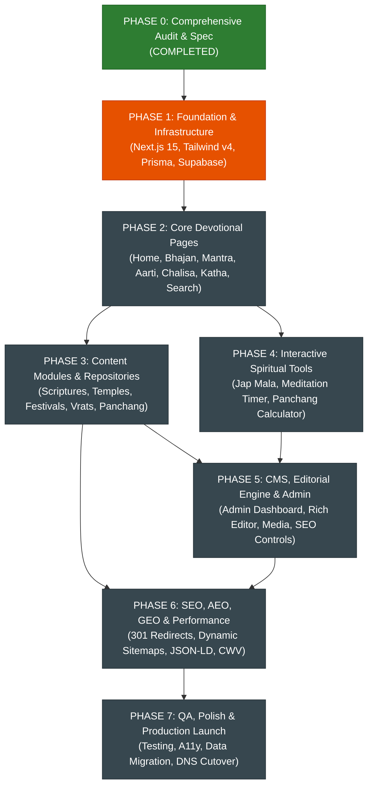
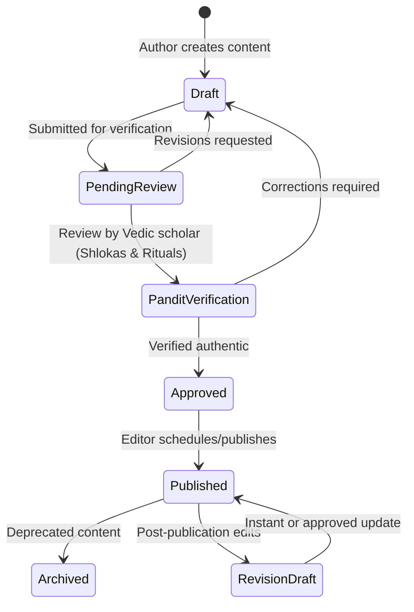

# BhaktiLok — Master Development Roadmap & Engineering Blueprint

**Document Reference:** `BL-ROADMAP-2026-V1`  
**Platform:** BhaktiLok (भक्तिलोक) — India's Premier Digital Sanctuary for Sanatan Dharma  
**Target Architecture:** Next.js 15 (App Router), TypeScript 5.x, Tailwind CSS v4, shadcn/ui, PostgreSQL 16 (Supabase), Prisma ORM  
**Target Domain:** [https://www.bhaktilok.in/](https://www.bhaktilok.in/)  
**Document Status:** Approved Engineering Specification  
**Publication Date:** November 2026  
**Author:** BhaktiLok Core Architecture & Engineering Team  

---

## 1. Executive Summary & Strategic Vision

### 1.1 The Mission
**BhaktiLok** is transitioning from a monolithic legacy PHP blog repository (~12,934 indexed URLs) into a high-performance, enterprise-grade, modern digital ecosystem dedicated to Sanatan Dharma. The new platform brings together centuries of sacred texts (Vedas, Upanishads, Puranas, Ramayana, Shrimad Bhagavad Gita), devotional hymns (Bhajans, Aartis, Chalisas, Mantras), ritual guides (Vrats, Kathas, Puja Vidhis), real-time astronomical engines (Vedic Panchang, Shubh Muhurat), and interactive spiritual utilities (Digital Jap Mala, Meditation Timers) into an authoritative, spiritually serene digital sanctuary.

### 1.2 Engineering North Stars
1. **Uncompromised Web Performance & Core Web Vitals:** Sub-second Largest Contentful Paint ($LCP < 1.2s$), zero Cumulative Layout Shift ($CLS < 0.05$), and ultra-responsive Interaction to Next Paint ($INP < 100ms$) on both low-tier mobile networks (4G/3G in Tier-2/Tier-3 India) and modern fiber connections.
2. **Preservation of 100% SEO Equity:** Flawless zero-loss migration of 12,934+ legacy URLs via edge-based redirect mapping, dynamic structured data generation (JSON-LD), and multi-engine optimization (SEO, AEO, and GEO).
3. **Linguistic & Typographic Authenticity:** Native Hindi-first (`hi-IN`) and Sanskrit Devanagari rendering, paired with International Alphabet of Sanskrit Transliteration (IAST) and phonetic search capabilities.
4. **Architectural Resilience:** Scalable, edge-cached serverless architecture built on Next.js 15 App Router, React Server Components (RSC), Supabase PostgreSQL 16 with Row Level Security (RLS), and Prisma ORM capable of gracefully handling massive traffic spikes (up to 50x baseline) during major Hindu festivals like Maha Shivaratri, Janmashtami, and Diwali.

```
┌────────────────────────────────────────────────────────────────────────────────────────┐
│                        BHAKTILOK TARGET ARCHITECTURE STACK                             │
├────────────────────────────────────────────────────────────────────────────────────────┤
│  Frontend: Next.js 15 (App Router, Server Actions, React 19, Streaming SSR)           │
│  Linguistic UI: Devanagari-First Typography (Hind, Outfit, Inter) + IAST Engine       │
│  Styling: Tailwind CSS v4 + Custom Sanatan Spiritual Design Tokens + shadcn/ui         │
│  Database: PostgreSQL 16 via Supabase Managed Engine (pg_trgm, pgvector, PostGIS)     │
│  ORM & Data Layer: Prisma ORM (Strict Type Safety, Migrations, Seeders)                │
│  State & Client: Zustand (Mala & Audio State), Lucide React, date-fns (Vedic Engine)  │
│  Edge & CDN: Cloudflare Enterprise DNS & Edge Workers + Vercel Multi-Region Edge       │
└────────────────────────────────────────────────────────────────────────────────────────┘
```

---

## 2. Master Technology Stack Matrix

The technical decisions for BhaktiLok are chosen specifically to satisfy the dual requirements of high-velocity developer experience and high-concurrency devotional user experiences:

| Layer | Technology | Version | Architectural Role & Justification |
| :--- | :--- | :--- | :--- |
| **Framework** | Next.js App Router | `15.x` | React Server Components (RSC), Incremental Static Regeneration (ISR), Server Actions, and Edge Middleware for redirects. |
| **Language** | TypeScript | `5.x` | Strict typing across API contracts, Prisma schemas, and Devanagari text processing utilities. |
| **CSS Engine** | Tailwind CSS | `v4.0+` | Zero-runtime CSS parsing, CSS-first `@theme` configuration, native cascade layers, and rapid responsive styling. |
| **UI Primitives** | shadcn/ui | Latest | Radix UI headless components tailored with custom devotional design tokens, accessible dialogs, sheets, and menus. |
| **Database** | PostgreSQL | `16.x` | Managed by Supabase. Supports native `pg_trgm` for Hindi fuzzy search, JSONB for liturgy blocks, and PostGIS for temple geospatial coordinates. |
| **ORM** | Prisma ORM | `6.x` | Automated type-safe database client, declarative schema migrations, robust relationship modeling, and database seeding. |
| **Authentication** | Supabase Auth | Latest | SSR-compatible cookie-based auth, Row-Level Security (RLS) integration, multi-role RBAC (SuperAdmin, Editor, Author, Devotee). |
| **Client State** | Zustand | `5.x` | Lightweight global state for interactive tools (Jap Mala counter, Audio player, Offline bookmarks). |
| **Icons & Media** | Lucide React | Latest | Clean, performant, tree-shakeable SVG icons customized for devotional UI elements. |
| **Deployment** | Vercel & Cloudflare | Edge | Vercel Edge Network for frontend rendering; Cloudflare for DNS management, edge caching, and WAF protection. |

---

## 3. High-Level Phase Roadmap & Critical Path

The project execution is organized into eight distinct, sequential phases (Phase 0 through Phase 7):



### Phase Summary Timeline & Cadence

| Phase | Phase Name | Status | Target Duration | Core Dependencies | Primary Focus |
| :---: | :--- | :---: | :---: | :--- | :--- |
| **0** | **Comprehensive Audit & Architecture** | **COMPLETED** | — | Legacy PHP Site, Sitemap Inventory | Complete site audit, URL inventory, DB schema, IA docs |
| **1** | **Foundation & Infrastructure** | **IN PROGRESS** | Sprint 1–2 | Phase 0 Specifications | Next.js 15, Tailwind v4, Prisma schema, Supabase Auth, Layout |
| **2** | **Core Devotional Pages** | **UPCOMING** | Sprint 3–4 | Phase 1 Foundation | Homepage, Global Search, Bhajan, Mantra, Aarti, Chalisa, Katha |
| **3** | **Content Modules & Repositories** | **UPCOMING** | Sprint 5–6 | Phase 2 Core Models | Gita, Ramayana, Puranas, Temples, Festivals, Vrats, Panchang |
| **4** | **Interactive Spiritual Tools** | **UPCOMING** | Sprint 7 | Phase 2 UI Components | Jap Mala, Meditation Timer, Vedic Panchang Calculator |
| **5** | **CMS, Editorial Engine & Admin** | **UPCOMING** | Sprint 8–9 | Phase 1 Auth, Phase 2–3 Schemas | Custom Editor, Media Library, Role-based Workflow |
| **6** | **SEO, AEO, GEO & Performance** | **UPCOMING** | Sprint 10 | Phase 2–5 Routes | 301 Redirect Edge Engine, Sitemaps (13k), JSON-LD, CWV |
| **7** | **QA, Polish & Production Launch** | **UPCOMING** | Sprint 11–12 | All Prior Phases | Testing, Accessibility, Data Migration, DNS Cutover |

---

## 4. Phase 0 — Audit & Architecture (COMPLETED ✓)

### 4.1 Phase Overview & Objectives
Phase 0 established the authoritative foundation for the entire engineering initiative. Over 12,934 legacy URLs were categorized, documented, and analyzed for structural weaknesses, technical debt, and SEO equity. Complete architectural specifications were authored to guarantee zero ambiguity during software engineering.

```
┌────────────────────────────────────────────────────────────────────────────────────────┐
│                          PHASE 0 DELIVERABLES VERIFICATION                             │
├────────────────────────────────────────────────────────────────────────────────────────┤
│  ✓ 01-WEBSITE-AUDIT.md            (Complete technical audit of legacy PHP platform)    │
│  ✓ 02-COMPLETE-URL-INVENTORY.md   (12,934 URL catalog, sitemaps, slug taxonomies)     │
│  ✓ 03-INFORMATION-ARCHITECTURE.md (New 21-domain taxonomy, relational entity graph)    │
│  ✓ 05-DATABASE-ARCHITECTURE.md    (PostgreSQL 16 relational schema, indexes, RLS)      │
│  ✓ 06-SEO-AEO-GEO-STRATEGY.md     (Dynamic metadata, JSON-LD, voice search, redirects) │
└────────────────────────────────────────────────────────────────────────────────────────┘
```

### 4.2 Completed Task Log

| Task ID | Task Description | Priority | Complexity | Deliverable | Status |
| :--- | :--- | :---: | :---: | :--- | :---: |
| **T0.1** | Comprehensive Website Audit & Legacy PHP Profiling | P0 | L | `01-WEBSITE-AUDIT.md` | **Completed** |
| **T0.2** | Complete URL Inventory & Taxonomy Mapping (~12,934 URLs) | P0 | XL | `02-COMPLETE-URL-INVENTORY.md` | **Completed** |
| **T0.3** | Information Architecture & Entity Relationship Strategy | P0 | L | `03-INFORMATION-ARCHITECTURE.md` | **Completed** |
| **T0.4** | Enterprise Database Architecture & Supabase DDL Specs | P0 | XL | `05-DATABASE-ARCHITECTURE.md` | **Completed** |
| **T0.5** | Technical SEO, AEO & Generative Engine Optimization Specs | P0 | L | `06-SEO-AEO-GEO-STRATEGY.md` | **Completed** |

---

## 5. Phase 1 — Foundation & Infrastructure

### 5.1 Phase Overview & Objectives
Phase 1 turns the architectural blueprints into a functioning Next.js 15 application shell. This includes bootstrapping the App Router with TypeScript strict mode, establishing Tailwind CSS v4 design tokens, provisioning Supabase PostgreSQL with Prisma ORM, configuring Supabase SSR authentication with Row-Level Security, assembling the shadcn/ui component primitive library, and deploying the global master layouts (Header, Mega-Menu, Footer, Mobile Bottom Navigation).

### 5.2 Detailed Task Breakdown

| Task ID | Task Name | Priority | Complexity | Dependencies | Implementation Details |
| :--- | :--- | :---: | :---: | :--- | :--- |
| **P1.1** | **Next.js 15 App Router Scaffolding** | **P0** | **M** | T0.3 | Configure Next.js 15 with Turbopack, React 19, strict standalone output, and structured path aliases (`@/*`). Setup standard folders: `app/`, `components/`, `lib/`, `hooks/`, `types/`, `styles/`. |
| **P1.2** | **TypeScript Strict Configuration** | **P0** | **S** | P1.1 | Establish `tsconfig.json` with `strict: true`, `noImplicitAny: true`, `isolatedModules: true`. Author global domain type definitions for Deities, Hymns, Scriptures, and Content Entities. |
| **P1.3** | **Tailwind CSS v4 & Spiritual Design Tokens** | **P0** | **M** | P1.1 | Implement Tailwind CSS v4 CSS-first configuration (`globals.css` using `@theme`). Define spiritual color tokens (`--color-bhagwa-500: #FF6F00`, `--color-marigold-500: #FFA000`, `--color-rudraksha-800: #4A154B`, `--color-sandstone-100: #FFFDF9`). Configure custom Devanagari font families (`Hind`, `Outfit`, `Inter`). |
| **P1.4** | **Database Schema & Prisma ORM Models** | **P0** | **XL** | T0.4, P1.2 | Implement `schema.prisma` mirroring the enterprise PostgreSQL DDL: Models for `User`, `Role`, `Deity`, `Bhajan`, `Mantra`, `Aarti`, `Chalisa`, `Katha`, `Scripture`, `ScriptureChapter`, `ScriptureVerse`, `Temple`, `Festival`, `Vrat`, `PanchangDay`, `Tool`, `MediaAsset`, `RedirectRule`. Generate Prisma Client and test connection. |
| **P1.5** | **Supabase Project Setup & Connection Pooling** | **P0** | **M** | P1.4 | Provision Supabase project, enable `pg_trgm`, `unaccent`, and `uuid-ossp` extensions. Configure connection pooling via Supavisor (Port 6543 for transaction pooling, Port 5432 for session/migration). Apply foundational Row Level Security (RLS) policies. |
| **P1.6** | **Authentication System (Supabase Auth SSR)** | **P0** | **L** | P1.5 | Implement `@supabase/ssr` authentication middleware and cookie management (`middleware.ts`). Configure sign-in, sign-up, magic link, and Google OAuth callbacks. Implement `useUser` hook and server-side session validator (`lib/auth.ts`). |
| **P1.7** | **Component Library Foundation (shadcn/ui)** | **P1** | **M** | P1.3 | Install and customize shadcn/ui components: Button, Card, Dialog, Sheet, DropdownMenu, Tabs, Input, Select, Badge, Skeleton, Accordion, Tooltip. Apply customized devotional aesthetic with saffron focus rings, smooth borders, and warm parchment surfaces. |
| **P1.8** | **Global Layout: Header, Mega-Menu & Footer** | **P0** | **L** | P1.7 | Construct responsive server-rendered Header with quick category dropdowns, sticky search trigger, and theme toggle. Implement desktop Mega-Menu organizing the 21 devotional categories. Build Mobile Bottom Navigation bar (Home, Bhajans, Panchang, Mala, Search) and comprehensive Footer. |

### 5.3 Deep Dive: Design Tokens & Typography Setup
In `src/app/globals.css`:
```css
@import "tailwindcss";

@theme {
  --color-bhagwa-50: #FFF8F1;
  --color-bhagwa-100: #FFEDE0;
  --color-bhagwa-500: #FF6F00; /* Primary Spiritual Saffron */
  --color-bhagwa-600: #E65100;
  --color-bhagwa-900: #7A2E00;

  --color-marigold-500: #FFA000; /* Secondary Festive Accent */
  --color-rudraksha-800: #3E2723; /* Sacred Earth / Deep Text */
  --color-parchment-50: #FDFBF7; /* Sacred Reading Surface */
  --color-parchment-100: #F5EFEB;

  --font-devanagari: 'Hind', 'Noto Sans Devanagari', sans-serif;
  --font-heading: 'Outfit', sans-serif;
  --font-sans: 'Inter', sans-serif;
}
```

### 5.4 Deliverables
1. Initialized Next.js 15 repository with Tailwind CSS v4 and strict TypeScript.
2. Fully compiled `prisma/schema.prisma` file with all core entity models and relational constraints.
3. Supabase integration module (`lib/supabase/server.ts`, `lib/supabase/client.ts`, `lib/supabase/middleware.ts`).
4. Reusable UI library inside `components/ui/` with custom devotional theme tokens.
5. Global layout components: `Header.tsx`, `MegaMenu.tsx`, `Footer.tsx`, `MobileNav.tsx`, `DevotionalBanner.tsx`.

### 5.5 Definition of Done (DoD)
- [ ] `pnpm build` executes with zero TypeScript errors and zero ESLint warnings.
- [ ] Prisma migrations successfully run against local and Supabase remote databases.
- [ ] Supabase Auth SSR flow (login, token refresh, logout, session check) functions seamlessly across client and server components.
- [ ] Design system tokens render correctly in both Light and Dark (Nocturnal Temple) modes.
- [ ] Header, Mega-menu, and Mobile navigation pass responsive design checks from 320px to 2560px screen widths.

---

## 6. Phase 2 — Core Devotional Pages

### 6.1 Phase Overview & Objectives
Phase 2 represents the core heart of the BhaktiLok user experience. It builds the high-traffic devotional listings and detail reading views for Bhajans, Mantras, Aartis, Chalisas, and Kathas, alongside the flagship Homepage and Universal Full-Text Search system. Every detail page will feature specialized devotional reading aids: font-resizing, Sanskrit shloka formatting, Devanagari-Hindi-English tabs, audio player controls, and bookmarking.

### 6.2 Detailed Task Breakdown

| Task ID | Task Name | Priority | Complexity | Dependencies | Implementation Details |
| :--- | :--- | :---: | :---: | :--- | :--- |
| **P2.1** | **Devotional Homepage (`/`)** | **P0** | **L** | P1.8 | Build modular homepage: Hero section with Daily Darshan & Search Bar, Real-Time Aaj Ka Panchang Card, Festival Countdown Widget, Trending Bhajans & Aartis Carousel, Scripture Spotlight (Gita Verse of the Day), Spiritual Tools Grid, and Sanatan Gyan Feed. |
| **P2.2** | **Universal Search System (`/search`)** | **P0** | **XL** | P1.4, P1.7 | Build multi-script search engine powered by PostgreSQL `pg_trgm` and `tsvector`. Support Hindi Devanagari, English transliteration (e.g., "Hanuman Chalisa" and "हनुमान चालीसा"), and phonetic matching. Implement instant search modal (`cmd+k`) and full search results page with deity/category filters. |
| **P2.3** | **Bhajan Listing & Detail Pages (`/bhajan`)** | **P0** | **L** | P1.4, P1.7 | Build category hub (`/bhajan`) with filtering by deity, singer, raga, and theme. Build detail page (`/bhajan/[slug]`) featuring synchronized audio/video player, clean lyrics display with stanza separation, PDF download, print-friendly view, and related aartis/mantras. |
| **P2.4** | **Mantra Listing & Detail Pages (`/mantra`)** | **P0** | **M** | P1.4, P1.7 | Build `/mantra` listing and `/mantra/[slug]` detail page. Implement Sanskrit shloka reader with Devanagari typography, IAST transliteration, word-by-word Hindi meaning, chanting benefits, chanting counter widget, and audio loop player. |
| **P2.5** | **Aarti Listing & Detail Pages (`/aarti`)** | **P0** | **M** | P1.4, P1.7 | Build `/aarti` hub and `/aarti/[slug]`. Standardize canonical URL taxonomy (resolving legacy `/aarati/` vs `/aarti/` discrepancies). Feature formatted aarti lyrics, vidhi (ritual instructions), auspicious timings, audio track playback, and downloadable high-res aarti cards. |
| **P2.6** | **Chalisa Listing & Detail Pages (`/chalisa`)** | **P0** | **M** | P1.4, P1.7 | Create dedicated standalone Chalisa repository (`/chalisa` and `/chalisa/[slug]`) fixing major legacy deficit. Display complete 40 Chaupais with Doha/Soratha highlights, Devanagari formatting, audio stream, and Hindi explanation. |
| **P2.7** | **Katha Listing & Detail Pages (`/katha`)** | **P1** | **M** | P1.4, P1.7 | Build `/katha` repository and `/katha/[slug]` reader. Organize stories into Vrat Kathas, Pauranik Legends, and Moral Parables. Provide estimated reading times, narrative chapter breaks, and associated fasts (Vrats). |

### 6.3 Technical Architecture: Shloka & Devotional Reader Component
Every sacred hymn and scripture verse renders via a specialized `DevotionalReader` component:
- **Typography Controls:** Dynamic font scaling ($16px$ to $32px$), line-height adjustments, and serif/sans toggle.
- **Multilingual Viewport:** Tabs for Devanagari Original (`मूल पाठ`), Hindi Translation (`हिंदी अनुवाद`), and English/IAST Transliteration (`अंग्रेजी/IAST`).
- **Devotional Audio Bar:** Persistent bottom dock with play/pause, 0.75x/1.0x/1.25x speed, loop chanting mode, and audio verse synchronization.
- **Engagement Utilities:** One-click WhatsApp sharing with pre-formatted Devanagari quote, Copy Shloka button, and user Bookmark toggle.

### 6.4 Deliverables
1. Dynamic Homepage (`app/page.tsx`) with server-side rendered widgets and ISR caching.
2. Search subsystem (`app/search/page.tsx`, `components/search/SearchModal.tsx`, `lib/search/engine.ts`).
3. Complete route tree and templates for `/bhajan`, `/mantra`, `/aarti`, `/chalisa`, and `/katha`.
4. Devotional reading toolkit components (`components/devotional/DevotionalReader.tsx`, `components/audio/ChantPlayer.tsx`).

### 6.5 Definition of Done (DoD)
- [ ] All 5 devotional post types (Bhajan, Mantra, Aarti, Chalisa, Katha) render dynamically from the database using ISR (`revalidate = 86400`).
- [ ] Search query returns sub-100ms results for both Devanagari and Latin queries (e.g. `हनुमान` vs `hanuman`).
- [ ] Audio player functions without stutter or memory leaks, retaining playback state during intra-site navigation.
- [ ] Shloka reader controls (font resize, tab toggle, copy) function smoothly without layout shifts.
- [ ] Mobile responsive layout verifies zero horizontal scroll and touch-friendly tap targets ($\ge 48px$).

---

## 7. Phase 3 — Content Modules & Canonical Repositories

### 7.1 Phase Overview & Objectives
Phase 3 expands BhaktiLok's canonical depth by implementing massive multi-tier structured repositories: the sacred Scripture Library (Bhagavad Gita, Ramayana, and Puranas with chapter/verse navigation), the geospatial Temple Directory, the Festival Calendar with automated tithi calculations, the Vrat fasting archive, the Sanatan Encyclopedia, and the daily Vedic Panchang.

### 7.2 Detailed Task Breakdown

| Task ID | Task Name | Priority | Complexity | Dependencies | Implementation Details |
| :--- | :--- | :---: | :---: | :--- | :--- |
| **P3.1** | **Scripture Library: Shrimad Bhagavad Gita** | **P0** | **XL** | P1.4, P2.3 | Build hierarchical Gita engine: `/granth/bhagavad-gita`, chapter hub (`/[chapter]`), and verse detail view (`/[chapter]/[verse]`). Support all 18 Chapters and 700+ verses with original Sanskrit, Anvaya (word order), word meanings, multiple authoritative commentaries (Adi Shankara, Ramanuja, Swami Sivananda), and audio recitation. |
| **P3.2** | **Scripture Library: Ramayana & Ramcharitmanas** | **P1** | **L** | P3.1 | Implement `/granth/ramayana` supporting the 7 Kands (Bal, Ayodhya, Aranya, Kishkindha, Sundar, Lanka, Uttar Kand). Support Chaupai, Doha, Chhand, and Soratha verse parsing with poetic indentations. |
| **P3.3** | **Scripture Library: Puranas & Upanishads** | **P1** | **L** | P3.1 | Build general scripture repository (`/granth/[grantha-slug]`) with nested chapter navigation, search within scripture, PDF reading viewer, and download manager. |
| **P3.4** | **Temple Directory & Pilgrimage Guides (`/mandir`)** | **P1** | **L** | P1.4, P1.7 | Construct `/mandir` directory with filtering by deity, state, Jyotirlinga, Shakti Peeth, and Char Dham. Build `/mandir/[slug]` with interactive location maps (OpenStreetMap/Google Maps embed), temple history, darshan & aarti timings, nearest railway/airport connectivity, dress code, and local accommodation guides. |
| **P3.5** | **Festival Calendar (`/tyohar`)** | **P0** | **L** | P1.4, P2.1 | Build dynamic Festival Hub (`/tyohar`) with upcoming festival countdowns, monthly filters, and year selection. Build `/tyohar/[slug]` with religious significance, auspicious puja timings (Shubh Muhurat), fasting rules, related aartis/kathas, and celebration rituals. |
| **P3.6** | **Vrat & Fasting Directory (`/vrat`)** | **P1** | **M** | P1.4, P2.7 | Build `/vrat` and `/vrat/[slug]` directory covering Ekadashi, Pradosh, Somwar, Sankashti Chaturthi, and Navratri fasts. Provide fasting calendar dates, Paran timing, Vidhi, and complete Katha readings. |
| **P3.7** | **Sanatan Encyclopedia (`/sanatan-gyan`)** | **P2** | **M** | P1.4, P1.7 | Build educational knowledge base covering Vedic philosophy, deities, rishis, symbols (Om, Swastika, Trishul), rituals, Samskaras (16 rites), and spiritual FAQs formatted for search answer boxes. |
| **P3.8** | **Daily Vedic Panchang Hub (`/panchang`)** | **P0** | **L** | P1.4, P1.7 | Build `/panchang` and historical/future `/panchang/[date]` pages displaying Tithi, Vaar, Nakshatra, Yoga, Karana, Rahu Kaal, Gulikai Kaal, Yamaganda, Abhijit Muhurat, Sunrise/Sunset, and Moonrise timings. |

### 7.3 Canonical Scripture Routing Specification
To avoid legacy flat-slug confusion, scriptures are strictly nested:
```
/granth/
├── bhagavad-gita/
│   ├── adhyay-1/
│   │   ├── shloka-1/
│   │   └── shloka-2/
│   └── adhyay-2/
├── ramayana/
│   ├── sundar-kand/
│   │   ├── doha-1/
│   │   └── chaupai-1/
└── shiv-puran/
    └── vidyeshvara-samhita/
```

### 7.4 Deliverables
1. Scripture reader engine supporting 700 Gita verses and 7 Kands of Ramayana.
2. Temple directory with geospatial metadata, timing tables, and filtering.
3. Automated Festival & Vrat calendars mapped to astronomical dates.
4. Comprehensive Panchang view with Vedic astronomical tables and city-based calculation adjustments.

### 7.5 Definition of Done (DoD)
- [ ] Every Gita chapter and verse URL loads in $< 500ms$ via Incremental Static Regeneration.
- [ ] Chapter/verse navigation controls (Next Shloka, Previous Shloka, Chapter Dropdown) operate with zero reload lag.
- [ ] Temple directory filters correctly by State, Deity, and Sacred Circuit (e.g., 12 Jyotirlingas).
- [ ] Panchang data accurately computes sunrise, sunset, and Tithi transitions for Indian Standard Time (IST) baseline.
- [ ] Valid Schema.org markup (`ItemPage`, `Article`, `Place`, `Event`) is generated for all modules.

---

## 8. Phase 4 — Interactive Spiritual Features & Tools

### 8.1 Phase Overview & Objectives
The legacy website promoted over 160 spiritual tools on its homepage that functioned largely as static placeholder text. Phase 4 eliminates this phantom debt by delivering authentic, high-utility, interactive client-side web applications: a digital Jap Mala counter with haptic feedback, a Dhyan/Meditation chanting timer with ambient Vedic soundscapes, a dynamic geolocation-aware Panchang calculator, and personalized Kundli/Muhurat tools.

### 8.2 Detailed Task Breakdown

| Task ID | Task Name | Priority | Complexity | Dependencies | Implementation Details |
| :--- | :--- | :---: | :---: | :--- | :--- |
| **P4.1** | **Spiritual Tools Directory Hub (`/tools`)** | **P1** | **M** | P1.7 | Create central interactive tools showcase categorizing utilities into: Daily Sadhana, Astrological Calculators, Ritual Utilities, and Scripture Assistants. Feature quick-launch cards with usage stats. |
| **P4.2** | **Digital Jap Mala Counter (`/tools/jap-mala`)** | **P0** | **L** | P1.7 | Develop client-side interactive Mala counter: 108 bead visual rotation, physical screen tap/click trigger, spacebar/keyboard support, subtle audio bead-click sound, device haptic vibration on each bead, milestone vibration on Meru (108th bead), lap counter, deity mantra selector, and local storage persistence of daily sadhana streaks. |
| **P4.3** | **Dhyan / Chanting Meditation Timer (`/tools/meditation-timer`)** | **P1** | **M** | P1.7 | Build ambient meditation application: Interval bell (Tibetan singing bowl, Conch/Shankha, Temple Bell), duration selector (5m, 11m, 21m, 45m, 60m), customizable background soundscape (Om Chanting, Ganga River Flow, Temple Ambience, Forest Dawn), and calming fullscreen Zen view. |
| **P4.4** | **Dynamic Vedic Panchang Calculator (`/tools/panchang-calculator`)** | **P0** | **XL** | P3.8 | Build geolocation-aware Vedic astronomical calculator. Accept user city or auto-detect lat/long coordinates. Accurately calculate Sunrise, Sunset, Moonrise, Moonset, exact Tithi ending times, Nakshatra spans, and inauspicious Rahu Kaal periods using verified astronomical algorithms. |
| **P4.5** | **Shubh Muhurat Calculator (`/tools/shubh-muhurat`)** | **P1** | **M** | P4.4 | Build auspicious timing finder for Griha Pravesh, Vivah, Vahan Kharid, Naamkaran, and Mundan based on Vedic panchang formulas and user date/city selection. |
| **P4.6** | **Kundli & Birth Chart Generator (`/tools/kundli`)** | **P2** | **L** | P4.4 | Implement North Indian & South Indian style Vedic birth chart generator based on date, exact time, and birthplace coordinates. Calculate Lagna, Rashi, and planetary positions with clean SVG rendering. |
| **P4.7** | **Interactive Step-by-Step Puja Vidhi Assistant (`/tools/puja-vidhi`)** | **P1** | **M** | P1.7 | Create interactive checklist and guided audio wizard for performing home pujas (e.g., Satyanarayan Puja, Ganesh Puja, Shiva Abhishekam) with samagri checklist, mantra recitations, and step-by-step progress tracking. |

### 8.3 Digital Jap Mala Technical Specification
```typescript
interface JapMalaState {
  currentBead: number; // 0 to 108
  completedRounds: number;
  totalChants: number;
  selectedMantraId: string;
  isHapticEnabled: boolean;
  isSoundEnabled: boolean;
  history: Array<{ date: string; counts: number }>;
  incrementBead: () => void;
  resetMala: () => void;
  switchMantra: (id: string) => void;
}
```
- **Haptic API Integration:** `navigator.vibrate([15])` on single beads; `navigator.vibrate([40, 60, 100])` on round completion.
- **Offline PWA Readiness:** Stored via Zustand with `persist` middleware in IndexedDB / LocalStorage; functional without network connectivity.

### 8.4 Deliverables
1. Interactive Digital Jap Mala web application with haptic and audio feedback.
2. Dhyan Chanting Timer with audio synthesized soundscapes and fullscreen mode.
3. Dynamic, city-based Vedic Panchang and Muhurat calculator.
4. Interactive Puja Vidhi step-by-step assistant.

### 8.5 Definition of Done (DoD)
- [ ] Jap Mala counter functions reliably on mobile touch without delayed touch events (`touch-action: manipulation`).
- [ ] Audio effects in Mala and Meditation Timer trigger with zero audible latency ($< 30ms$) via HTML5 Web Audio API.
- [ ] Panchang calculator matches traditional ephemeris (Nirayana / Lahiri Ayanamsha) calculations within a $\pm 1$ minute margin of error.
- [ ] All tool states persist across page refreshes via LocalStorage.
- [ ] Zero layout shifts or hydration mismatches on initial client render.

---

## 9. Phase 5 — CMS, Editorial Engine & Admin Dashboard

### 9.1 Phase Overview & Objectives
Phase 5 empowers the BhaktiLok editorial board, scholarly pandits, and content creators with an enterprise-grade back-office CMS. Built natively within Next.js using Server Actions and Supabase RBAC, the CMS provides custom Devanagari text editors with specialized Shloka input blocks, automated media optimization, role-based approval workflows, and granular SEO meta controls.

### 9.2 Detailed Task Breakdown

| Task ID | Task Name | Priority | Complexity | Dependencies | Implementation Details |
| :--- | :--- | :---: | :---: | :--- | :--- |
| **P5.1** | **Admin Dashboard Layout & RBAC Guard** | **P0** | **M** | P1.6 | Build secure back-office layout at `app/admin/`. Implement role gatekeeper (`SuperAdmin`, `Editor`, `Author`, `Pandit`). Dashboard summary widgets displaying total published posts, pending drafts, daily visitor trends, and broken redirect alerts. |
| **P5.2** | **Content Management Engine & Custom Editor** | **P0** | **XL** | P5.1 | Build content authoring suite with support for all 21 content types. Implement TipTap / Lexical rich text editor customized for Indian scripts: Sanskrit Shloka Block (Devanagari + Anvaya + Meaning), Deity Tagging, Audio File Attachment, Singer Attribution, and Live Preview. |
| **P5.3** | **Media Asset Library & WebP/AVIF Pipeline** | **P0** | **L** | P5.1 | Build media manager connected to Supabase Storage / S3. Features: Drag-and-drop batch upload, automated WebP/AVIF compression, automated responsive resizing ($320w, 640w, 1280w$), auto-tagging, and Hindi alt-text requirement enforcement. |
| **P5.4** | **Editorial Workflow & Versioning System** | **P1** | **M** | P5.2 | Implement multi-stage editorial lifecycle: `Draft` $\rightarrow$ `Pending Review` (Author to Pandit/Editor) $\rightarrow$ `Approved` $\rightarrow$ `Published`. Maintain complete revision history (`content_revisions` table) with visual diff viewer and one-click rollback. |
| **P5.5** | **In-CMS SEO, Schema & OpenGraph Controls** | **P0** | **M** | P5.2 | Integrate real-time SERP preview (Google Mobile/Desktop search snippet), social share card preview (WhatsApp, Facebook, Twitter), custom canonical URL overrides, and JSON-LD schema entity linking in the post editor. |
| **P5.6** | **User & Contributor Management** | **P1** | **M** | P5.1 | Build user directory interface to invite pandits/authors, manage permissions, ban abusive accounts, and review devotee-submitted bhajans or feedback. |

### 9.3 Content Lifecycle Workflow


### 9.4 Deliverables
1. Full Admin portal at `/admin` protected by Supabase RLS and server-side RBAC middleware.
2. Custom rich text editor with specialized Shloka, Mantra, and Devotional Liturgy blocks.
3. Media management library with automated image conversion and storage integration.
4. Editorial approval workflow engine with audit revision history.

### 9.5 Definition of Done (DoD)
- [ ] Authors cannot publish content directly without Pandit/Editor verification.
- [ ] Shloka block enforces correct structure (Devanagari text, IAST transliteration, Hindi meaning).
- [ ] Image uploads automatically generate optimized WebP/AVIF variants with enforced Alt text.
- [ ] Revisions are recorded in the database, and rollback successfully restores historical text.
- [ ] RLS policies prevent unauthorized users from viewing or mutating draft content.

---

## 10. Phase 6 — SEO, AEO, GEO & Performance Optimization

### 10.1 Phase Overview & Objectives
Phase 6 executes the transition of 12,934+ legacy URLs while cementing BhaktiLok's search engine dominance. This phase deploys an ultra-fast Edge-based 301 redirect engine, generates 11 dynamic categorical XML sitemaps under a root index, injects rich Schema.org JSON-LD microdata for Google and AI Answer Engines (AEO/GEO), and tunes the Next.js runtime for lightning-fast Core Web Vitals.

### 10.2 Detailed Task Breakdown

| Task ID | Task Name | Priority | Complexity | Dependencies | Implementation Details |
| :--- | :--- | :---: | :---: | :--- | :--- |
| **P6.1** | **Zero-Loss Edge Redirect Engine (301 Mapping)** | **P0** | **XL** | T0.2, P1.1 | Implement Cloudflare / Next.js edge middleware redirect engine. Map all 10,232 legacy dated posts (`/2021/10/slug.html`) and legacy taxonomies (`/aarati/` $\rightarrow$ `/aarti/`) to clean canonical URLs. Cache lookup table in Cloudflare KV / Upstash Redis for $< 5ms$ edge redirect execution. |
| **P6.2** | **Dynamic Categorical XML Sitemaps** | **P0** | **L** | P2.3–P3.8 | Construct dynamic Next.js sitemap index (`/sitemap.xml`) referencing 11 categorical sitemaps (`sitemap-bhajan.xml`, `sitemap-mantra.xml`, `sitemap-aarti.xml`, `sitemap-chalisa.xml`, `sitemap-katha.xml`, `sitemap-gita.xml`, `sitemap-ramayana.xml`, `sitemap-granth.xml`, `sitemap-mandir.xml`, `sitemap-tyohar.xml`, `sitemap-tools.xml`). Automatically append `<lastmod>` timestamps based on database `updated_at`. |
| **P6.3** | **JSON-LD Structured Data Subsystem** | **P0** | **L** | P2.3–P3.8 | Inject standardized Schema.org JSON-LD scripts across all templates: `MusicComposition` & `Lyrics` for Bhajans, `HowTo` for Puja Vidhis and Vrats, `Place` & `TouristAttraction` for Temples, `Event` for Festivals, `FAQPage` for Q&A, and `BreadcrumbList` for all pages. |
| **P6.4** | **Dynamic Metadata & Social Share Engine** | **P0** | **M** | P1.2 | Implement Next.js `generateMetadata` function across all dynamic routes. Generate dynamic OpenGraph images using `@vercel/og` showing the Deity portrait, Bhajan title in Devanagari, and platform branding. |
| **P6.5** | **Answer Engine (AEO) & Gen-AI Optimization (GEO)** | **P1** | **M** | P6.3 | Optimize content templates for AI retrieval (ChatGPT Search, Perplexity, Google AI Overviews): Add clear 40-word concise introductory answer boxes, verified Pandit author E-E-A-T badges, and structured scripture citation tables. |
| **P6.6** | **Core Web Vitals & Edge Performance Tuning** | **P0** | **L** | All UI tasks | Fine-tune LCP, CLS, and INP: Implement font preloading for `Hind` Devanagari (`font-display: swap`), priority image loading (`priority` flag on Hero/Darshan photos), aggressive edge caching via HTTP `Cache-Control: s-maxage=86400, stale-while-revalidate=604800`, and script deferral for analytics. |

### 10.3 JSON-LD Structured Data Example (Aarti Entity)
```html
<script type="application/ld+json">
{
  "@context": "https://schema.org",
  "@graph": [
    {
      "@type": "MusicComposition",
      "@id": "https://www.bhaktilok.in/aarti/om-jai-jagdish-hare#composition",
      "name": "ओम जय जगदीश हरे आरती (Om Jai Jagdish Hare Aarti)",
      "inLanguage": "hi",
      "composer": {
        "@type": "Person",
        "name": "पं. श्रद्धाराम शर्मा (Pandit Shardha Ram Phillauri)"
      },
      "lyrics": {
        "@type": "CreativeWork",
        "text": "ओम जय जगदीश हरे, स्वामी जय जगदीश हरे..."
      }
    },
    {
      "@type": "BreadcrumbList",
      "itemListElement": [
        { "@type": "ListItem", "position": 1, "name": "होम", "item": "https://www.bhaktilok.in" },
        { "@type": "ListItem", "position": 2, "name": "आरती", "item": "https://www.bhaktilok.in/aarti" },
        { "@type": "ListItem", "position": 3, "name": "ओम जय जगदीश हरे", "item": "https://www.bhaktilok.in/aarti/om-jai-jagdish-hare" }
      ]
    }
  ]
}
</script>
```

### 10.4 Deliverables
1. Edge redirect middleware mapping 100% of legacy 12,934 URLs with zero redirect chains.
2. Complete programmatic XML sitemap suite with `<lastmod>` validation.
3. Modular JSON-LD schema builder with automatic entity resolution.
4. Automated OpenGraph image generator for social sharing.
5. Core Web Vitals optimization audit report validating all green metrics.

### 10.5 Definition of Done (DoD)
- [ ] 100 sample legacy URLs (`/2021/10/example.html`) resolve to new canonical routes with HTTP 301 status in $< 50ms$.
- [ ] Sitemaps pass Google Search Console XML validation without syntax or encoding errors.
- [ ] Schema.org Rich Results Test validates 100% of tested URLs without warnings or missing required fields.
- [ ] Mobile Google PageSpeed Insights score achieves $\ge 90$ on Core pages.
- [ ] Cumulative Layout Shift (CLS) measures $\le 0.05$ across all responsive viewports.

---

## 11. Phase 7 — Testing, Polish, Migration & Production Launch

### 11.1 Phase Overview & Objectives
Phase 7 represents the final transition into production. It encompasses end-to-end automated testing, accessibility audits for visually impaired and elderly devotees, complete database ETL migration from the legacy PHP/MySQL database, production environment provisioning on Vercel and Supabase, zero-downtime DNS cutover, and post-launch telemetry monitoring.

### 11.2 Detailed Task Breakdown

| Task ID | Task Name | Priority | Complexity | Dependencies | Implementation Details |
| :--- | :--- | :---: | :---: | :--- | :--- |
| **P7.1** | **Unit & Integration Test Suite** | **P0** | **L** | P2.1–P6.4 | Author automated test suites using Vitest and React Testing Library: Test search query parsing, Devanagari transliteration utilities, Panchang astronomical calculation logic, and Prisma database queries. |
| **P7.2** | **End-to-End (E2E) Testing (Playwright)** | **P0** | **L** | P7.1 | Develop cross-browser E2E regression tests with Playwright: Verify homepage loading, prayer search, audio playback, shloka font-resizing, Jap Mala counting, bookmarking, and admin login flows on Desktop Chrome, Safari, and Mobile Emulators (Android/iOS). |
| **P7.3** | **Accessibility (a11y) & WCAG 2.1 AA Audit** | **P1** | **M** | P1.7, P2.3 | Conduct accessibility verification: Ensure screen reader compatibility with Devanagari text, ARIA attributes on audio players and Mala counters, keyboard navigation across all menus, and high color contrast ($\ge 4.5:1$) against saffron/parchment backgrounds. |
| **P7.4** | **Production Infrastructure Provisioning** | **P0** | **M** | P1.5, P6.1 | Configure production Vercel project, link repository, configure production environment secrets, enable Vercel Edge Cache. Upgrade Supabase project to Pro tier, configure connection poolers (PgBouncer/Supavisor), and setup automated point-in-time database backups. |
| **P7.5** | **Legacy Data ETL Migration & Verification** | **P0** | **XL** | P1.4, P5.3 | Execute automated Node.js ETL migration scripts: Extract posts, bhajans, aartis, scriptures, and categories from legacy MySQL database. Clean HTML artifacts, normalize typography, transform into Prisma relational models, import into Supabase PostgreSQL, and run automated checksum validation. |
| **P7.6** | **API Documentation & System Runbooks** | **P2** | **S** | P1.1–P6.6 | Author internal API documentation, disaster recovery runbooks, database backup restoration guides, and content editorial operating procedures. |
| **P7.7** | **Production DNS Cutover & Zero-Downtime Launch** | **P0** | **L** | P7.1–P7.5 | Switch Cloudflare DNS records to point to Vercel production edge servers. Verify SSL certificate auto-issuance. Monitor 301 redirects, edge error rates (5xx), database connection spikes, and Google Search Console crawl activity. |

### 11.3 Legacy Data ETL Migration Protocol
```
┌────────────────────────────────────────────────────────────────────────┐
│                      LEGACY DATA ETL PIPELINE                          │
├────────────────────────────────────────────────────────────────────────┤
│  1. EXTRACT: MySQL Dump (10,232 posts, 453 granths, 91 temples)       │
│  2. TRANSFORM:                                                         │
│     • Strip legacy inline styles, font tags, and broken embeds        │
│     • Normalize Hindi Unicode text & Devanagari numerals               │
│     • Extract metadata (Deity, Singer, Tithi, Shloka count)           │
│     • Map legacy category IDs to new 21-domain relational models       │
│     • Generate 301 redirect mapping entries in `redirect_rules` table │
│  3. LOAD: Batch upsert into Supabase PostgreSQL via Prisma Client      │
│  4. VERIFY: Automated row-count and integrity checksum comparison      │
└────────────────────────────────────────────────────────────────────────┘
```

### 11.4 Deliverables
1. Comprehensive automated test suite (Unit, Integration, and E2E) with $> 80\%$ critical path coverage.
2. WCAG 2.1 AA compliance audit report with zero critical a11y violations.
3. 100% migrated and sanitized database populated in Supabase PostgreSQL.
4. Seamlessly executed production DNS cutover with zero downtime.
5. Post-launch live telemetry dashboard in Google Analytics 4, Search Console, and Vercel Analytics.

### 11.5 Definition of Done (DoD)
- [ ] All Vitest and Playwright test suites execute green in CI/CD pipeline.
- [ ] 100% of legacy content entities are accounted for in the new database without character corruption or truncation.
- [ ] Production site scores 100 on Lighthouse Desktop and $\ge 90$ on Lighthouse Mobile.
- [ ] Zero 5xx errors recorded during initial 72 hours of DNS migration.
- [ ] Google Search Console confirms successful crawl of sitemaps and proper execution of 301 redirects.

---

## 12. Cross-Phase Operational Framework

### 12.1 Git Branching & Deployment Strategy
The team adheres to a strict Trunk-Based Development workflow with short-lived feature branches:
- `main`: Production-ready code automatically deployed to `production` environment upon merge.
- `preview`: Staging environment for QA and client review.
- `feat/feature-name`, `fix/bug-name`: Short-lived developer branches with automated ephemeral preview deployments on Vercel.

```
Feature Branch (feat/*) ──► Pull Request ──► Automated CI (Lint, Typecheck, Test) ──► Vercel Preview
                                     │
                                     ▼
                            Merge to 'main' ──► Automated Deploy to Production (bhaktilok.in)
```

### 12.2 CI/CD Automation Pipeline
Every Pull Request must pass the automated GitHub Actions pipeline before merge:
1. **Lint & Style Check:** `eslint` and `prettier` validation.
2. **Typecheck:** `tsc --noEmit` validation against TypeScript strict standards.
3. **Prisma Schema Validation:** `prisma validate` to verify relational consistency.
4. **Unit Tests:** `vitest run` covering calculation helpers and UI hooks.
5. **E2E Smoke Tests:** Playwright headless smoke tests on staging deploy.

### 12.3 Environment Topology

| Environment | Purpose | URL / Host | Database Instance |
| :--- | :--- | :--- | :--- |
| **Local Dev** | Feature Engineering | `http://localhost:3000` | Local Supabase Docker / Dev Cloud DB |
| **Preview** | PR Verification & Review | `https://bhaktilok-*-preview.vercel.app` | Supabase Staging Branch DB |
| **Production** | Live Devotee Platform | `https://www.bhaktilok.in` | Supabase Pro Production Cluster |

---

## 13. Risk Management & Mitigation Matrix

| Risk Factor | Probability | Impact | Mitigation Strategy |
| :--- | :---: | :---: | :--- |
| **Organic Traffic Drop from 13k URL Migration** | Medium | Critical | Implement redundant edge redirect middleware with pre-compiled memory lookup maps. Test 301 mappings on staging prior to cutover. Submit comprehensive sitemaps to Google immediately upon launch. |
| **Devanagari Font Rendering Lag (FOIT/FOUT)** | High | Medium | Self-host font subsets for `Hind` Devanagari using `@next/font/google`. Apply `font-display: swap` and preload primary weights (400, 600, 700). |
| **High Database Concurrency on Festive Days** | High | High | Utilize Next.js Incremental Static Regeneration (ISR) with long TTLs ($24h+$) on static prayer pages. Utilize Supavisor connection pooling for dynamic Panchang queries. |
| **Scripture Text Transcription Inaccuracies** | Medium | Critical | Establish dedicated Pandit Review role in CMS. Restrict publication of sacred texts (Gita, Vedas) to scholarly validated sources with multi-eye verification. |
| **Third-Party Ad Disruption on Holy Reading** | Medium | Medium | Strict ad placement guidelines: Zero ads inside shloka/mantra text blocks; ads limited to unobtrusive headers, footers, and sidebar modules to maintain spiritual sanctity. |

---

## 14. Post-Launch Horizon (Phase 8 Preview)

Following the successful execution of Phases 0 through 7, BhaktiLok will evaluate secondary horizon expansions:
1. **BhaktiLok Mobile App (iOS & Android):** React Native / Expo application utilizing the Next.js API layer, featuring offline reading rooms, temple notification chimes, and customizable home screen widgets.
2. **AI Vedic Pandit Assistant:** Generative conversational agent grounded strictly in verified Sanatan Dharma scriptures via pgvector RAG (Retrieval-Augmented Generation) answering spiritual queries without hallucination.
3. **Multilingual Regional Expansion:** Progressive rollout of Gujarati, Bengali, Telugu, Tamil, Marathi, and Kannada localized portals anchored by the unified database graph.
4. **Community Satsang & Live Temple Darshan:** Live video stream integrations from major pilgrimage temples (Kashi Vishwanath, Somnath, Mahakaleshwar, Tirupati Balaji).

---

*This document serves as the formal engineering contract for the development and deployment of BhaktiLok 2.0.*
