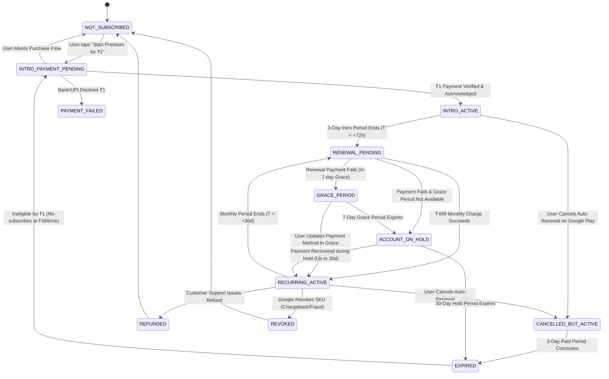

# BHAVLAYA SUBSCRIPTION STATE MANAGEMENT SPECIFICATION

**Product:** Bhavlaya Premium  
**Architecture:** Google Play Billing v7/v8 + Google Play Developer API v3 + RTDN  
**Author:** Code Crew Labs Technical Architecture Group  
**Date:** November 2026  

---

## 1. Complete 12-State Lifecycle Architecture

The Bhavlaya subscription engine implements an exhaustive 12-state finite state machine (FSM). This machine models the complete lifecycle from initial installation, through the ₹1 for 3-day introductory period, into the recurring ₹499 monthly phase, and through recovery, cancellation, and expiration flows.

---

## 2. State Definitions & Entitlement Matrix

| State Enum | Entitlement Status | Duration / Timing | Access Granted | Billing & Recovery Actions |
| :--- | :--- | :--- | :--- | :--- |
| `NOT_SUBSCRIBED` | ❌ No | Indefinite | Free content, basic Panchang, free tools | Displays ₹1 Introductory Paywall |
| `INTRO_PAYMENT_PENDING` | ❌ No | Max 24 hours | Free content only | Waits for Google Play payment settlement |
| `INTRO_ACTIVE` | ✅ **YES** | **Exactly 3 Days (72h)** | **All 20 Premium Features** | Next renewal scheduled at ₹499 |
| `RECURRING_ACTIVE` | ✅ **YES** | 1 Month (`P1M`) | **All 20 Premium Features** | Automatically renews at ₹499/month |
| `RENEWAL_PENDING` | ✅ **YES** | Up to 24 hours | **All 20 Premium Features** | Google Play attempts recurring charge |
| `CANCELLED_BUT_ACTIVE` | ✅ **YES** | Until current expiry | **All 20 Premium Features** | Auto-renewal cancelled; no upcoming charge |
| `EXPIRED` | ❌ No | Indefinite | Free content only | Displays Re-subscribe / Renewal CTA |
| `PAYMENT_FAILED` | ❌ No | Immediate | Free content only | Prompts user to retry with valid method |
| `GRACE_PERIOD` | ✅ **YES** | Up to 7 Days | **All 20 Premium Features** | Warns user to fix billing in Google Play |
| `ACCOUNT_ON_HOLD` | ❌ No | Up to 30 Days | Free content only | Suspends access until card/UPI updated |
| `REFUNDED` | ❌ No | Immediate | Free content only | Entitlement revoked upon refund notice |
| `REVOKED` | ❌ No | Immediate | Free content only | Instant permanent revocation |

---

## 3. Business Logic for Lifecycle Transitions

### Phase 1: Successful ₹1 Introductory Purchase

1. **Client Event:** User initiates purchase on the Paywall; Google Play returns `BillingClient.BillingResponseCode.OK` with a valid `Purchase` object.
2. **Replay Protection Check:** The client and server inspect `purchaseToken`. If already registered, duplicate handling returns existing entitlement without redundant database writes.
3. **Server-Side Verification:** Purchase token forwarded to `/api/subscription/verify`. The backend queries the Google Play Developer API (Android Publisher v3 `purchases.subscriptionsv2.get`).
4. **Entitlement Activation:**
   - State transition: `INTRO_ACTIVE`.
   - `purchaseDate`: Verified timestamp from Google Play.
   - `introductoryExpiryDate`: Calculated strictly as `purchaseDate + (3 * 24 * 60 * 60 * 1000)`.
   - `nextRenewalDate`: Set to match `introductoryExpiryDate`.
   - `initialAmountPaid`: ₹1.00 (100 paise).
5. **Google Play Acknowledgment:** The backend/client invokes `acknowledgePurchaseAsync` to prevent Google Play from automatically refunding the transaction within 3 days.

### Phase 2: During the 3-Day Introductory Period

- All 20 Premium features are unlocked.
- The "My Plan" screen displays the verified ₹1 payment and the remaining time.
- The user is **never** charged again during this 72-hour window.
- If the user re-installs or opens the app on another device, `/api/subscription/status` or `BillingClient.queryPurchasesAsync()` instantly restores access.

### Phase 3: Cancellation during the Introductory Period

- The user accesses the cancellation option via the "My Plan" screen, which redirects to the official Google Play subscription management URI:
  `https://play.google.com/store/account/subscriptions?sku=bhavlaya_premium_monthly&package=com.codecrewlabs.bhavlaya`
- Google Cloud Pub/Sub dispatches an RTDN event of type `3 (SUBSCRIPTION_CANCELED)`.
- The webhook updates the subscription record to `CANCELLED_BUT_ACTIVE`.
- **Access Rule:** The user **retains 100% of their Premium access** through the remainder of the already-paid 3-day introductory period.
- **Billing Rule:** Auto-renewal is cancelled. Google Play will **not** execute the ₹499 monthly charge.

### Phase 4: Renewal at Day 3 (Transition to Monthly Plan)

- Exactly 72 hours after purchase, Google Play attempts to bill the recurring price of ₹499.00.
- **Scenario A (Success):** Google Play dispatches RTDN `2 (SUBSCRIPTION_RENEWED)`.
  - State becomes `RECURRING_ACTIVE`.
  - Expiry extended by 1 month (`P1M`).
  - Next renewal date updated to `currentPeriodEndDate + 1 month`.
- **Scenario B (Transient Decline - Grace Period):** If payment method fails but account is eligible for grace:
  - Google Play dispatches RTDN `6 (SUBSCRIPTION_IN_GRACE_PERIOD)`.
  - State becomes `GRACE_PERIOD` for up to 7 days.
  - Premium access is maintained; in-app banner notifies user to update billing details.
- **Scenario C (Decline - Account Hold):** If grace period expires without successful payment:
  - Google Play dispatches RTDN `5 (SUBSCRIPTION_ON_HOLD)`.
  - State becomes `ACCOUNT_ON_HOLD`.
  - Premium access is **immediately suspended** until the user fixes payment credentials in Play Store.

### Phase 5: Expiration

- When a subscription reaches its expiry date without renewal:
  - State becomes `EXPIRED`.
  - All 20 Premium features are locked.
  - User profile, saved prayers, and personalized preferences are **never deleted**.
  - My Plan screen displays a renewal offer at the standard recurring price (₹499/month).

---

## 4. Google Play Real-Time Developer Notifications (RTDN) Mapping

The Bhavlaya backend endpoint at `/api/subscription/webhook` ingests Pub/Sub pushes and updates the state machine:

| RTDN Type Code | Google Play Event | Target State | Entitlements Action |
| :---: | :--- | :--- | :--- |
| `1` | `SUBSCRIPTION_RECOVERED` | `RECURRING_ACTIVE` | Restores all 20 Premium features |
| `2` | `SUBSCRIPTION_RENEWED` | `RECURRING_ACTIVE` | Extends expiry date by 1 month (P1M) |
| `3` | `SUBSCRIPTION_CANCELED` | `CANCELLED_BUT_ACTIVE` | Retains features until current expiry |
| `4` | `SUBSCRIPTION_PURCHASED` | `INTRO_ACTIVE` | Grants 3-day access for ₹1 |
| `5` | `SUBSCRIPTION_ON_HOLD` | `ACCOUNT_ON_HOLD` | Suspends all Premium features |
| `6` | `SUBSCRIPTION_IN_GRACE_PERIOD` | `GRACE_PERIOD` | Retains features for 7 days |
| `7` | `SUBSCRIPTION_RESTARTED` | `RECURRING_ACTIVE` | Reactivates auto-renewal |
| `12` | `SUBSCRIPTION_REVOKED` | `REVOKED` | Immediately revokes all access |
| `13` | `SUBSCRIPTION_EXPIRED` | `EXPIRED` | Removes all Premium entitlements |

---

## 5. Security & Idempotency Safeguards

1. **Replay & Token Injection Attack Defense:** All purchase tokens are verified directly against Google Play's OAuth2 authenticated publisher endpoint before granting entitlements.
2. **Token Deduplication Registry:** Processed tokens are stored with order IDs. Repeated verification requests return idempotent success responses with existing subscription data.
3. **No Client-Side Authority:** The Android client cannot unilaterally unlock features. Feature gates query `SubscriptionRepository` which is synchronized with the signed backend state.
4. **Zero Financial Data Storage:** No credit card numbers, CVVs, net banking credentials, or UPI PINs are ever collected, transmitted, or logged.

---

*Bhavlaya — A Code Crew Labs Product.*
